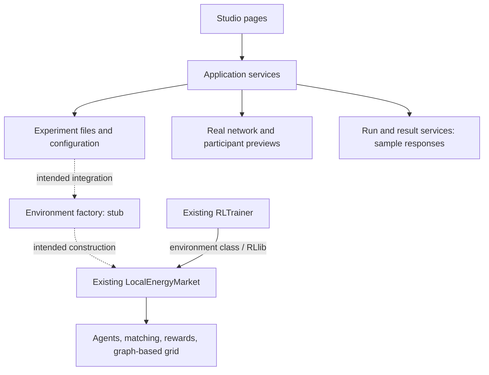

# Master: how MARLEM works today

This is the starting point for understanding the program as its author or a new
contributor. Follow one experiment from its saved settings to the market and RL
code. Open the linked source only when you want the next level of detail.

**Source review: 2026-10-05.** These chapters describe inspected implementation;
they are not a report of a successfully executed end-to-end experiment.

## The central distinction

There are two parts to understand today:

1. **The developing SimBench platform:** Studio pages, experiment files, real
   network/profile previews, and infrastructure for saved runs.
2. **The existing market and RL implementation:** `LocalEnergyMarket`, market
   matching, agents, rewards and RLlib training. This code still includes the
   earlier graph-based grid and documented research-method issues.

The new factory that should connect them is not implemented yet. A working
participant preview or a chart in the Studio therefore does not establish that
the configured SimBench experiment can be trained.

Solid arrows describe existing relationships, not a claim that they are free of
defects. Dashed arrows describe missing integration. The workflow chapters name
the actual functions behind these boxes.

## Read in this order

| Chapter | Question it answers |
|---|---|
| [1. Experiment input](01-experiment.md) | What is the saved file, and how does the Studio obtain it? |
| [2. Participants and profiles](02-participants.md) | How does a named participant acquire a location, assets and time series? |
| [3. Constructing the runtime](03-runtime.md) | Where should configuration become live objects, and where does that stop today? |
| [4. One market timestep](04-timestep.md) | What actually happens between an action and the next observation? |
| [5. Training and evaluation](05-learning.md) | How does a policy interact with that environment and learn? |
| [6. Runs and results](06-results.md) | What gets saved, and which displayed results are currently samples? |

Every chapter uses the same five questions: **purpose, inputs and outputs,
implementation, caller, current status**. Each ends with a link to the next step.

## A small example to carry through the chapters

Imagine two participants, Alice and Bob, at two existing LV connections. During
one interval Alice has surplus PV energy and Bob needs energy. Their policies
submit offers; the market determines trades; the environment updates state and
returns rewards and observations.

This is an explanatory example, not a new runnable preset. We use the existing
[heterogeneity preset](../../src_thesis/platform/experiments/presets/case2-heterogeneity.marlem.json)
to show real file fields. Its own description identifies placeholder assumptions.
Do not treat that preset as a validated instance of Alice and Bob's story.

## Where to look when you are lost

| Responsibility | First file to open |
|---|---|
| Studio page frame and navigation | [studio/layout.py](../../src_thesis/platform/studio/layout.py): `shell` |
| Current draft and service access | [studio/state.py](../../src_thesis/platform/studio/state.py): `current_draft`, `services` |
| Creating service objects | [application/container.py](../../src_thesis/platform/services/container.py): `build_services` |
| Meaning of experiment fields | [experiments/models/records.py](../../src_thesis/platform/experiments/models/records.py), [sections.py](../../src_thesis/platform/experiments/models/sections.py) |
| Turning settings into a runtime | [experiments/factory/environment.py](../../src_thesis/platform/experiments/factory/environment.py): `build_env` |
| One simulation step | [environment/lem.py](../../src_thesis/marlem/environment/lem.py): `LocalEnergyMarket.step` |
| Training / restored-policy execution | [marl/train.py](../../src_thesis/marlem/marl/train.py), [marl/inference.py](../../src_thesis/marlem/marl/inference.py) |

A **service** is the application-facing operation a page calls. A **factory**
constructs runtime objects. An **environment** owns simulation state and advances
it. A **policy** chooses actions; the **trainer** improves that policy. A **worker**
runs a job in a separate process. These are different responsibilities even when
their functions have similar names.

## One documentation set, with distinct responsibilities

- **Master:** the reading route and explanation of current execution.
- [Architecture](../thesis/architecture/README.md): design decisions, contracts and future structure.
- [Validation](../thesis/validation/README.md): methodological evidence and issue status.
- **API Reference tab:** generated signatures, detailed docstrings and expandable source code.
- [Guide](../guide/studio-workflow.md): operating the user interface.

The experiment schema, full API descriptions and issue register stay in their
existing locations. Master links to them instead of copying their specifications.
Source links open the repository branch; API pages are generated from the local
source used to build this site, which may include changes not yet pushed.

## Keeping this explanation useful

When an execution path changes, update the affected chapter in the same change:
inputs/outputs, actual caller, and implementation status. Review the date above
when the whole route is checked again. A working-looking docstring is not evidence
that a method body is implemented.

Useful change handover: **what behaviour changed → which chapter explains it →
which function implements it → how it was verified**. Keep exact issue dispositions
in the issue register; the status paragraphs here only identify execution gaps and
link to that evidence.

**Next:** [1. Experiment input](01-experiment.md).
