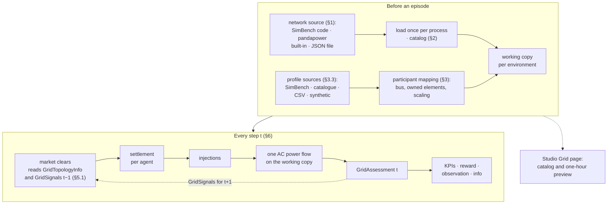

# 01. SimBench grid

> Network sources, loading, assigning profiles to MARLEM agents, the grid contract, and what changes in MARLEM's step.
> Master: [README.md](README.md) · Decisions: D-01 to D-07, D-11 to D-13, D-15.
> Checked against the installed `simbench` 1.6.2 / `pandapower` 3.5.4 on 2026-09-25 (the Studio's grid catalog uses them).

<!-- BEGIN toc (python docs_thesis/toc.py) -->
## Contents

- [0. At a glance](#0-at-a-glance)
- [1. One grid technology, several network sources (D-02)](#1-one-grid-technology-several-network-sources-d-02)
- [2. Network loading](#2-network-loading)
- [3. Profile assignment (the core flexibility)](#3-profile-assignment-the-core-flexibility)
  - [3.1 Placement: which bus does the agent sit on?](#31-placement-which-bus-does-the-agent-sit-on)
  - [3.2 Ownership: which network elements does the agent replace?](#32-ownership-which-network-elements-does-the-agent-replace)
  - [3.3 Profile source per agent](#33-profile-source-per-agent)
  - [3.4 Scaling, time window, resolution](#34-scaling-time-window-resolution)
  - [3.5 Background elements](#35-background-elements)
- [4. Time alignment with MARLEM](#4-time-alignment-with-marlem)
- [5. Grid contract (the seam)](#5-grid-contract-the-seam)
  - [5.1 Ownership and data flow (D-13): the target architecture](#51-ownership-and-data-flow-d-13-the-target-architecture)
- [6. The step with SimBench (D-01)](#6-the-step-with-simbench-d-01)
- [7. File-by-file changes to MARLEM (D-04)](#7-file-by-file-changes-to-marlem-d-04)
- [8. Open decisions](#8-open-decisions)
- [9. Performance (measure in R4)](#9-performance-measure-in-r4)

<!-- END toc -->

## 0. At a glance

From a network source to one power flow per step. The market never calls the grid; it reads last step's signals (§5.1).



[↑ Contents](#contents)

## 1. One grid technology, several network sources (D-02)

**Why:** The original grid is an abstract NetworkX graph with capacities and a distance-based loss, but no power-flow physics (no voltages, no real losses). One pandapower implementation gives real physics, one code path to test, and results that are comparable across networks. Several sources exist because each answers a different need: SimBench gives realistic German feeders with a year of profiles, the built-ins give standard test feeders known from the literature, and files let any other network in without code.

The tool has **one** grid implementation: a pandapower adapter running an AC power flow. The paper's abstract NetworkX grid lives only in the frozen reference copy (`src_thesis_reference/`). It is not maintained in the tool.

| Source (`grid.source.type`) | Examples | Profiles included? | Notes |
|---|---|---|---|
| `simbench` (primary) | `1-LV-semiurb4--0-sw`, `1-MV-rural--1-sw` | **Yes**: one year at 15 min for every load, generator and storage | The main research world |
| `pandapower_builtin` | `case33bw` (IEEE 33-bus Baran & Wu), `create_cigre_network_mv`, `create_cigre_network_lv`, `create_kerber_*`, `mv_oberrhein` (the code is the `pandapower.networks` function name) | No: profiles are assigned from the SimBench profile catalogue or CSV (§3.3) | Standard feeders at zero cost. `case33bw` has no line ratings, so either add them (§2) or check voltage only. Checked 2026-09-23: all converge. |
| `pandapower_file` | Any pandapower JSON, e.g. a one-time balanced IEEE 34 build | No (as above) | How extra networks enter without code |

Unbalanced networks (IEEE European LV, which needs `runpp_3ph`) are out of scope for the first version.

[↑ Contents](#contents)

## 2. Network loading

**Why:** Networks are slow to load and a power flow writes its results into the net it runs on. So each network is loaded once, kept untouched, and every environment works on its own copy. The functions below are the steps between a network name in the experiment file and a net that is safe to run power flows on.

| Function | Why it is there | Behaviour |
|---|---|---|
| **Catalog** | Lets users compare networks before loading one into an experiment | List the available networks with metadata: source, voltage level, number of buses, loads, sgens and storage; total load/PV; whether geodata, profiles and line ratings are present. This powers the Studio's Grid page and `marlem grid list`. |
| **Load** | Loading takes seconds, so it happens once per process; the source is never modified | `simbench.get_simbench_net(code)`, `pandapower.networks.<name>()` or `pandapower.from_json(path)`, cached **once per process** as an immutable source |
| **Working copy** | A power flow writes results into the net, so environments running in parallel must not share one | Each environment (and each RLlib env runner) gets its own deep copy; it is reset per episode. The net is never shared or serialised. |
| **Profiles** | SimBench ships a year of profiles per element; reading them is slow, so they are cached | SimBench: `simbench.get_absolute_values(net, profiles_instead_of_study_cases=True)`, cached per process |
| **Line ratings** | Without ratings there is no overload check; the experiment must say what happens instead of silently skipping it | Taken from the network. If missing: a rule from the experiment file (e.g. a margin over base-case peak current) or a ratings file. If none is set, loading checks are switched off and reported as such. |
| **Voltage limits** (D-15) | Decides what counts as a voltage violation; fixed by D-15 | `grid.limits` in the experiment file overrides every bus when set. When unset, each bus uses the network's own `min_vm_pu` / `max_vm_pu` (SimBench: 0.9–1.1), with 0.95–1.05 pu as the fallback. |
| **Summary / topology view** | The UI and plots need the network's shape, not a pandapower object | Plain data for UI and plots: buses with coordinates, lines, transformers, elements per bus. No pandapower objects cross the adapter boundary. Buses reached only through a transformer (the upstream bus with the external grid) are drawn just above their transformer, because SimBench gives them their real position in the upstream network, often hundreds of metres away. |
| **Validation** | Catches broken networks and mappings before a run, not during training | Profile tables agree in length and time. Selected bus and element IDs exist. The unmodified net converges at the selected timestep. |

[↑ Contents](#contents)

## 3. Profile assignment (the core flexibility)

**Why:** An agent's trades only have a physical effect if the agent sits somewhere in the network, and its behaviour only makes sense with realistic generation and demand. This section decides both: where each agent sits and what data drives it.

An **agent** in MARLEM is one market participant with generation, demand and an optional battery. Each agent is tied to the network through a **participant mapping**. The mapping is part of the experiment file (02) and is persisted as data, never as a live net.

### 3.1 Placement: which bus does the agent sit on?

**Why:** The bus decides which voltages and lines an agent affects. Hand-designed studies pick buses themselves, scalability studies need a reproducible rule, and shared studies need an imported list.

| Mode | Description | Use |
|---|---|---|
| `manual` | The user picks a bus per agent (table or map in the Studio) | Hand-designed studies |
| `by_elements` | The agent adopts the bus of the load or sgen it owns | Default |
| `rule` | Seeded selection by rule, e.g. "N buses with a household load and PV", "feeder ends only", or "spread across feeders" | Scalability (Case 7), sensitivity studies |
| `file` | Import a mapping CSV/JSON | Sharing, reproducing a published mapping |

A rule is resolved into explicit placements when the experiment is validated. The resolved list is stored in the run manifest.

### 3.2 Ownership: which network elements does the agent replace?

**Why:** A SimBench bus already has loads and PV with their own profiles. If an agent were simply added on top, that household would be counted twice. Owning an element replaces it with the agent's settled behaviour.

The agent **owns** zero or more existing loads, sgens and storage at its bus. Owned elements are driven by the agent's settlement. Unowned elements stay as background (§3.5). If an agent has generation but owns no sgen, the adapter creates one deterministic controllable sgen at its bus.

Validation rejects:
- an element owned twice;
- an owned element on a different bus from the agent;
- unknown IDs;
- agents without a mapping.

### 3.3 Profile source per agent

**Why:** `native` keeps the network and its data consistent. `catalog` gives realistic profiles to networks that have none (every non-SimBench network) and allows the paper's heterogeneous roles. `csv` keeps the original MARLEM data usable, and `synthetic` is for quick tests.

| Source | Generation / demand come from | Use |
|---|---|---|
| `native` | The owned elements' own SimBench profiles (sum of owned loads; sum of owned sgens) | Default on SimBench; fully consistent network and data |
| `catalog` | Any SimBench profile type (e.g. `H0-B` demand + `PV3` generation), independent of the network | Heterogeneous roles (Cases 2 and 6); **all** non-SimBench networks |
| `csv` | The existing MARLEM data (`data/demand`, `data/generation`) or a user CSV, with an explicit column → agent mapping | Original data; own datasets |
| `synthetic` | MARLEM's procedural generator | Quick tests |

### 3.4 Scaling, time window, resolution

**Why:** Profiles come in the network's own sizes and units, while the market's quantity bounds and the battery sizes must fit the agent. The time window decides which days the agents train on and which are kept for evaluation.

| Option | Choices |
|---|---|
| **Scaling** | Keep absolute values · scale to a peak kW · scale to an annual/daily energy (kWh). Agent `capacity` is derived from the scaled peak. |
| **Time window** | A fixed date (paper-style single day) · a date range · a day **sampler** (day type, season, or random days) with a disjoint held-out set for evaluation |
| **Resolution** | Native 15 min (96 steps per day, `time_step_hours = 0.25`) · hourly aggregation (24 steps, energy-consistent mean of 4 rows). The rule used is recorded in the manifest. |
| **Batteries** | A MARLEM `Battery` spec per agent (capacity, SoC limits, efficiencies, power limit) · or sized from an owned SimBench storage element |
| **Reactive power** | Consumption keeps the load profile's q/p ratio. Generation and battery run at unity power factor. There is a fallback power factor when p = 0. |
| **DSO tariffs** | SimBench has no prices (its profile tables are load, renewables, powerplants and storage), so tariffs come from the MARLEM tariff CSVs or the synthetic DSO profile handler, aligned to the same time window |

The **day sampler** is what makes "many more profiles" useful: training episodes draw different days, and evaluation uses held-out days. This directly addresses the single-seed, single-day evaluation of the original results (issues I-72 and I-03).

### 3.5 Background elements

**Why:** In a real feeder most loads are not market participants, but they still load the lines and pull the voltage down. Leaving them out would make the grid look emptier than it is.

| Mode | Behaviour | Use |
|---|---|---|
| `mapped_replacement` (default) | All non-owned elements run with their profiles at the current timestep. Non-SimBench networks use their static values or assigned catalogue profiles. | Realistic feeder |
| `scaled_background` | As above, times a factor | Stress tests (Case 4 congestion) |
| `no_background` | Non-owned elements are set to 0 | Small deterministic tests |

[↑ Contents](#contents)

## 4. Time alignment with MARLEM

**Why:** MARLEM counts energy in kWh per period, SimBench stores power per 15 minutes. Without one explicit rule, the market and the power flow would be talking about different quantities (I-56).

MARLEM's episode is `max_steps` periods of `time_step_hours`, with quantities in kWh per period. The adapter maps episode step `t` to a profile row range:

```text
row_start = day_start_row + t * rows_per_step      rows_per_step = 1 (15 min) or 4 (hourly)
background p at step t = mean of the p values over the rows in that range
```

- Paper-parity presets use the hourly rule (24 steps) (D-07).
- A 15-minute experiment is a different experiment file, not a silent resampling.

[↑ Contents](#contents)

## 5. Grid contract (the seam)

**Why:** The contract is the only thing the market and the grid share. Keeping it to small, frozen dataclasses means the market can be tested without pandapower, and the grid backend can change without touching the market.

The existing stub [contract_new.py](../../../src_thesis/marketplace/grid/contract_new.py) is extended to:

```python
@dataclass(frozen=True)
class ParticipantInjection:          # built from settlement, never from trades
    participant_id: str
    bus_id: str
    production_kw: float             # (generation − curtailment + battery_discharge) / h
    consumption_kw: float            # (served_demand + battery_charge) / h
    net_injection_kw: float          # production − consumption  (= (exports − imports) / h)

@dataclass(frozen=True)
class GridViolation:
    code: str                        # "V_LOW", "V_HIGH", "LINE_OVERLOAD", "TRAFO_OVERLOAD", "NOT_CONVERGED"
    element_type: str
    element_id: str | None
    observed: float | None
    limit: float | None

@dataclass(frozen=True)
class GridAssessment:
    step: int
    converged: bool
    min_voltage_pu: float | None
    max_voltage_pu: float | None
    max_line_loading_percent: float | None      # None if the network has no ratings
    max_trafo_loading_percent: float | None
    losses_kwh: float | None
    external_grid_kwh: float | None             # + import from upstream, − export
    bus_voltage_pu: Mapping[str, float]         # participant buses (reward attribution)
    violations: tuple[GridViolation, ...]

@dataclass(frozen=True)
class GridTopologyInfo:              # static per network; built by the grid at reset (§5.1)
    distance_km: Mapping[tuple[str, str], float]   # (bus_a, bus_b) -> electrical distance along lines
    zone: Mapping[str, str]                        # bus -> zone

@dataclass(frozen=True)
class GridSignals:                   # what the market may know about the grid: step t−1 (§5.1)
    max_line_loading: float          # 0..1; replaces calculate_congestion_level()
    external_grid_kwh: float         # replaces dso.balance as the "grid balance" input

    @classmethod
    def from_assessment(cls, a: GridAssessment) -> "GridSignals": ...
    @classmethod
    def initial(cls) -> "GridSignals": ...          # before the first power flow of an episode

class GridModel(Protocol):
    def reset(self, episode_seed: int | None = None, day: str | None = None) -> None: ...
    def assess(self, step: int, injections: Sequence[ParticipantInjection]) -> GridAssessment: ...
    def topology_info(self) -> GridTopologyInfo: ...   # distances and zones, computed once
    def electrical_distance(self, bus_a: str, bus_b: str) -> float: ...   # along lines, km
    def summary(self) -> NetworkSummary: ...          # plain data for UI and reports
    def topology_view(self) -> TopologyView: ...
```

**Market side (D-05).** Matching becomes lossless: delivered = sold, and there are no path limits in matching. The only grid information the market still uses is the electrical distance (partner preference, distance-based DSO fees), the zones, and last step's loading and external-grid exchange (fees, eq. 8h). It receives them as `GridTopologyInfo` and `GridSignals` (§5.1). Physical losses appear once, system-wide, in the assessment.

### 5.1 Ownership and data flow (D-13): the target architecture

`LocalEnergyMarket` stays the central orchestrator that owns and calls every component, as in the original. What changes is how the grid is reached. In the original, one mutable `GridNetwork` is shared by `OrderMatcher`, `DSOAgent`, `RewardHandler`, `ObservationHandler` and `ImplicitCooperation`; matching changes edge flows while it matches and reads them back for fees in the same step. The SimBench edition follows three rules:

| Rule | Meaning | Why |
|---|---|---|
| **One owner** | Only `LocalEnergyMarket` holds the `GridModel` (`self.grid`). No other component keeps a reference to it. | pandapower nets are heavy and change during a power flow. One holder means one place where the net is modified, and one copy per RLlib env runner. |
| **The market reads, never writes** | `OrderMatcher`, `DSOAgent` and `DERAgent` receive `GridTopologyInfo` and `GridSignals` as method arguments. They never call the grid. | A fee or a trade cannot depend on the order in which trades were matched. The market can be unit-tested with a hand-written 3-bus table and fixed signals, without pandapower. |
| **Time is explicit** | The market at step t uses `GridSignals` from the power flow of t−1 (`GridSignals.initial()` at the first step). KPIs, reward and observation at t use `GridAssessment[t]`. | The t−1 / t split is a modelling decision (§6); it becomes visible in the signatures instead of depending on call order. |

Data flow of one step:

```text
                 static at reset                       from step t−1
        ┌──────────────────────────────┐     ┌───────────────────────────┐
        │ GridTopologyInfo              │     │ GridSignals               │
        │  distance_km, zone            │     │  max_line_loading,        │
        │                               │     │  external_grid_kwh        │
        └──────────────┬───────────────┘     └─────────────┬─────────────┘
                       ▼                                   ▼
orders ──► OrderMatcher.match_orders(orders, …, topology, signals) ──► trades   (no grid access)
trades ──► settlement (DERAgent, Battery) ──► ledger + injections
injections ──► self.grid.assess(t, injections) ──► GridAssessment[t]     (the only grid call)
GridAssessment[t] ──► KPIs, reward, observation, info ──► GridSignals for t+1
```

Sketch of `LocalEnergyMarket.step`:

```python
def step(self, actions):
    orders = self._to_orders(actions)
    result = self.market.match_orders(
        self.t, orders, self.reputation, self.topology, self.signals
    )
    ledger = self.settlement.settle(self.agents, orders, result.trades)
    assessment = self.grid.assess(self.t, ledger.injections())
    kpis = self.cooperation.get_kpis(result, ledger, assessment)
    rewards = self.reward_handler.calculate(ledger, result, kpis, assessment)
    self.signals = GridSignals.from_assessment(assessment)  # read by the market at t + 1
    obs = self.observation_handler.build(self.agents, result, kpis, assessment)
    ...
```

`reset` sets `self.topology = self.grid.topology_info()` and `self.signals = GridSignals.initial()`.

**Example of the change in one method.** The original `DSOAgent.calculate_fees(buy, sell, price, q)` calls `self.grid_network.get_path_congestion(...)` and `distance_to(..., self.grid_network.graph)` while matching is still changing the flows. The SimBench edition is `calculate_fees(buy, sell, price, q, topology, signals)` and reads `signals.max_line_loading` and `topology.distance_km[(buy.bus, sell.bus)]`, which stay fixed for the whole step.

**Accepted fallback:** if a method must keep a reference, give it a **read-only view** (a `Protocol` with only `distance`, `zone` and `signals`) that the loop refreshes between steps. Plain arguments are preferred because the signature shows what is read and when.

[↑ Contents](#contents)

## 6. The step with SimBench (D-01)

**Why:** This is where the grid actually changes MARLEM's behaviour: the order of operations within one step, and whether grid results are only recorded (`shadow`) or also feed back into what agents see and are rewarded for (`feedback`).

```text
actions
 → orders                                   (DERAgent feasibility, ActionHandler)
 → economic matching + DSO residual          (OrderMatcher, lossless;
                                              receives GridTopologyInfo + GridSignals[t−1],
                                              which the DSO fees use; §5.1)
 → cash + energy + battery settlement        (DERAgent, Battery)
 → injections  (settlement → ParticipantInjection)
 → ONE power flow  (background at t + injections)  → GridAssessment[t]
 → KPIs  (congestion = loading, imbalance = external-grid exchange)
 → reward  (feedback mode: physical-violation term)
 → reputation, next observation (grid block from assessment[t]), info, raw records
```

**Modes** (D-03, a field of the experiment file):

| Mode | Assessment used for | Phase |
|---|---|---|
| `shadow` | Recorded in `info` and raw artifacts only; observations and reward keep the validated definitions | R4 |
| `feedback` | Also in observations (fixed-size grid block) and reward (violation term) | R5 |

**Violation feedback in the reward** (D-11, open):

| Option | Penalty for agent i | Trade-off |
|---|---|---|
| Shared | The same system penalty for all agents | Simple, but weak credit assignment |
| Bus-attributed | A penalty from violations at or electrically near i's bus, plus a share of the system penalty | Matches the paper's `f_contrib` idea. **Recommended.** |
| Marginal | The change in violation when i's injection is removed (an extra power flow per agent) | Most accurate; N+1 power flows per step, so expensive |

**Non-convergence** (D-12, open): for deterministic simulation, fail the run with a clear error. For training, either truncate the episode with a fixed penalty or fail. Never substitute zeros or stale values.

**Observation grid block** (fixed size, independent of the network):

- min and max voltage (pu);
- max line and transformer loading (%);
- losses (kWh);
- external-grid exchange (kWh);
- number of violations;
- the agent's own bus voltage (pu).

Whether the agent's own bus voltage is private or public is an experiment option.

[↑ Contents](#contents)

## 7. File-by-file changes to MARLEM (D-04)

**Why:** One row per file, so every change in the rebuild can be traced against the frozen original in `src_thesis_reference/`.

These are made in `src_thesis/` (the live code; D-04, D-14), keeping file names; a file may be rewritten:

| File | Change | Phase |
|---|---|---|
| [marketplace/grid/contract_new.py](../../../src_thesis/marketplace/grid/contract_new.py) | Extend as in §5 (rename to `contract.py` when stable). **Done 2026-09-25**, with the catalog records for §2; `GridTopologyInfo`, `GridSignals` and `GridModel.topology_info` (§5.1) still to add. | R3 |
| `marketplace/grid/injection.py` (new) | Settlement → `ParticipantInjection`, with the invariant `net_injection · h = exports − imports` | R3 |
| [adapters/grid/simbench_new.py](../../../src_thesis/adapters/grid/simbench_new.py) | Becomes the pandapower adapter for all network sources (§1–§2, §4–§6); the only module importing `pandapower`, together with the profile source. **§2 catalog done 2026-09-25** (SimBench + built-in; files not yet); §4–§6 step-time model open. | R3 |
| `adapters/profiles/simbench.py` (new) | Catalog, ownership, scaling, windows, sampler (§3) | R3 |
| [adapters/grid/network.py](../../../src_thesis_reference/adapters/grid/network.py), [marketplace/grid/base.py](../../../src_thesis_reference/marketplace/grid/base.py), [config.py](../../../src_thesis_reference/marketplace/grid/config.py) | **Removed from the tool** (frozen in `src_thesis_reference/`). `Location` shrinks to participant ID + bus ID. | R3 |
| [marketplace/lem.py](../../../src_thesis_reference/marketplace/lem.py) | Takes `grid_model` and `assessment_mode` from the factory. After settlement: build injections → `assess` → pass to KPIs, reward, observation, info. `reset` forwards the episode day. | R4 |
| [marketplace/market/matching.py](../../../src_thesis_reference/marketplace/market/matching.py) | Remove NetworkX calls (path loss, `update_flow_from_trade`, capacity check); lossless matching; holds no grid: `match_orders` takes `GridTopologyInfo` and `GridSignals` (§5.1) | R3 |
| [marketplace/dso/dso.py](../../../src_thesis_reference/marketplace/dso/dso.py) | Holds no grid; `calculate_fees` takes `GridTopologyInfo` and `GridSignals[t−1]` (loading, external-grid exchange, electrical distance); `validate_grid_constraints` removed; tariffs and residual clearing unchanged | R3, R5 |
| [marketplace/market/order.py](../../../src_thesis_reference/marketplace/market/order.py) | `Trade.transmission_loss` removed (always 0); `distance` = electrical distance | R3 |
| [marl/agents/der.py](../../../src_thesis_reference/marl/agents/der.py) | Location = bus ID; partner distance from `GridTopologyInfo.distance_km` (passed in, no graph) | R3 |
| [marketplace/observation.py](../../../src_thesis_reference/marketplace/observation.py) | `observation_version`; grid block from the assessment in feedback mode | R5 |
| [marketplace/reward.py](../../../src_thesis_reference/marketplace/reward.py) | `reward_version`; violation term (D-11) | R5 |
| [cooperation/implicit_cooperation.py](../../../src_thesis_reference/cooperation/implicit_cooperation.py) | `grid_congestion` and imbalance from the assessment | R4 |
| [cooperation/metrics/grid_metrics.py](../../../src_thesis_reference/cooperation/metrics/grid_metrics.py) | Rebuilt on the assessment history | R5 |
| [marl/train.py](../../../src_thesis_reference/marl/train.py) | `env_config` carries the experiment file section. Each runner builds its env through the factory. | R6 |

[↑ Contents](#contents)

## 8. Open decisions

| Question | Recommendation | Linked issue |
|---|---|---|
| Violation reward attribution (D-11) | Bus-attributed + shared share | C2 (I-42, I-76) |
| Non-convergence in training (D-12) | Truncate with a fixed penalty; flag the episode | — |
| Does reputation keep a grid term? | Yes, from bus-attributed violations; otherwise drop it | I-38 |
| Are DSO congestion fees charged? | Yes, from `GridSignals[t−1]` loading (§5.1); fees become real only once I-28 is fixed | I-28, I-70 |
| Partner preference distance | Electrical distance along lines | I-77 |
| Units and Δt | kWh per step for the market; kW for injections; Δt explicit in the experiment file | I-56 |
| Physical `B_grid` | `−external_grid_kwh` replaces the trade-based imbalance | I-23, I-68 |
| Line ratings for `case33bw` | Check whether the "Enhanced IEEE 33-bus" paper provides them; otherwise a documented rule | — |

[↑ Contents](#contents)

## 9. Performance (measure in R4)

**Why:** A power flow in every step of every environment can make training much slower than the original. Measuring first decides whether 15-minute resolution or many parallel env runners are affordable.

Measure the following per network and resolution. Compare against the corrected original in `marlem-baseline`: about 15 ms per `env.step` for Case 6 after its speed-ups, dominated by blockchain proof-of-work.

- cold and warm `runpp` time;
- deep-copy time;
- full `env.step`;
- memory per env runner;
- throughput for 1, 2, 4 and 6 runners.

If power flow dominates, the levers are: warm-starting `runpp` from the previous step, fewer env runners, or hourly instead of 15-minute resolution.

[↑ Contents](#contents)
