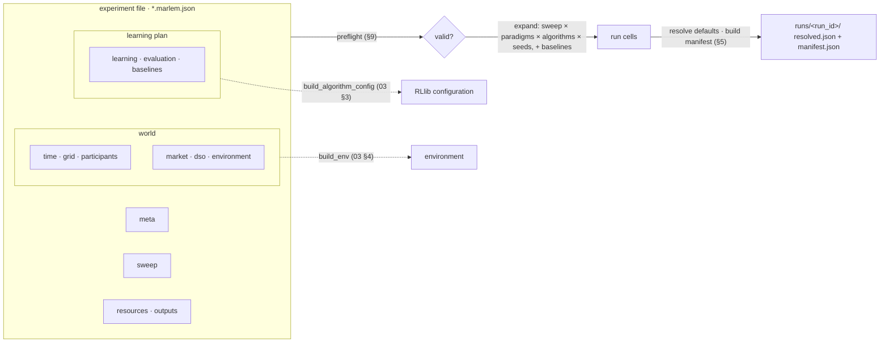

# 02. Experiment file

> One JSON file describes a complete study: the simulated world, the reinforcement-learning plan, evaluation and the sweep. It is used identically by CLI, notebooks and Studio.
> Master: [README.md](README.md) · Decisions: D-07, D-08 · State: [implementation-status.md](implementation-status.md).
> "Original default" = the value in the original MARLEM code (`src_thesis/` before its rewrite, git tag `marlem-original`; see link) or in [P2] Table 7/8. Fields marked *(new)* do not exist in the original.

<!-- BEGIN toc (python docs_thesis/toc.py) -->
## Contents

- [0. At a glance](#0-at-a-glance)
  - [0.1 Where the file lives in code](#01-where-the-file-lives-in-code)
- [1. One file, one study (D-08)](#1-one-file-one-study-d-08)
- [2. Top-level structure](#2-top-level-structure)
- [3. Field reference](#3-field-reference)
  - [3.1 `meta`](#31-meta)
  - [3.2 `time`](#32-time)
  - [3.3 `grid`](#33-grid)
  - [3.4 `participants`](#34-participants)
  - [3.5 `market`](#35-market)
  - [3.6 `dso`](#36-dso)
  - [3.7 `environment`](#37-environment)
  - [3.8 `learning`](#38-learning)
  - [3.9 `evaluation`](#39-evaluation)
  - [3.10 `baselines`](#310-baselines)
  - [3.11 `sweep`](#311-sweep)
  - [3.12 `resources`](#312-resources)
  - [3.13 `outputs`](#313-outputs)
- [4. Example (Case 6, 3 × 3 on SimBench)](#4-example-case-6-3--3-on-simbench)
- [5. Run manifest (system-written)](#5-run-manifest-system-written)
- [6. Sharing](#6-sharing)
- [7. Presets (original experiments on SimBench)](#7-presets-original-experiments-on-simbench)
- [8. Relation to the original](#8-relation-to-the-original)
- [9. Validation (preflight)](#9-validation-preflight)

<!-- END toc -->

## 0. At a glance

One JSON file holds the whole study; the system expands it into runs and writes a manifest for each (§1, §5).



### 0.1 Where the file lives in code

The file format is the `ExperimentFile` model in [experiments/models/records.py](../../../src_thesis/experiments/models/records.py); the defaults of §3 are `DEFAULTS` in [resolve.py](../../../src_thesis/experiments/models/resolve.py). The experiment layer (03) reads, expands and resolves it; `ConfigService` (04) is how the Studio and the CLI open, edit and save it; presets are files in [experiments/presets/](../../../src_thesis/experiments/presets/). The sections are plain dictionaries until each gets a typed model; this document is their reference until then.

[↑ Contents](#contents)

## 1. One file, one study (D-08)

**Why:** In the original, a study's settings were spread over notebooks, `marl/train.py` and hard-coded constants, so a result could not be rerun from one place. One file gives one thing to share, validate, version and rerun.

```text
my-study.marlem.json        ← written by the user or the Studio; shared as-is
        │  validate + resolve defaults + expand sweep
        ▼
runs/<run_id>/manifest.json ← written by the system: one per (sweep point × paradigm × algorithm × seed)
```

- **The experiment file** is the only thing a user writes or shares. Everything is in it: the world, the learning plan, evaluation and baselines.
- **The run manifest** is written by the system. It is the fully resolved file (all defaults filled, placement rules resolved, sweep point applied) plus code, data and environment fingerprints (§5).
- **The 3 × 3 matrix is one file.** `learning.paradigms × learning.algorithms × learning.seeds` expand to runs. A `sweep` (e.g. Case 1's six mechanisms) multiplies that.

[↑ Contents](#contents)

## 2. Top-level structure

**Why:** The sections separate *what is simulated* (the world) from *how agents learn and are judged* (the learning plan), so one world can be reused with different learning plans and vice versa.

| Section | Content | § |
|---|---|---|
| `schema_version`, `kind` | `"1.0"`, `"marlem-experiment"` | — |
| `meta` | Identity, description, provenance, data status | 3.1 |
| `time` | Resolution, horizon, days (fixed, range, sampler), train/eval split | 3.2 |
| `grid` | Network source, background, limits, ratings, power flow, assessment mode | 3.3 |
| `participants` | Agents: bus, owned elements, profiles, scaling, battery (or a placement rule) | 3.4 |
| `market` | Mechanism, bounds, partner preference, ledger | 3.5 |
| `dso` | Tariffs, fee factors and thresholds | 3.6 |
| `environment` | Observation, reward, reputation, cooperation KPI settings | 3.7 |
| `learning` | Paradigms, algorithms, per-algorithm hyperparameters, network model, tuning (PBT), budget, rollouts, checkpoints, seeds | 3.8 |
| `evaluation` | When and how policies are evaluated | 3.9 |
| `baselines` | Non-learning comparators | 3.10 |
| `sweep` | Parameter variations across runs | 3.11 |
| `resources` | CPUs, GPUs, parallel runs, store path | 3.12 |
| `outputs` | What is recorded | 3.13 |

[↑ Contents](#contents)

## 3. Field reference

### 3.1 `meta`

**Why:** Names the study and records where it came from. `id` becomes part of every run ID, and `data_status` keeps reconstructed data from being presented as measured.

| Field | Type | Default | Description |
|---|---|---|---|
| `id` | str | — | Stable identifier (file name stem); used in run IDs |
| `name`, `description` | str | — | Human-readable |
| `author`, `created` | str, date | — | Provenance |
| `tags` | list[str] | [] | E.g. `["paper", "case6"]` |
| `derived_from` | str \| null | null | Preset or file this was cloned from |
| `data_status` | enum | `"synthetic"` | `synthetic` · `measured` · `reconstructed-unverified` (Case 6, I-51) |

### 3.2 `time`

**Why:** Resolution and horizon set the step length that every energy quantity depends on. The day settings decide which days the agents see, and keep the evaluation days out of training.

| Field | Type | Default | Description |
|---|---|---|---|
| `resolution` | enum | `"hourly_aggregated"` | `native_15min` or `hourly_aggregated` (D-07) |
| `horizon_steps` | int | 24 | Periods per episode (original `max_steps`, [P2] Table 7: 24) |
| `days.mode` | enum | `"fixed"` | `fixed` · `range` · `sampler` |
| `days.date` | date | — | For `fixed` |
| `days.start`, `days.end` | date | — | For `range` and `sampler` |
| `days.filter` | object | {} | `season`, `months`, `day_type` (`workday`/`weekend`) for `sampler` |
| `days.eval_holdout` | float \| list[date] | 0.2 | Fraction or explicit dates reserved for evaluation (never trained on) |
| `days.seed` | int | 42 | Seed of the day split and sampling |

### 3.3 `grid`

**Why:** Which network, how the non-participant load behaves, what counts as a violation, and whether grid results feed back into learning (01).

| Field | Type | Default | Description |
|---|---|---|---|
| `source.type` | enum | `"simbench"` | `simbench` · `pandapower_builtin` · `pandapower_file` (01 §1) |
| `source.code` / `name` / `path` | str | — | SimBench code, built-in name (e.g. `case33bw`) or JSON path |
| `source.sha256` | str | — | For `pandapower_file` |
| `background.mode` | enum | `"mapped_replacement"` | `mapped_replacement` · `scaled_background` · `no_background` (01 §3.5) |
| `background.scale` | float | 1.0 | For `scaled_background` |
| `background.profiles` | enum | `"native"` | For non-SimBench networks: `static` (element values) or `catalog` assignment by load type |
| `limits.v_min_pu`, `v_max_pu` | float \| null | null | Voltage band for every bus. `null` = each bus's own network limits, fallback 0.95 / 1.05 (D-15) |
| `limits.line_max_percent`, `trafo_max_percent` | float | 100, 100 | Loading limits |
| `ratings.source` | enum | `"network"` | `network` · `file` · `rule` · `none` (no loading checks) |
| `ratings.rule` | object | — | E.g. `{"type": "base_case_margin", "factor": 1.5}` |
| `power_flow.algorithm` | enum | `"nr"` | pandapower `runpp` algorithm |
| `power_flow.tolerance_mva`, `max_iteration` | float, int | pandapower defaults | Solver settings |
| `power_flow.init` | enum | `"results"` | Warm start from the previous step |
| `reactive.load` | enum | `"profile_ratio"` | Keep the profile's q/p, or `fixed_pf` |
| `reactive.fallback_pf` | float | 0.95 | Used when p = 0 or `fixed_pf` |
| `assessment.mode` | enum | `"feedback"` | `shadow` · `feedback` (01 §6) |
| `assessment.non_convergence` | enum | open (D-12) | `fail_run` · `truncate_episode` |
| `assessment.non_convergence_penalty` | float | — | For `truncate_episode` |

### 3.4 `participants`

**Why:** The agents themselves: where they sit, what they own, what data drives them and which battery they have. This is what differs most between the paper's cases.

Either an explicit list, or a `placement_rule` that is resolved at validation.

| Field | Type | Default | Description |
|---|---|---|---|
| `id` | str | — | Agent ID; order defines agent order everywhere |
| `role` | str | — | Label, e.g. `"community_solar"` ([P2] Table 6) |
| `bus` | str | — | Network bus name |
| `owns.loads`, `owns.sgens`, `owns.storage` | list[str] | [] | Owned element names (01 §3.2) |
| `profile.source` | enum | `"native"` | `native` · `catalog` · `csv` · `synthetic` |
| `profile.demand`, `profile.generation` | object | — | `{"type": "H0-B"}`, `{"path": …, "column": …, "sha256": …}`, or synthetic parameters |
| `scaling.mode` | enum | `"none"` | `none` · `peak_kw` · `energy_kwh` |
| `scaling.demand`, `scaling.generation` | float | — | Target value |
| `battery` | object \| null | null | See below |
| `battery.nominal_capacity_kwh` | float | — | Original `Battery.nominal_capacity` |
| `battery.min_soc`, `max_soc` | float | 0.0, 1.0 | Original defaults |
| `battery.charge_efficiency`, `discharge_efficiency` | float | 1.0, 1.0 | Original defaults ([P1] Case 5 uses 0.95) |
| `battery.max_power_kw` | float \| null | null | *(new)* power limit (I-71) |
| `battery.initial_soc` | float \| `"random"` | `"random"` | Original: uniform in [min, max] at reset |
| `placement_rule` | object | — | `{"type": "household_with_pv", "n": 8, "seed": 1}`, `"feeder_ends"`, `"spread"`, or `{"file": …}` (01 §3.1) |

### 3.5 `market`

**Why:** The clearing rules. Case 1 compares mechanisms, so they must be settings per run instead of code.

Original: [`MarketConfig`](../../../src_thesis/marketplace/market/matching.py#L35-L43).

| Field | Type | Original default | Description |
|---|---|---|---|
| `mechanism` | enum | `"average"` | `average` · `buyer` · `seller` · `bid_ask_spread` · `nash_bargaining` · `proportional_surplus` |
| `price.min`, `price.max` | float | 0, 1000 ([P2]: 20, 600) | Bid price bounds (currency/kWh) |
| `quantity.min`, `quantity.max` | float | 0, 1000 ([P2]: 0, 180) | Order bounds (kWh per step) |
| `partner_preference` | bool | false | RL-chosen partner (true) vs rule-based |
| `match_threshold` | float | 1e-6 | Minimum matched quantity |
| `ledger.enabled` | bool | true | Hash-chained trade log |
| `ledger.difficulty` | int | 2 | Proof-of-work difficulty (0 = no mining) |
| `async_orders` | bool | true | Random order timestamps within the period ([P2] Table 7) |

### 3.6 `dso`

**Why:** The original hard-coded every DSO constant. Exposing them turns Case 3 (DSO strategies) into a sweep, and lets fees actually be charged (I-28).

Original: [`DSOAgent`](../../../src_thesis/marketplace/dso/dso.py#L44-L75) (all constants were hard-coded; exposed here).

| Field | Type | Original default | Description |
|---|---|---|---|
| `tariffs.source` | enum | `"synthetic"` | `csv` · `synthetic` |
| `tariffs.feed_in`, `tariffs.utility` | object | — | `{"path", "column", "sha256"}` for `csv` |
| `tariffs.mode` | enum | `"normalized"` | How CSV values are mapped into the price bounds |
| `tariffs.reset_per_episode` | bool | false | Original `enable_reset_dso_profiles` |
| `fees.charged` | bool | false | *(new)* fees are actually paid (I-28) |
| `fees.congestion_factor`, `congestion_threshold` | float | 0.5, 0.8 | Eq. 8a |
| `fees.distance_factor` | float | 0.35 | Transmission fee (formula undefined in the paper, I-29) |
| `fees.voltage_factor`, `voltage_threshold` | float | 0.15, 0.05 | Eq. 8c/8f |
| `fees.instability_threshold` | float | 0.2 | Thermal-fee threshold (eq. 8g) |
| `fees.imbalance_factor` | float | 0.15 | Eq. 8b |
| `fees.zone_factor` | float | 0.15 | Same-zone bonus (eq. 8e) |

### 3.7 `environment`

**Why:** What agents observe and what they are rewarded for. Both carry a version name, so results from different definitions are never compared by accident.

| Field | Type | Original default | Description |
|---|---|---|---|
| `observation.version` | str | `"v1"` | `v1` = [P1] Table 2 (42 dims); `v2-grid` adds the grid block (01 §6) |
| `observation.forecast_error` | float | 0.3 | Max relative forecast error ([P2] Table 7; unused in the original, I-39) |
| `observation.forecast_anchors` | int | 4 | Original `num_anchor` |
| `observation.include_partner_reputation` | bool | = `market.partner_preference` | Appends N reputations |
| `observation.own_bus_voltage` | enum | `"private"` | `private` · `public` · `off` |
| `reward.version` | str | `"corrected-v1"` | Different versions are never compared directly |
| `reward.base_weights` | object | grid 10, resource 1.5, trading 5, stability 2, economic 3 | Eq. 4 `R_base` weights ([reward.py](../../../src_thesis/marketplace/reward.py#L51-L56)) |
| `reward.cooperation_weights` | object | welfare 7, liquidity 1.5, spread 1.5, volatility 3, coordination 5, imbalance 10, congestion 9, convergence 8, self-consumption 5, flexibility 6 | Eq. 5 (Σ = 56) |
| `reward.penalties` | object | dso 15, grid_imbalance 10, price_deviation 2, unutilized 1.5, volatility 2, no_trades 5 | Penalty factors |
| `reward.contribution_weights` | object | grid 0.5, price 0.2, local 0.3 | Eq. 6 |
| `reward.log_scale` | float | 20 | Eq. 3 |
| `reward.grid_violation` | object | — | *(new)* `{"attribution": "bus", "w_voltage": …, "w_loading": …, "w_nonconvergence": …}` (D-11) |
| `reputation.weights` | object | reliability 0.3, fairness 0.2, grid 0.5 | Eq. 12 |
| `reputation.decay` | enum | `"time_of_day"` | Original rule (I-38); alternative `"constant"` with a factor |

### 3.8 `learning`

**Why:** Which RL algorithms and training paradigms are compared, with which hyperparameters and budget: the 3 × 3 study of [P2]. In the original these were fixed in code; here every value is visible and stored with the run.

This section replaces the original `RLTrainer` arguments ([train.py](../../../src_thesis/marl/train.py#L42-L54)) and the hard-coded algorithm configs ([train.py](../../../src_thesis/marl/train.py#L209-L265)).

**General**

| Field | Type | Original default | Description |
|---|---|---|---|
| `paradigms` | list[enum] | `["dtde"]` | Any of `ctce`, `ctde`, `dtde` |
| `algorithms` | list[enum] | `["ppo"]` | Any of `ppo`, `appo`, `sac` |
| `seeds` | list[int] | [42] | One run per seed and cell |
| `budget.unit` | enum | `"iterations"` | `env_steps` (recommended: equal across cells, I-50) · `iterations` · `episodes` |
| `budget.value` | int | 100 | Original `iters`; [P2]: "10 000 episodes" |

**Paradigms**

| Field | Type | Original default | Description |
|---|---|---|---|
| `paradigm_options.ctce.reward_aggregation` | enum | `"sum"` | Group reward: `sum` (original) or `mean` (I-73) |
| `paradigm_options.ctde.reward_aggregation` | enum | `"sum"` | Same |
| `paradigm_options.ctde.critic_input` | enum | `"joint_obs_actions"` | Centralised critic input |
| `paradigm_options.dtde.policy_sharing` | enum | `"independent"` | One policy per agent (original); `shared` is optional *(new)* |

**Network model**

| Field | Type | Original default | Description |
|---|---|---|---|
| `model.embeddings_dim` | int | 128 | Width of the CTCE/CTDE custom module encoders ([ctde.py](../../../src_thesis/marl/ctde.py#L313-L329)): 2 × Linear + ReLU |
| `model.dtde_hiddens` | list[int] | RLlib default | DTDE uses RLlib's default module per algorithm |
| `model.activation` | enum | `"relu"` | |

**Algorithm hyperparameters** (`algorithm_params.<algo>`). Unset fields fall back to the RLlib default of the pinned version, which the manifest records.

| Algorithm | Field | Original default | [P2] Table 8 |
|---|---|---|---|
| **ppo** | `lr` | 1e-5 | 1e-5 |
| | `gamma` | 0.99 | 0.99 |
| | `lambda_` (GAE) | 0.95 | GAE |
| | `use_gae`, `use_critic` | true, true | |
| | `num_epochs` | 30 | |
| | `minibatch_size` | 128 | 128 |
| | `train_batch_size_per_learner` | RLlib default | |
| | `clip_param` | 0.2 | 0.2 |
| | `vf_loss_coeff`, `vf_clip_param` | RLlib default | |
| | `entropy_coeff` | 0.01 | 0.01 |
| | `kl_coeff` | 0.0 | |
| | `grad_clip` | 0.5 | 0.5 |
| **appo** | `lr` | 1e-5 | 1e-5 |
| | `gamma` | 0.99 (RLlib default) | 0.99 |
| | `vtrace` | true | V-trace |
| | `lambda_` | 0.95 | |
| | `clip_param`, `vtrace_clip_rho_threshold`, `vtrace_clip_pg_rho_threshold` | RLlib default | |
| | `entropy_coeff` | 0.01 | 0.01 |
| | `kl_coeff` | 0.0 | |
| | `grad_clip` | 0.5 | 0.5 |
| | `train_batch_size_per_learner` | RLlib default | |
| **sac** | `actor_lr`, `critic_lr` | 1e-5, 1e-5 | 1e-5, 1e-5 |
| | `alpha_lr`, `initial_alpha` | RLlib default | |
| | `gamma` | 0.99 | 0.99 |
| | `tau` | RLlib default | |
| | `twin_q` | true | |
| | `target_entropy` | `"auto"` = −Σ dim(A) for CTCE/CTDE, −dim(Aᵢ) for DTDE | Same rule |
| | `n_step` | RLlib default | |
| | `replay_buffer.type` | `EpisodeReplayBuffer` (CTCE/CTDE), `MultiAgentEpisodeReplayBuffer` (DTDE) | |
| | `replay_buffer.capacity` | 1000 | 1 000 |
| | `num_steps_sampled_before_learning_starts` | RLlib default | |
| | `train_batch_size_per_learner` | RLlib default | |
| | `grad_clip` | 0.5 | 0.5 |
| | `batch_mode` | `"complete_episodes"` | |

**Tuning** (`learning.tuning`). Original: PBT always on ([train.py](../../../src_thesis/marl/train.py#L179-L197), [L439](../../../src_thesis/marl/train.py#L439)).

| Field | Type | Original default | Description |
|---|---|---|---|
| `method` | enum | `"pbt"` | `none` · `pbt` (I-62: PBT was always installed) |
| `num_samples` | int | 1 ([P2]: 10) | Population size per cell |
| `perturbation_interval` | int | = `checkpoint.every` | Iterations between exploit/explore |
| `metric` | str | `"env_runners/episode_return_mean"` | Selection metric (training return) |
| `mutations.ppo` | object | lr loguniform(1e-4, 1e-2), entropy_coeff (0.01, 10), lambda_ (0.8, 0.99) | Search space; must contain the initial value (I-49) |
| `mutations.appo` | object | same as ppo | |
| `mutations.sac` | object | actor_lr, critic_lr loguniform(1e-4, 1e-2) | |

**Rollouts and checkpoints**

| Field | Type | Original default | Description |
|---|---|---|---|
| `rollout.num_env_runners` | int | = CPUs | Original `cpus` → `num_env_runners` |
| `rollout.envs_per_runner`, `rollout_fragment_length` | int | RLlib default | |
| `checkpoint.every` | int | 10 | Iterations between checkpoints |
| `checkpoint.keep` | int | 3 | Retained checkpoints |
| `checkpoint.score` | str | `"evaluation/env_runners/episode_return_mean"` | Best-checkpoint metric |

### 3.9 `evaluation`

**Why:** How, how often and on which days learned policies are judged. Kept separate from training so results are not measured on the training data (I-72).

| Field | Type | Original default | Description |
|---|---|---|---|
| `interval` | int | 1 | Evaluate every N iterations |
| `episodes` | int \| `"auto"` | `"auto"` | Original `evaluation_duration` |
| `explore` | bool | false | Deterministic policy during evaluation |
| `days` | enum | `"holdout"` *(new)* | `holdout` · `train` · explicit dates; the original evaluated on the training scenario (I-72) |
| `seeds` | list[int] | *(new)* | Evaluation env seeds, disjoint from training |
| `parallel_to_training` | bool | true | Original setting |
| `metrics` | list[str] | reward + research outcomes | Served/unmet demand, curtailment, P2P share, costs, violations, losses, RL return |

### 3.10 `baselines`

**Why:** Simple reference policies that give the learned results a scale: a policy is only good if it beats doing nothing and trading at random.

| Field | Type | Default | Description |
|---|---|---|---|
| `baselines` | list | `["no_order", "random"]` | `no_order` · `random` (zero-intelligence, [P1] §4.2) · `rule_based` (with params) |
| `rule_based.strategy` | enum | — | E.g. `"net_position"`: sell surplus and buy deficit at the tariff midpoint |

### 3.11 `sweep`

**Why:** Studies that vary one setting (mechanism, fees, number of agents) stay one file instead of several copies that drift apart.

| Field | Type | Description |
|---|---|---|
| `sweep.mode` | enum | `grid` (Cartesian product) · `zip` (paired lists) |
| `sweep.parameters` | object | JSON-pointer-style path → list of values, e.g. `{"market.mechanism": ["average", "buyer", "seller", "bid_ask_spread", "nash_bargaining", "proportional_surplus"]}` |
| `sweep.labels` | list[str] | Optional names per point |

### 3.12 `resources`

**Why:** How much of the machine a run may use. Machine-specific, so it is kept apart from the scientific settings.

| Field | Type | Original default | Description |
|---|---|---|---|
| `cpus_per_run` | int | all detected | Env runners (see 3.8) |
| `gpus_per_learner` | int | all detected | Measured to be slower on this machine; recommend 0 |
| `max_parallel_runs` | int | 1 | Runs executed at once by the worker pool |
| `store` | path | configurable | Experiment store location (outside OneDrive recommended) |

### 3.13 `outputs`

**Why:** What is saved beyond the defaults. Per-step records and per-element grid results can be large, so they are opt-in per study.

| Field | Type | Default | Description |
|---|---|---|---|
| `record_steps` | enum | `"evaluation"` | `none` · `evaluation` · `all` (per-step orders, trades, settlement, assessment) |
| `grid_element_results` | bool | false | Per-bus/line result tables (large) |
| `figures` | list[str] | [] | Figures to render at the end |

[↑ Contents](#contents)

## 4. Example (Case 6, 3 × 3 on SimBench)

```json
{
  "schema_version": "1.0",
  "kind": "marlem-experiment",
  "meta": {
    "id": "case6-3x3-semiurb4",
    "name": "Case 6 implicit cooperation, 3x3, SimBench semi-urban",
    "derived_from": "preset:case6",
    "data_status": "reconstructed-unverified"
  },
  "time": {
    "resolution": "hourly_aggregated",
    "horizon_steps": 24,
    "days": {
      "mode": "sampler",
      "start": "2016-05-01",
      "end": "2016-08-31",
      "filter": {
        "day_type": "workday"
      },
      "eval_holdout": 0.2,
      "seed": 42
    }
  },
  "grid": {
    "source": {
      "type": "simbench",
      "code": "1-LV-semiurb4--0-sw"
    },
    "background": {
      "mode": "mapped_replacement"
    },
    "limits": {
      "v_min_pu": 0.95,
      "v_max_pu": 1.05,
      "line_max_percent": 100,
      "trafo_max_percent": 100
    },
    "assessment": {
      "mode": "feedback",
      "non_convergence": "truncate_episode",
      "non_convergence_penalty": -50
    }
  },
  "participants": [
    {
      "id": "small_industry",
      "role": "small_industry",
      "bus": "LV4.101 Bus 17",
      "owns": {
        "loads": [
          "LV4.101 Load 12"
        ]
      },
      "profile": {
        "source": "catalog",
        "demand": {
          "type": "G1-A"
        },
        "generation": {
          "type": "PV3"
        }
      },
      "scaling": {
        "mode": "peak_kw",
        "demand": 180,
        "generation": 180
      },
      "battery": {
        "nominal_capacity_kwh": 108,
        "min_soc": 0.1,
        "max_soc": 0.9,
        "charge_efficiency": 0.95,
        "discharge_efficiency": 0.95,
        "max_power_kw": 54
      }
    }
  ],
  "market": {
    "mechanism": "average",
    "price": {
      "min": 20,
      "max": 600
    },
    "quantity": {
      "min": 0,
      "max": 180
    },
    "partner_preference": false,
    "ledger": {
      "enabled": true,
      "difficulty": 0
    },
    "async_orders": true
  },
  "dso": {
    "tariffs": {
      "source": "csv",
      "mode": "normalized",
      "feed_in": {
        "path": "data/prices/fit_60min.csv",
        "sha256": "…"
      },
      "utility": {
        "path": "data/prices/utility_60min.csv",
        "sha256": "…"
      }
    },
    "fees": {
      "charged": true
    }
  },
  "environment": {
    "observation": {
      "version": "v2-grid",
      "forecast_error": 0.3
    },
    "reward": {
      "version": "corrected-v1",
      "grid_violation": {
        "attribution": "bus"
      }
    }
  },
  "learning": {
    "paradigms": [
      "ctce",
      "ctde",
      "dtde"
    ],
    "algorithms": [
      "ppo",
      "appo",
      "sac"
    ],
    "seeds": [
      1,
      2,
      3
    ],
    "budget": {
      "unit": "env_steps",
      "value": 2000000
    },
    "algorithm_params": {
      "ppo": {
        "lr": 1e-05,
        "entropy_coeff": 0.01,
        "clip_param": 0.2,
        "minibatch_size": 128
      },
      "appo": {
        "lr": 1e-05,
        "vtrace": true
      },
      "sac": {
        "actor_lr": 1e-05,
        "critic_lr": 1e-05,
        "replay_buffer": {
          "capacity": 1000
        }
      }
    },
    "tuning": {
      "method": "none"
    },
    "checkpoint": {
      "every": 10,
      "keep": 3
    }
  },
  "evaluation": {
    "interval": 10,
    "episodes": 20,
    "days": "holdout",
    "explore": false
  },
  "baselines": [
    "no_order",
    "random"
  ],
  "resources": {
    "cpus_per_run": 6,
    "gpus_per_learner": 0,
    "max_parallel_runs": 1
  }
}
```

The example lists one participant for brevity. Unlisted fields take their defaults, and the manifest records the resolved values.

[↑ Contents](#contents)

## 5. Run manifest (system-written)

**Why:** The receipt of a run: exactly what it used, so it can be traced and rerun. Details and the reason for each field: [03 §7](03-experiment-layer.md#7-what-makes-a-run-reproducible).

- the fully resolved experiment file for this run: defaults filled, placement rule resolved, sweep point applied, cell fixed;
- the canonical hash of the user's file and of the resolved file;
- code: git commit and a dirty-tree diff hash;
- environment: python and the versions of `ray`, `torch`, `pandapower`, `simbench` and `pydantic`;
- data: the network source and version, and sha256 of every CSV used;
- the resolved train and eval day lists and the time-alignment rule;
- validation report hash and platform (OS, CPU).

[↑ Contents](#contents)

## 6. Sharing

**Why:** Another person must be able to rerun a study from what you send them, without your machine or your copies of the data.

- **Share = send the one JSON file.** SimBench and built-in networks are referenced by code or name plus the package version, so they are not copied.
- External CSVs and pandapower files are referenced by path + sha256. `marlem export <file> --bundle` zips the JSON with exactly those files, only when they exist.
- The canonical hash is computed on sorted-key JSON with defaults filled in. It identifies "the same study" regardless of formatting.
- `schema_version` plus migration functions keep old files loadable.
- A JSON Schema is generated from the Pydantic models. Editors (VS Code) then autocomplete and validate the file. JSON has no comments, so the `description` fields and this document carry the explanations.

[↑ Contents](#contents)

## 7. Presets (original experiments on SimBench)

**Why:** The papers' seven cases as ready-made files, so reproducing a case is "open the preset, run it", and new studies start from a known, validated configuration.

```text
src_thesis/experiments/presets/   # in the repo, read-only
├── case1-mechanisms.marlem.json          sweep: market.mechanism (6)
├── case2-heterogeneity.marlem.json       sweep: participant sizes (balanced / monopoly / oligopoly)
├── case3-dso-strategies.marlem.json      sweep: dso.fees + tariffs (permissive / moderate / strict / dynamic)
├── case4-grid-constraints.marlem.json    sweep: grid.source.code, SimBench scenario 0/1/2, background.scale
├── case5-battery.marlem.json             sweep: batteries none vs strategic
├── case6-3x3.marlem.json                 paradigms × algorithms × seeds
└── case7-scalability.marlem.json         sweep: placement_rule.n
```

- Case 4 on SimBench is a different study from the paper's topology/capacity comparison (real physics). This is documented in the preset's `description`.
- The [P2] Case 6 profile mapping is unpublished (I-51), so the Case 6 preset is `reconstructed-unverified`.

[↑ Contents](#contents)

## 8. Relation to the original

- There is no validated NetworkX release (retired 2026-09-27, D-02). The original code is kept as git tag `marlem-original` for comparison; the tool never runs it.
- Presets reproduce the papers' cases on SimBench and say in `meta.description` which case and which deviations (e.g. Case 4 has real physics).
- R9 compares results with the figures published in [P1] and [P2], qualitatively. Values read off the papers can be stored as reference data (04 §5, `ResultService.reference`).

[↑ Contents](#contents)

## 9. Validation (preflight)

**Why:** Mistakes should cost seconds, not hours of training. Many do not crash (an agent on the wrong bus, evaluation days that overlap training) and would silently produce wrong results.

Run by `ValidationService` before any run (04 §5):

- schema;
- references (buses, elements, CSVs, hashes);
- time (horizon vs profile length; aligned resolution);
- units;
- market bounds vs profiles;
- battery feasibility;
- grid mapping rules (01 §3.2);
- RL (algorithm and paradigm supported; mutation domains contain initial values; budget equal across cells);
- protocol (seeds distinct; held-out days disjoint);
- resources.

Findings have stable codes. For example `GRID_MAPPING_DUPLICATE_OWNER` is an error, and `PBT_DOMAIN_EXCLUDES_INITIAL` is an error.

[↑ Contents](#contents)
