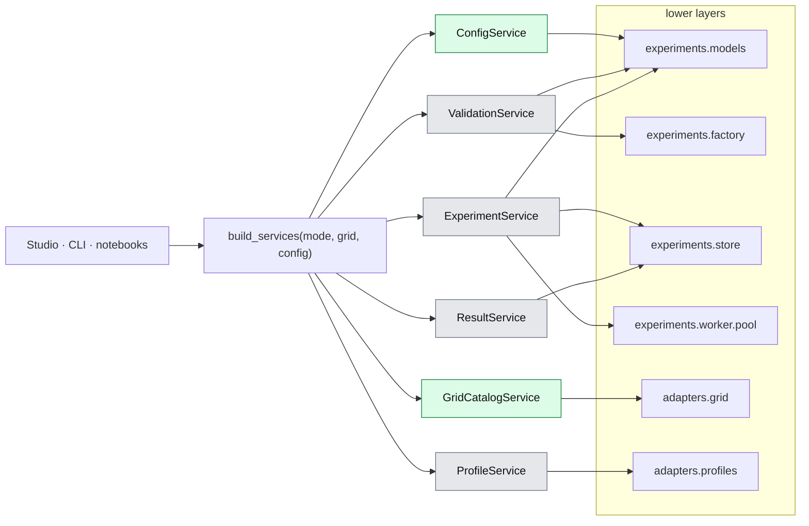

# 03. Application layer

> `src_thesis/application/`: the services that the Studio, the CLI and notebooks call. They hide MARLEM, the experiment layer and the adapters behind typed, plain-data methods.
> Master: [README.md](README.md) (layers and who may call whom: §2.1) · Experiment layer: [05-experiment-layer.md](05-experiment-layer.md) · Presentation: [04-presentation.md](04-presentation.md) · Decisions: D-09, D-13.

<!-- BEGIN toc (python docs_thesis/toc.py) -->
## Contents

- [0. At a glance](#0-at-a-glance)
- [1. Status and wiring](#1-status-and-wiring)
- [2. Services](#2-services)
  - [2.1 `ConfigService`: experiment files](#21-configservice-experiment-files)
  - [2.2 `GridCatalogService`: networks without an environment](#22-gridcatalogservice-networks-without-an-environment)
  - [2.3 `ProfileService`: profiles and participant mapping](#23-profileservice-profiles-and-participant-mapping)
  - [2.4 `ValidationService`: preflight](#24-validationservice-preflight)
  - [2.5 `ExperimentService`: runs](#25-experimentservice-runs)
  - [2.6 `ResultService`: reading results](#26-resultservice-reading-results)
- [3. Returned data](#3-returned-data)
- [4. What each real service calls](#4-what-each-real-service-calls)

<!-- END toc -->

## 0. At a glance

Every caller gets the six services from one container; each service reaches exactly the lower layers it needs (§4). Green = real implementation today (the grid catalog and the experiment files), grey = demo.

Services return plain data only (§3); nothing from the lower layers reaches the caller.

[↑ Contents](#contents)

## 1. Status and wiring

**Why:** One set of services sits between every user interface and the engine, so the Studio, the CLI and notebooks do the same thing in the same way. Demo implementations let the Studio be built and tested before the engine behind it exists.

| File | Why it is there | Holds | State (2026-09-27) |
|---|---|---|---|
| [contracts.py](../../../src_thesis/application/contracts.py) | Callers depend on the protocol, so demo and real services are interchangeable | One `Protocol` per service, mirroring the method tables in §2 | Done |
| [models.py](../../../src_thesis/application/models.py) | The UI never holds engine objects, only these plain records | The plain data the services return (§3) | Done; experiment sections still dicts |
| [demo.py](../../../src_thesis/application/demo.py) | The Studio can be built and tested before the engine exists | Demo implementations with deterministic sample data; no MARLEM, pandapower or Ray | Done |
| [grid_catalog.py](../../../src_thesis/application/grid_catalog.py) | The first real service: browse real networks in the Studio today | The real `GridCatalogService` over the pandapower adapter | Done (R3, catalog part) |
| [config_files.py](../../../src_thesis/application/config_files.py) | The real `ConfigService`: you can open, edit and save real experiment files | `FileConfigService` over presets and the workspace library | Done (R7, file part) |
| [workspace.py](../../../src_thesis/application/workspace.py) | User data must live outside the repository and outside OneDrive (runs write many small files; sync clients lock and duplicate them) | `Workspace`: library, store and exports folders; `default_home()` | Done |
| [container.py](../../../src_thesis/application/container.py) | One switch between demo and real services, in one file | `build_services(mode, grid, config, home)` → `Services` | Done |

| Service | Implementation today | Real implementation calls | Phase |
|---|---|---|---|
| `ConfigService` | **real** (`FileConfigService`) or demo | `experiments.models` (files, expand, resolve, manifest data paths) | R7 (done; `import_bundle` open) |
| `GridCatalogService` | **real** (`PandapowerGridCatalogService`) or demo | `adapters/grid/simbench_new.py` | R3 (done) |
| `ProfileService` | demo | `adapters/profiles/` (SimBench catalogue, mapping rules) | R3 |
| `ValidationService` | demo | `experiments.models` + `experiments.factory` (dry run) | R6–R7 |
| `ExperimentService` | demo | `experiments.models`, `experiments.store`, `experiments.worker.pool` | R7 |
| `ResultService` | demo | `experiments.store` (+ paper reference data) | R7 |

**Wiring.** Callers get every service through [`build_services`](../../../src_thesis/application/container.py) and depend only on the protocols:

- `build_services("demo")`: demo services everywhere; never loads pandapower (a test checks this).
- `build_services("demo", grid="pandapower", config="files")`: the real grid catalog and real experiment files, the rest demo. The Studio uses this unless `MARLEM_STUDIO_GRID=demo` or `MARLEM_STUDIO_CONFIG=demo`; its header then reads "DEMO DATA · real grid, files".
- `build_services("real")`: reserved; raises until R6–R7.

Real services replace demo ones one at a time, in roadmap order, and are imported lazily inside `build_services`. Only this module changes when a real service arrives.

**Workspace.** User data lives in one folder outside the repository and OneDrive. Its location is, in order: `MARLEM_HOME` if set; the folder chosen on the Studio's Settings page (kept in `%APPDATA%\MARLEM\settings.json`, [`workspace.set_home`](../../../src_thesis/application/workspace.py)); otherwise `%LOCALAPPDATA%\MARLEM` on Windows (here `C:\Users\Kevin\AppData\Local\MARLEM`), `~/.local/share/marlem` elsewhere. Inside: `library/` (the user's experiment files), `store/` (run folders, 05 §3.5) and `exports/` (bundles). Presets stay in the repository, read-only.

[↑ Contents](#contents)

## 2. Services

One protocol per service in [contracts.py](../../../src_thesis/application/contracts.py). The earlier `*_service_new.py` stubs were removed: `scenario_service_new.py` became `ConfigService`, and `dataset_service_new.py` merged into `ProfileService`.

### 2.1 `ConfigService`: experiment files

**Why:** Everything a user does to an experiment file (start from a preset, edit, save, compare, share), without running anything.

Real implementation: [`FileConfigService`](../../../src_thesis/application/config_files.py). Presets are read-only files in [experiments/presets/](../../../src_thesis/experiments/presets/); the user's files are `<id>.marlem.json` in the workspace library (§1).

| Method | Input → output | Notes | State |
|---|---|---|---|
| `list(kind)` | → `[FileSummary]` | Presets (`kind="preset"`) and library files (`"draft"`) | Done |
| `load(file_id)` | → `ExperimentFile` | Library first, then presets; parses and migrates old `schema_version`s; `FileNotFoundError` if neither exists | Done |
| `new_from_preset(preset_id)` | → `ExperimentFile` | Copies the preset into the library as `<preset>-draft` (then `-draft-2`, …) with `meta.derived_from = "preset:<id>"` | Done |
| `save(file, path=None)` | → path | Atomic, pretty JSON; refuses preset IDs and IDs that are not path-safe or contain `__` (the run-ID separator) | Done |
| `clone(file_id, new_id)` | → `ExperimentFile` | Sets `meta.derived_from`; refuses an existing ID | Done |
| `delete(file_id)` | → None | Library files only; presets cannot be deleted | Done |
| `update(file, changes)` | → `ExperimentFile` | A validated copy with each dotted path set (`{"market.mechanism": "seller"}`); what the Studio's "Apply to draft" uses. Does not save | Done |
| `origin(file)` | → `ExperimentFile` or None | The preset or file named in `meta.derived_from`, for "diff against origin" | Done |
| `resolve(file)` | → `ExperimentFile` | Fills defaults and day lists; placement rules wait for R3 | Done |
| `expand(file)` | → `[RunCell]` | Sweep × paradigms × algorithms × seeds (+ baselines) | Done |
| `hash(file)` | → str | Canonical sha256 (02 §6) | Done |
| `to_json(file)` | → str | The JSON view in the Studio | Done |
| `diff(a, b)` | → `[FieldChange]` | Changed leaves as dotted paths (`participants[2].bus`), for "diff against preset" | Done |
| `export_bundle(file)` | → path | `exports/<id>.zip`: the file plus the external CSV/JSON files it names that exist | Done |
| `import_bundle(zip)` | → `ExperimentFile` | Unpacks a bundle into the library | Not yet |
| `json_schema()` | → dict | For editor autocomplete; exists in `experiments.models.files`, not yet on the service | Not yet |

### 2.2 `GridCatalogService`: networks without an environment

**Why:** Choosing a network comes before building an experiment, so it must work on the grid adapter alone, without agents, an environment or RL.

| Method | Input → output | Notes |
|---|---|---|
| `list_networks(filter)` | → `[NetworkInfo]` | SimBench codes, pandapower built-ins, files. Metadata: level, buses, loads, sgens, storage, profiles?, ratings? |
| `summary(source)` | → `NetworkSummary` | Totals and element counts per type |
| `topology(source)` | → `TopologyView` | Buses with coordinates, lines, transformers (plain data for Plotly) |
| `elements(source, bus?)` | → `[ElementInfo]` | Loads, sgens and storage with profile type and rated power |
| `preview_powerflow(source, day, step, injections?)` | → `GridAssessment` + per-bus voltages | One power flow in-process (small and fast); used by the Grid page and the CLI |

### 2.3 `ProfileService`: profiles and participant mapping

**Why:** Tying agents to buses and profiles is the most error-prone part of setting up a study. Previews and suggestions show the data before anything runs.

| Method | Input → output | Notes |
|---|---|---|
| `profile_types(source)` | → `[ProfileType]` | SimBench catalogue (household, commercial, PV, wind, …) |
| `preview(participant_spec, time_spec)` | → series (G, D, net, background total) | After scaling and resolution |
| `suggest_mapping(source, rule)` | → `[ParticipantSpec]` | E.g. `{"type": "household_with_pv", "n": 8, "seed": 1}` |
| `import_mapping(file)` | → `[ParticipantSpec]` | CSV/JSON |
| `days(time_spec)` | → train/eval day lists | Resolves the sampler with its seed |

### 2.4 `ValidationService`: preflight

**Why:** One place for all checks (02 §9), so the Studio and the CLI accept and reject exactly the same files.

| Method | Input → output | Notes |
|---|---|---|
| `validate(file, level)` | → `ValidationReport` | Levels: `schema` (instant, as you type) · `references` · `full` (includes the dry run) |
| `dry_run(file)` | → `DryRunResult` | Builds one environment through the factory, takes one step with the no-order policy, and checks observation shapes, one power flow and the settlement identities |

`ValidationReport` = `[Finding(code, severity, path, message, fix_hint)]`. The `path` (e.g. `participants[3].owns.loads[0]`) lets the Studio jump to the field. The checks are listed in 02 §9.

### 2.5 `ExperimentService`: runs

**Why:** The only way to create and control runs. It hides the store and the worker pool from every caller.

| Method | Input → output | Notes |
|---|---|---|
| `create_runs(file)` | → `[run_id]` | Validates (`full`), expands, writes each run directory with its resolved file and manifest; state `READY` |
| `start(run_ids)` | → queued | Queues runs; the pool starts up to `resources.max_parallel_runs` workers |
| `cancel(run_id)` | → `CANCELLING` | Writes `cancel.request`; forced stop after a timeout |
| `snapshot(run_id)` | → `RunStatus` | State, progress (iteration / budget), last metrics, log tail |
| `list_runs(filter)` | → `[RunSummary]` | By experiment ID, state, network, date |
| `reconcile()` | — | On start-up: marks runs whose worker died as `FAILED` |
| `estimate(file)` | → runs count, time estimate | From stored benchmarks per network, algorithm and paradigm |

### 2.6 `ResultService`: reading results

**Why:** Turns run folders into tables and series for pages, notebooks and the thesis, and keeps research outcomes apart from RL return.

| Method | Input → output | Notes |
|---|---|---|
| `summary(run_id)` | → `RunResult` | Research outcomes + RL return + manifest info |
| `training_curve(run_id)` | → series | Training and evaluation returns per iteration |
| `step_records(run_id, episode)` | → table | Orders, trades, settlement, assessment per step |
| `grid_series(run_id, episode)` | → series | Voltages, loadings, losses, violations over time |
| `matrix(experiment_id, metric)` | → table | Paradigm × algorithm (mean ± std over seeds): the 3 × 3 table |
| `compare(run_ids, metric)` | → series | Flags different `reward.version`s as non-comparable |
| `reference(case, metric)` | → series | Values reported in the papers for that case (reference data entered by hand), read-only |
| `export(run_ids, fmt)` | → path | CSV/JSON of raw series, figures |

[↑ Contents](#contents)

## 3. Returned data

**Why:** A page that holds a pandapower net or a Ray object is tied to the engine and can freeze or break with it. Plain data keeps each layer replaceable and testable on its own.

[models.py](../../../src_thesis/application/models.py) holds the only types that cross the boundary to the Studio, the CLI and notebooks.

- **Plain data only:** Pydantic models, dicts, lists and chart-ready `Series`. Never NiceGUI elements, Ray objects, pandapower nets or MARLEM objects.
- **One import path:** `ExperimentFile`, `ExperimentMeta`, `RunCell` and `RunState` belong to the experiment layer ([05 §2](05-experiment-layer.md#2-records-modelsrecordspy)) and are re-exported here, so callers import everything from `application.models`.
- **Translation happens in the service:** a real service converts lower-layer records into these models (e.g. `grid_catalog.py` turns the grid contract's `NetworkInfo` / `TopologyView` into the API models of the same names).

| Service | Returns |
|---|---|
| `ConfigService` | `ExperimentFile`, `FileSummary`, `RunCell`, `FieldChange`, JSON text and schema |
| `GridCatalogService` | `NetworkInfo`, `NetworkSummary`, `TopologyView`, `ElementInfo`, `PowerFlowPreview` |
| `ProfileService` | `ProfileType`, `Series`, participant dicts |
| `ValidationService` | `ValidationReport` (`Finding`s with `Severity`), `DryRunResult` |
| `ExperimentService` | run IDs, `RunStatus`, `RunSummary`, `RunEstimate`, `RepositoryHealth` |
| `ResultService` | `RunResult`, `Series`, step records (dicts), `MatrixTable`, export paths |

[↑ Contents](#contents)

## 4. What each real service calls

Services run in the process of their caller (no REST layer, D-09). Anything long-running goes through the experiment layer's worker process.

| Service method | Lower-layer calls |
|---|---|
| `ConfigService.load` / `save` / `hash` / `json_schema` | `experiments.models.files.load` / `save` / `canonical_hash` / `json_schema` |
| `ConfigService.resolve` / `expand` | `experiments.models.resolve.resolve` / `expand.expand` |
| `GridCatalogService.*` | `adapters.grid.simbench_new` (catalog, summary, topology, elements, preview) |
| `ProfileService.*` | `adapters.profiles` (SimBench catalogue, mapping rules; R3) |
| `ValidationService.validate` | schema via the models; references, time, units, grid mapping and RL checks (02 §9) |
| `ValidationService.dry_run` | `experiments.factory.environment.build_env` + one step with the no-order policy |
| `ExperimentService.create_runs(file)` | validate → `expand` → per cell: `resolve_run`, `run_id`, `build_manifest`, `store.create_run` |
| `ExperimentService.start` / `cancel` | `worker.pool.WorkerPool.enqueue` + `poll` / `cancel` |
| `ExperimentService.snapshot` / `list_runs` / `reconcile` | `store.read_status`, `log_tail` / `store.list_runs` / `worker.pool.reconcile` |
| `ResultService.summary` / `step_records` / `grid_series` | `store.read_manifest`, `metrics/*` / `store.read_jsonl("raw/steps.jsonl")` |
| `ResultService.reference(case, metric)` | Values reported in the papers, entered by hand as reference data in a read-only `reference/` folder beside the store, each with its source (paper, figure or table) |

[↑ Contents](#contents)
