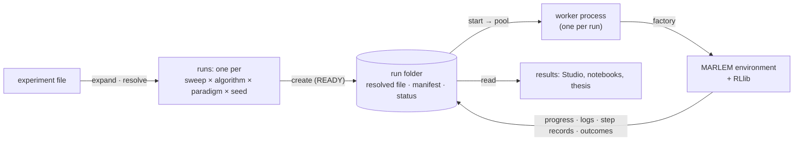
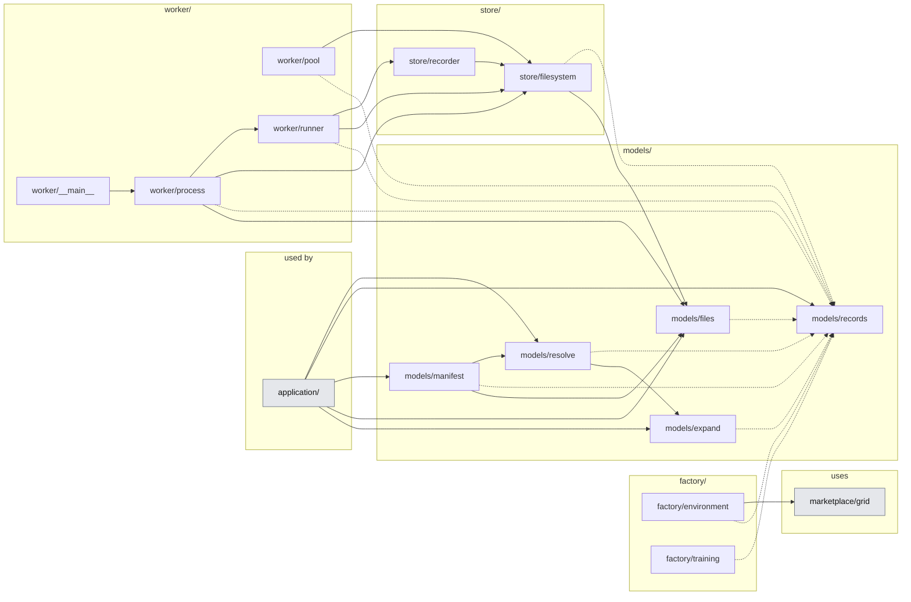
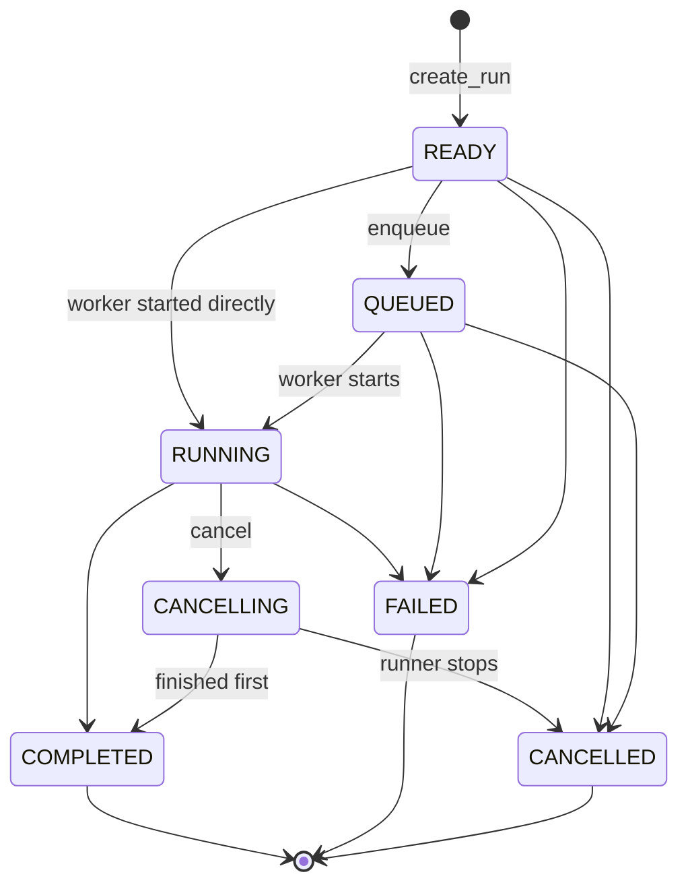
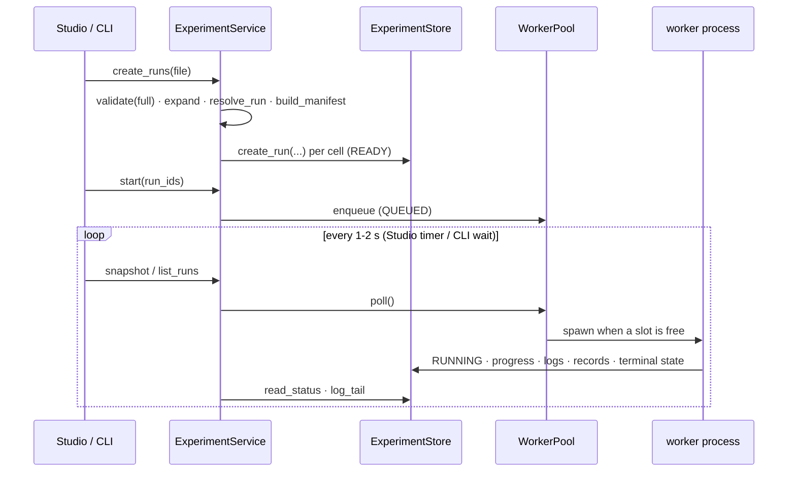

# 03. Experiment layer

> `src_thesis/experiments/`: from one experiment file to runs, run folders and worker processes. The application layer (04) calls it; it calls MARLEM only through the environment factory.
> Master: [README.md](README.md) · Experiment file: [02-experiment-config.md](02-experiment-config.md) · Services: [04-application-layer.md](04-application-layer.md) · Decisions: D-08, D-09 · Functions: docstrings in [the code](../../../src_thesis/experiments/), shown in the API Reference · State: [implementation-status.md](implementation-status.md).

<!-- BEGIN toc (python docs_thesis/toc.py) -->
## Contents

- [1. Purpose](#1-purpose)
- [2. At a glance](#2-at-a-glance)
- [3. Structure in code](#3-structure-in-code)
- [4. Rules](#4-rules)
- [5. Run lifecycle](#5-run-lifecycle)
- [6. The run folder](#6-the-run-folder)
- [7. What makes a run reproducible](#7-what-makes-a-run-reproducible)
- [8. Tests](#8-tests)

<!-- END toc -->

## 1. Purpose

A study is described by one experiment file (02), but what actually executes is a set of **runs**: one per sweep point × algorithm × paradigm × seed, plus the baselines. This layer turns the file into that list, gives every run a folder on disk with everything needed to reproduce it, executes each run in its own process so training can never freeze or kill the Studio, and keeps the record of what happened. The services (04) are its only callers.

[↑ Contents](#contents)

## 2. At a glance



The run folder is the source of truth: the Studio only reads it and asks for changes (start, cancel); the worker writes it while it runs.

[↑ Contents](#contents)

## 3. Structure in code

<!-- BEGIN generated:graph experiments -->

<!-- END generated:graph -->

Arrows are imports: who uses whom. Dashed arrows go to `models/records`, the record types nearly every file uses. Generated from the code by `docs_thesis/graphs.py`.

| Part | Files | What it is for |
|---|---|---|
| `models/` | `records`, `files`, `expand`, `resolve`, `manifest` | The data (experiment file, run cell, run state, manifest) and pure functions over it: load and save, expand into runs, fill defaults, fingerprint a run |
| `store/` | `filesystem`, `recorder` | The run folders on disk and the per-step records written into them |
| `factory/` | `environment`, `training` | The only place that turns a file into a live environment and an RLlib configuration |
| `worker/` | `pool`, `process`, `runner`, `__main__` | Starting runs as processes (pool), executing one run (process), and the work per kind of run (runner) |

What each function does, and why each module exists, is in the module docstrings, shown in the API Reference.

[↑ Contents](#contents)

## 4. Rules

- **Callers.** Only the application layer imports `experiments/`; `experiments/` never imports `application/` or `studio/` (tested).
- **Light imports.** Importing any module loads no heavy package (Ray, torch, pandapower, NiceGUI); heavy imports happen inside the functions that need them (tested).
- **One factory.** Only `factory/` builds live MARLEM objects. RLlib env runners call it inside each runner; a network or agents never travel in `env_config`.
- **Fixed inputs, live status.** What a run was built from (`resolved.json`, `manifest.json`) is written once and never changed; the worker refuses a run whose resolved file no longer matches its manifest hash. Only `status.json` changes while it runs.
- **One writer of the state.** Runners report progress but never set the final state; the worker process does, through the store, which enforces the lifecycle (§5).
- **Outcomes apart from reward.** Learning metrics and research outcomes are stored in separate files, so results never present reward as a proxy for outcomes.

[↑ Contents](#contents)

## 5. Run lifecycle



Any non-terminal state may go to FAILED; terminal states are final. Invalid files never produce runs: validation happens before `create_run`. After a restart, `reconcile` marks runs whose worker process is gone as FAILED.



The pool lives in the process that owns `ExperimentService` and is polled, not threaded. One run at a time by default, because one RLlib run already uses every core. Closing the Studio never stops a worker.

[↑ Contents](#contents)

## 6. The run folder

```text
<workspace>/store/                         # outside OneDrive (04 §6)
├── index.json                             # cache; rebuilt from the folders
└── runs/<run_id>/                         # <meta.id>__<sweep>__<algo>-<paradigm>__s<seed>__<hash8>
    ├── experiment.json  resolved.json  manifest.json    # fixed inputs (written once)
    ├── status.json  artifacts.json  cancel.request?     # live state
    ├── logs/        worker.log, worker.stdout
    ├── metrics/     training.csv (RL learning), evaluation.jsonl (research outcomes)
    ├── raw/         steps.jsonl (per step, if outputs.record_steps asks)
    ├── checkpoints/
    └── figures/     (derived; regenerable)
```

Plain folders instead of a database: a run can be opened, copied, zipped and shared, and a crashed worker leaves readable files. Small state files are replaced atomically; streams are append-only, so they stay valid up to the last complete line.

[↑ Contents](#contents)

## 7. What makes a run reproducible

- **`resolved.json`:** the experiment file with every default filled in and the run's cell fixed. If a default changes in the code later, the run still records what it used.
- **`manifest.json`:** the run's receipt: both file hashes, the train and evaluation days, and fingerprints of the code (git commit and uncommitted diff), the environment (package versions) and the data (sha256 of every referenced file). It is what lets a run be rerun exactly, and two runs be refused for comparison when they differ unintentionally.
- **The canonical hash** identifies "the same study" regardless of formatting; it is the last part of every run ID.

[↑ Contents](#contents)

## 8. Tests

[tests/test_experiments.py](../../../tests/test_experiments.py) covers every part with a no-op runner: hash stability, expansion counts and run IDs, defaults and the day split, the store's state machine and cancel flag, the recorder modes, the worker (completion, an edited `resolved.json`, cancel, runner errors) and the pool with real subprocesses, including `reconcile`.

[↑ Contents](#contents)
