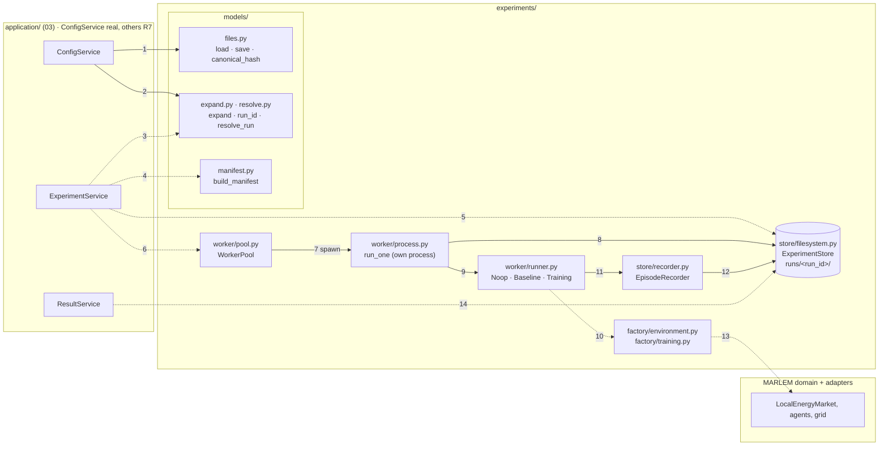
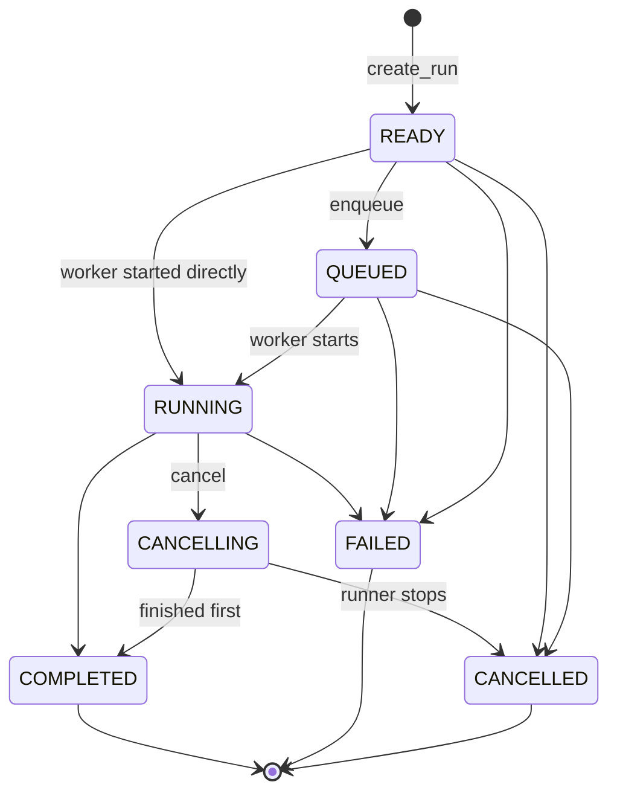
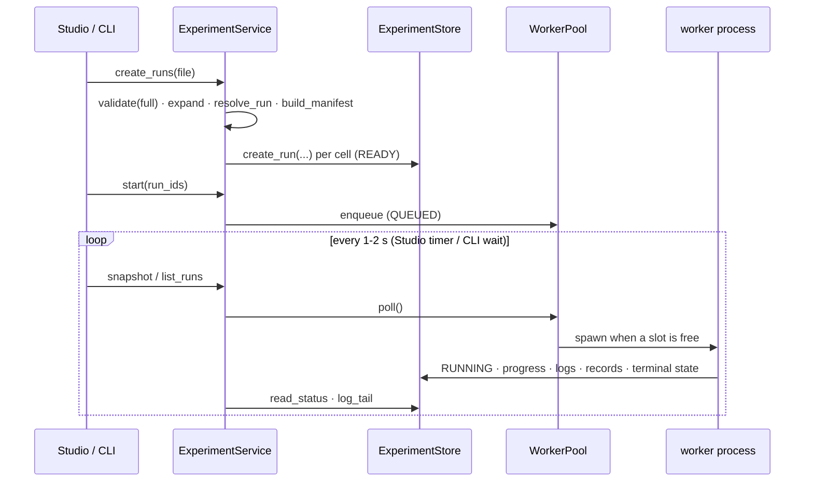

# 05. Experiment layer

> `src_thesis/experiments/`: from an experiment file to runs, run folders and worker processes. The application services (03) call it; it calls MARLEM only through the environment factory.
> Master: [README.md](README.md) · Experiment file: [02-experiment-config.md](02-experiment-config.md) · Services: [03-application-layer.md](03-application-layer.md) · Decisions: D-08, D-09, D-14.
> Written 2026-09-27. Code: [experiments/](../../../src_thesis/experiments/) · Tests: [tests/test_experiments.py](../../../tests/test_experiments.py).

<!-- BEGIN toc (python docs_thesis/toc.py) -->
## Contents

- [1. Place in the system and status](#1-place-in-the-system-and-status)
- [2. Records (models/records.py)](#2-records-modelsrecordspy)
- [3. Functions](#3-functions)
  - [3.1 Files (models/files.py)](#31-files-modelsfilespy)
  - [3.2 Runs of a file (models/expand.py)](#32-runs-of-a-file-modelsexpandpy)
  - [3.3 Resolution (models/resolve.py)](#33-resolution-modelsresolvepy)
  - [3.4 Manifest (models/manifest.py)](#34-manifest-modelsmanifestpy)
  - [3.5 Store (store/filesystem.py)](#35-store-storefilesystempy)
  - [3.6 Step records (store/recorder.py)](#36-step-records-storerecorderpy)
  - [3.7 Environment factory (factory/environment.py)](#37-environment-factory-factoryenvironmentpy)
  - [3.8 RL configuration (factory/training.py)](#38-rl-configuration-factorytrainingpy)
  - [3.9 Runners (worker/runner.py)](#39-runners-workerrunnerpy)
  - [3.10 Worker (worker/process.py)](#310-worker-workerprocesspy)
  - [3.11 Pool (worker/pool.py)](#311-pool-workerpoolpy)
- [4. Run lifecycle](#4-run-lifecycle)
- [5. How the services use it](#5-how-the-services-use-it)
- [6. Tests (tests/test_experiments.py)](#6-tests-teststest_experimentspy)

<!-- END toc -->

## 1. Place in the system and status



Solid arrows are implemented and tested; dashed arrows are the planned calls (the services other than `ConfigService` are demo implementations until R7, `build_env` waits for R1 / R4, training for stage D). Each number is one call in the table below.

| # | Business step | Call (caller → callee) | State |
|---|---|---|---|
| 1 | Open, edit and save an experiment file | [`ConfigService`](03-application-layer.md#21-configservice-experiment-files) → [`files.load`](../../../src_thesis/experiments/models/files.py#L41) / [`save`](../../../src_thesis/experiments/models/files.py#L65) / [`canonical_hash`](../../../src_thesis/experiments/models/files.py#L75) / [`json_schema`](../../../src_thesis/experiments/models/files.py#L80) | implemented (`FileConfigService`) |
| 2 | Preview what a file will run | `ConfigService.resolve` / `expand` → [`resolve.resolve`](../../../src_thesis/experiments/models/resolve.py#L122), [`expand.expand`](../../../src_thesis/experiments/models/expand.py#L67) | implemented (`FileConfigService`) |
| 3 | Turn a file into runs | [`ExperimentService.create_runs`](03-application-layer.md#25-experimentservice-runs) → [`expand`](../../../src_thesis/experiments/models/expand.py#L67), then per cell [`resolve_run`](../../../src_thesis/experiments/models/resolve.py#L138) and [`run_id`](../../../src_thesis/experiments/models/expand.py#L101) | planned (R7) |
| 4 | Pin what each run was built from | `create_runs` → [`build_manifest`](../../../src_thesis/experiments/models/manifest.py#L24) (code, environment and data fingerprints) | planned (R7) |
| 5 | Create the run folder (state READY) | `create_runs` → [`ExperimentStore.create_run`](../../../src_thesis/experiments/store/filesystem.py#L58) writes `resolved.json`, `manifest.json`, `status.json` | planned (R7) |
| 6 | Start, watch, cancel runs | `ExperimentService.start` / `snapshot` / `cancel` → [`WorkerPool.enqueue`](../../../src_thesis/experiments/worker/pool.py#L80) / [`poll`](../../../src_thesis/experiments/worker/pool.py#L85) / [`cancel`](../../../src_thesis/experiments/worker/pool.py#L106); after a restart [`reconcile`](../../../src_thesis/experiments/worker/pool.py#L62) | planned (R7) |
| 7 | One subprocess per run | [`spawn`](../../../src_thesis/experiments/worker/pool.py#L23) starts `python -m src_thesis.experiments.worker <run_dir>` → [`__main__.py`](../../../src_thesis/experiments/worker/__main__.py) → [`process.main`](../../../src_thesis/experiments/worker/process.py#L74) → [`run_one`](../../../src_thesis/experiments/worker/process.py#L24) | implemented |
| 8 | The run's state and log | `run_one` → [`read_manifest`](../../../src_thesis/experiments/store/filesystem.py#L89), [`read_resolved`](../../../src_thesis/experiments/store/filesystem.py#L86), [`set_state`](../../../src_thesis/experiments/store/filesystem.py#L100) (RUNNING, then COMPLETED / FAILED / CANCELLED), [`append_log`](../../../src_thesis/experiments/store/filesystem.py#L169), [`write_artifacts`](../../../src_thesis/experiments/store/filesystem.py#L208) | implemented |
| 9 | Do the work for this kind of run | `run_one` → [`select_runner(cell)`](../../../src_thesis/experiments/worker/runner.py#L100)`.run(ctx)`; the [`RunContext`](../../../src_thesis/experiments/worker/runner.py#L20) gives the runner `should_stop`, `report` (progress) and `log` on the store | implemented (noop runner) |
| 10 | Build the environment and the RL configuration | runner → [`build_env_config`](../../../src_thesis/experiments/factory/environment.py#L24) → [`build_env`](../../../src_thesis/experiments/factory/environment.py#L39); [`build_algorithm_config`](../../../src_thesis/experiments/factory/training.py#L18) | `build_env_config` implemented; the rest after R1 / R4 / stage D |
| 11 | Record every step of an episode | runner → [`ctx.recorder()`](../../../src_thesis/experiments/worker/runner.py#L42) → [`EpisodeRecorder.start_episode`](../../../src_thesis/experiments/store/recorder.py#L52) / [`record`](../../../src_thesis/experiments/store/recorder.py#L56) / [`end_episode`](../../../src_thesis/experiments/store/recorder.py#L62) | implemented |
| 12 | Persist the step records | `end_episode` → [`append_jsonl`](../../../src_thesis/experiments/store/filesystem.py#L192) to `raw/steps.jsonl` | implemented |
| 13 | Live MARLEM objects | `build_env` → `LocalEnergyMarket`, agents; [`build_grid`](../../../src_thesis/experiments/factory/environment.py#L55) → the pandapower `GridModel` | after R1 / R4 |
| 14 | Read results | [`ResultService`](03-application-layer.md#26-resultservice-reading-results) → [`read_manifest`](../../../src_thesis/experiments/store/filesystem.py#L89), [`read_status`](../../../src_thesis/experiments/store/filesystem.py#L95), [`read_jsonl`](../../../src_thesis/experiments/store/filesystem.py#L200), [`log_tail`](../../../src_thesis/experiments/store/filesystem.py#L175) | planned (R7) |

The full list of service → experiment-layer calls is in [03 §4](03-application-layer.md#4-what-each-real-service-calls); the functions themselves are in §3 below.

Rules:
- `experiments/` never imports `application/` or `studio/`. The application layer imports `experiments/` and re-exports its models (`ExperimentFile`, `RunCell`, `RunState`) so callers keep one import path.
- Importing any module of `experiments/` loads no heavy package (Ray, torch, pandapower, simbench, NiceGUI). Heavy imports happen inside the functions that need them. A test checks this.
- Only the factory turns a file into live MARLEM objects; only the worker runs them.

| Module | What it is for | Status (2026-09-27) |
|---|---|---|
| [models/records.py](../../../src_thesis/experiments/models/records.py) | The shapes of the data that move through the layer: the file a user writes, one unit of work, its state, and what gets written per run | Implemented |
| [models/files.py](../../../src_thesis/experiments/models/files.py) | Reading and writing experiment files safely, and a fingerprint (hash) that says whether two files describe the same study | Implemented |
| [models/expand.py](../../../src_thesis/experiments/models/expand.py) | Turning one file into the list of runs it asks for (e.g. the 3 × 3 matrix × seeds), each with a readable, unique name | Implemented |
| [models/resolve.py](../../../src_thesis/experiments/models/resolve.py) | Filling in every value the user left out, so each run is fully specified; choosing the training and evaluation days | Implemented; placement rules need the network (R3) |
| [models/manifest.py](../../../src_thesis/experiments/models/manifest.py) | A receipt per run: exactly which code, package versions, input data and machine produced it, so a result can be traced and rerun | Implemented |
| [store/filesystem.py](../../../src_thesis/experiments/store/filesystem.py) | The on-disk home of every run: one folder per run with its inputs, state, logs and outputs | Implemented |
| [store/recorder.py](../../../src_thesis/experiments/store/recorder.py) | Writing what happened in each step of an episode, for replay and for the research outcomes | Implemented; `StepRecord` fields fixed once the environment exists (R1, R4) |
| [factory/environment.py](../../../src_thesis/experiments/factory/environment.py) | The one place that turns a file into a live MARLEM environment | `build_env_config` implemented; `build_env`, `build_grid` wait for R1 / R4 |
| [factory/training.py](../../../src_thesis/experiments/factory/training.py) | The one place that turns the file's `learning` section into an RLlib configuration | Interface only (validation stage D) |
| [worker/runner.py](../../../src_thesis/experiments/worker/runner.py) | What a run actually does, per kind: nothing (test), a scripted baseline, or RL training | Noop implemented; baseline and training wait for the factory |
| [worker/process.py](../../../src_thesis/experiments/worker/process.py) | The separate process that executes one run from its folder | Implemented |
| [worker/pool.py](../../../src_thesis/experiments/worker/pool.py) | Starting, limiting, watching and cancelling those processes from the Studio or CLI | Implemented |

The package has four parts, as in the layer diagram (README §2.1):

```text
experiments/
├── models/    records.py · files.py · expand.py · resolve.py · manifest.py
├── factory/   environment.py · training.py
├── store/     filesystem.py · recorder.py
└── worker/    runner.py · process.py · pool.py · __main__.py
```

The four earlier stubs (`factory_new.py`, `runner_new.py`, `store_new.py`, `worker_new.py`) were replaced by these modules.

[↑ Contents](#contents)

## 2. Records (models/records.py)

Code: [models/records.py](../../../src_thesis/experiments/models/records.py)

**Why:** every other module passes these around, so they are defined once, as Pydantic models that validate themselves. The split matters: what the user writes (`ExperimentFile`), what the system fixes once per run (`Manifest`) and what keeps changing while it runs (`StatusRecord`) are separate records, so the fixed parts can never be overwritten by a running worker.

| Record | Why it exists | Fields | Written by | Notes |
|---|---|---|---|---|
| `ExperimentFile` | The only input a user writes or shares; everything a study needs is in it (D-08) | `schema_version`, `kind`, `meta` (`ExperimentMeta`), `time`, `grid`, `participants`, `market`, `dso`, `environment`, `learning`, `evaluation`, `baselines`, `sweep`, `resources`, `outputs` | the user / the Studio | Sections are dicts until each gets its typed model (02) |
| `RunCell` | One unit of work (one algorithm × paradigm × seed at one sweep point); it is what makes one run different from its siblings | `kind` (`train` · `baseline` · `noop`), `sweep_label`, `sweep_point`, `algorithm`, `paradigm`, `seed` | `expand` | For baselines `algorithm` is the baseline name and `paradigm` is `"-"` |
| `RunState` | An explicit lifecycle, so the Studio, the pool and the worker agree on what a run is doing and illegal jumps (e.g. a finished run restarting) are rejected | `READY`, `QUEUED`, `RUNNING`, `COMPLETED`, `FAILED`, `CANCELLING`, `CANCELLED` | — | Transitions in §4 (`TRANSITIONS`, `can_transition`) |
| `Manifest` | The run's receipt (§3.4): written once, never changed, so a result can always be traced to what produced it | `run_id`, `experiment_id`, `cell`, `created`, `file_hash`, `resolved_hash`, `code`, `environment`, `data`, `days`, `time_alignment`, `validation_hash`, `platform` | `build_manifest`, once | Never changed after creation (02 §5) |
| `StatusRecord` | The live, changing part of a run (state, progress, last metrics) that the Studio polls | `run_id`, `experiment_id`, `state`, `pid`, `created`, `started`, `updated`, `finished`, `progress`, `iteration`, `last_metrics`, `message` | store (worker, pool) | `status.json`, replaced atomically |
| `ArtifactIndex` | A list of the files a run produced, so results code finds checkpoints and figures without guessing paths | `files`: name → path in the run folder | worker | `artifacts.json` |

[↑ Contents](#contents)

## 3. Functions

### 3.1 Files (models/files.py)

Code: [models/files.py](../../../src_thesis/experiments/models/files.py)

**Why:** the experiment file is the product people share, so reading and writing it must never corrupt it, old files must stay loadable, and "is this the same study?" needs a precise answer. That answer is the canonical hash, which the run ID and the manifest are built on.

| Function | Input → output | Why it is there | Notes |
|---|---|---|---|
| `parse(text)` | JSON text → `ExperimentFile` | Single entry point that upgrades and validates, so no code ever sees an unchecked file | Migrates, then validates |
| `load(path)` | path → `ExperimentFile` | Convenience around `parse` | |
| `dumps(file)` | → str | Files are read and diffed by people, so field order and indentation stay readable | Pretty JSON in field order |
| `save(file, path)` | → `Path` | Saving must not leave a half-written file | Atomic |
| `canonical_json(file_or_dict)` / `canonical_hash(...)` | → str | Two files that differ only in formatting or key order are the same study and must get the same hash; the hash goes into run IDs and the manifest | Sorted keys, compact; sha256 (02 §6) |
| `migrate(data)` | raw dict → raw dict at `SCHEMA_VERSION` | Files written today must still load after the format changes. Matters only once a second schema version exists | Steps through `MIGRATIONS`; unknown versions raise |
| `json_schema()` | → dict | Lets VS Code autocomplete and check a hand-edited file. Convenience | For editor autocompletion |
| `atomic_write_text(path, text)` | → `Path` | A crash, OneDrive sync or a reader mid-write never sees a partial file; used for every small state file | Temp file in the same folder, then `os.replace` |

### 3.2 Runs of a file (models/expand.py)

Code: [models/expand.py](../../../src_thesis/experiments/models/expand.py)

**Why:** one file describes many runs (e.g. 3 paradigms × 3 algorithms × 3 seeds, possibly times a sweep of six market mechanisms). This module turns that description into the explicit list, so the count is visible before anything starts and every run can be named.

| Function | Input → output | Why it is there | Notes |
|---|---|---|---|
| `sweep_points(file)` | → `[SweepPoint(label, overrides)]` | A sweep (e.g. Case 1's mechanisms) is "the same study with one value changed"; this lists those variants | `grid` = Cartesian product, `zip` = paired lists; no sweep = one empty point |
| `apply_overrides(file, overrides)` | dotted path → value → new `ExperimentFile` | Produces each variant as a normal file, so everything downstream handles swept and unswept runs the same way | E.g. `{"market.mechanism": "buyer"}` |
| `expand(file)` | → `[RunCell]` | The full work list, including the baselines that learned policies are compared against | Sweep points × paradigms × algorithms × seeds, plus sweep points × baselines × seeds |
| `run_id(experiment_id, cell, file_hash)` | → str | A folder name a person can read ("which run is this?") that still cannot collide: the hash suffix changes when the file changes | `<meta.id>__<sweep-label>__<algo>-<paradigm>__s<seed>__<hash8>`; baselines use their name instead of `algo-paradigm` |

### 3.3 Resolution (models/resolve.py)

Code: [models/resolve.py](../../../src_thesis/experiments/models/resolve.py)

**Why:** users write short files and leave most values at their defaults. A run must not depend on what the defaults happen to be later, so each run stores a fully filled-in copy (`resolved.json`). If a default changes in the code, old runs still say exactly what they used.

| Function | Input → output | Why it is there | Notes |
|---|---|---|---|
| `resolve(file)` | → `ExperimentFile` | Makes every value explicit; also what the Studio shows as "effective settings" | Fills every unset field from `DEFAULTS` (02 §3); set values win. Placement rules raise until R3 |
| `resolve_run(file, cell)` | → `ExperimentFile` | The exact input of one run: this sweep point, this algorithm, paradigm and seed, nothing else | Applies the sweep point, resolves, fixes `learning` to the cell. Stored as `resolved.json` |
| `resolve_days(time_section)` | → `DaySplit(train, eval)` | Evaluation must use days the agents never trained on; the original evaluated on its training day (I-72). The split is seeded so every run of a study gets the same days | `fixed`: the same date for both. `range` / `sampler`: filters (season, months, day type), then a seeded hold-out share or list for evaluation, disjoint from training |

### 3.4 Manifest (models/manifest.py)

Code: [models/manifest.py](../../../src_thesis/experiments/models/manifest.py)

**Why:** a result is only useful if you can say what produced it. Months later, "PPO under CTDE scored X" raises questions the experiment file alone cannot answer: which version of the code ran, was it committed, which Ray and torch versions (RLlib defaults change between versions), were the tariff CSVs the same, which days were actually drawn? The manifest answers those once, when the run is created, and is never edited. It is what lets you (a) rerun a run exactly, (b) refuse to compare two runs that differ in something you did not intend, and (c) state in the thesis what the numbers came from.

A **fingerprint** here means a short record that changes whenever the thing it describes changes: a git commit ID, a package version, or a sha256 hash of a file's bytes.

| Function | Input → output | Why it is there | Notes |
|---|---|---|---|
| `build_manifest(file, resolved, cell, run_id, validation_hash=None)` | → `Manifest` | Collects everything below plus the two file hashes (as written and as resolved) and the day lists into one record, written with the run folder | The worker refuses to run if `resolved.json` no longer matches `resolved_hash` (§3.10) |
| `code_fingerprint()` | → `{commit, dirty, diff_sha256}` | Which code ran. The commit alone is not enough while you work with uncommitted changes, so `dirty` flags them and the diff hash tells two dirty states apart | From git; `None` outside a repository |
| `environment_fingerprint()` | → `{python, packages}` | Which library versions ran. Unset hyperparameters fall back to RLlib's defaults, which change between Ray versions, so results can shift without any change in your code | Versions of ray, torch, pandapower, simbench, pydantic, numpy, gymnasium; read from package metadata without importing them |
| `data_fingerprint(resolved)` | → `{network, files}` | Which input data ran. A CSV edited in place has the same path but different content; its sha256 exposes that | sha256 of every `path` the world names (CSVs, pandapower files) plus the network source |
| *(inline)* `platform` | OS, release, machine, CPU | Explains timing differences between machines and rare numeric differences. Nice to have; the least important field | In `build_manifest` |

### 3.5 Store (store/filesystem.py)

Code: [store/filesystem.py](../../../src_thesis/experiments/store/filesystem.py)

**Why:** runs outlive the process that started them, so their state has to live somewhere durable. Plain folders were chosen over a database: you can open, copy, zip and share a run folder, a crashed worker leaves readable files, and nothing needs to be installed. Everyone (services, worker, pool) goes through this one class, so the folder layout is defined in exactly one place.

```text
<store>/                                  # configurable; default outside OneDrive
├── index.json                            # cache; rebuild_index() rewrites it
└── runs/<run_id>/
    ├── experiment.json  resolved.json  manifest.json
    ├── status.json  artifacts.json  cancel.request?
    ├── logs/        worker.log, worker.stdout
    ├── metrics/     training.csv, evaluation.jsonl
    ├── raw/         steps.jsonl (per step, if outputs.record_steps asks)
    ├── checkpoints/
    └── figures/     (derived; regenerable)
```

| Method of `ExperimentStore(root)` | Input → output | Why it is there | Notes |
|---|---|---|---|
| `run_dir(run_id)` / `exists(run_id)` | → `Path` / bool | Callers never build paths themselves | |
| `create_run(file, resolved, manifest)` | → `Path` | Creates a run with all its inputs in one go, and refuses to overwrite an existing run (and its results) | State READY; raises `RunExistsError` |
| `read_file` / `read_resolved` / `read_manifest(run_id)` | → records | Typed access to a run's fixed inputs (worker, results) | |
| `read_status(run_id)` | → `StatusRecord` | What the Studio polls | |
| `set_state(run_id, state, **fields)` | → `StatusRecord` | The only way to change a run's state, so the state machine (§4) is enforced in one place; a late or stale worker cannot mark a finished run as running | `IllegalTransitionError`; stamps `started` / `finished` |
| `update_progress(run_id, progress, iteration, metrics)` | → `StatusRecord` | Progress bars and "last metrics" in the Runs page | Progress clipped to 0..1 |
| `list_runs(experiment_id, state)` | → `[StatusRecord]` | The Runs page and the Compare matrix need all runs of an experiment | Scans folders, oldest first |
| `rebuild_index()` | → dict | A cached overview for fast listing when there are many runs. The folders stay the truth, so the cache can always be rebuilt. Convenience | |
| `request_cancel(run_id)` / `cancel_requested(run_id)` | → None / bool | The worker is another process; a marker file is the simplest cancel signal that works the same on Windows and Linux | The `cancel.request` file |
| `append_log(run_id, line)` / `log_tail(run_id, lines)` | → None / `[str]` | A per-run log you can read after a crash; the tail is the Studio's live log | Timestamped |
| `append_metrics_row(run_id, name, row)` | → None | Learning curves as CSV, readable in any tool | The first row fixes the header |
| `append_jsonl` / `read_jsonl(run_id, relative_path, …)` | → None / iterator | Append-only streams (step records, evaluation outcomes) that stay valid up to the last complete line even if a run dies | |
| `write_artifacts(run_id, files)` / `read_artifacts(run_id)` | → `ArtifactIndex` | Records which output files exist (checkpoints, figures) | Merges names |

Small state files are replaced atomically; streams are append-only. RL learning metrics (`metrics/training.csv`, RLlib's own files) and research outcomes (`metrics/evaluation.jsonl`: served and unmet demand, curtailment, P2P share, costs, violations, losses) are stored apart, so results never present reward as a proxy for outcomes.

### 3.6 Step records (store/recorder.py)

Code: [store/recorder.py](../../../src_thesis/experiments/store/recorder.py)

**Why:** the reward is not the result. To judge a policy you need what actually happened (orders, trades, settlement, grid state) step by step, both for the Results page's episode replay and for outcome metrics. Building one record per step and deriving reward, observation, `info` and logs from it means they can never disagree with each other. Buffering per episode keeps disk writes to one per episode, and the `mode` keeps disk use small (by default only evaluation episodes are kept).

`StepRecord(episode, step, day, orders, trades, settlement, assessment, kpis, reward_components, rewards)` is built once per step by the environment, after settlement and the power flow; it is the single source for reward, observation, `info` and logging.

| Method of `EpisodeRecorder(store, run_id, mode)` | Input → output | Why it is there | Notes |
|---|---|---|---|
| `start_episode(episode, day, evaluation)` | → None | Knows whether this episode should be kept at all | |
| `record(step_record)` | → None | Called every step; cheap because it only buffers | Buffered only if `mode` keeps this episode (`all`, or `evaluation` and an evaluation episode) |
| `end_episode(outcomes)` | → None | One write per episode; evaluation episodes also give one outcome line for the results tables | Appends the buffered steps to `raw/steps.jsonl`; outcomes to `metrics/evaluation.jsonl` |

During RLlib training the environment runs inside env-runner processes, so the recorder is driven from an RLlib callback (`on_episode_step` / `on_episode_end`) in `factory/training.py`; episode-level outcomes also go to RLlib's custom metrics so they appear next to the return in `progress.csv`.

### 3.7 Environment factory (factory/environment.py)

Code: [factory/environment.py](../../../src_thesis/experiments/factory/environment.py)

**Why:** in the original, the environment was assembled inside `marl/train.py` and the notebooks, each with its own hard-coded values. Here there is exactly one function that builds an environment from a file, used by the worker, the dry run, notebooks, tests and every RLlib env runner. So whatever runs is exactly what the file says, and the same file always gives the same environment.

| Function | Input → output | Why it is there | Notes |
|---|---|---|---|
| `build_env_config(resolved, cell, episode_seed)` | → dict | RLlib copies `env_config` into every env-runner process, so it must be small, plain data; it carries the file, not the built objects | The resolved file, the cell, the seed (key `ENV_CONFIG_KEY`) |
| `build_env(env_config)` | → `LocalEnergyMarket` | Called inside each process to build its own environment from that plain data | Day from the day list → profiles (01 §3) → agents, batteries, DSO, `MarketConfig` → grid model → observation, reward, reputation, assessment mode. **R1 / R4** |
| `build_grid(resolved)` | → `GridModel` | Separate so the grid can be built and tested on its own, and so the market gets its grid only through the contract (D-13) | `SimBenchGrid` for `grid.source` (01 §5). **R4** |

RLlib env runners call the factory inside each runner; a network or agents never travel in `env_config`.

### 3.8 RL configuration (factory/training.py)

Code: [factory/training.py](../../../src_thesis/experiments/factory/training.py)

**Why:** the original hard-coded the PPO, APPO and SAC settings in `marl/train.py` and always switched PBT on (I-62). Building the RLlib configuration from the file's `learning` section makes every hyperparameter visible, editable, stored in `resolved.json` and equal across cells when it should be (I-49, I-50).

| Function | Input → output | Why it is there | Notes |
|---|---|---|---|
| `build_algorithm_config(resolved, cell)` | → RLlib `AlgorithmConfig` | One algorithm × paradigm cell as RLlib needs it | Algorithm parameters, paradigm module, rollouts, evaluation, checkpoints (02 §3.8–3.9). **Stage D** |
| `build_tuner_settings(resolved)` | → dict | Whether and how Ray Tune runs (PBT or not), and when to stop | Scheduler (`none` / PBT), stop criterion from `budget`, checkpoint settings. **Stage D** |

### 3.9 Runners (worker/runner.py)

Code: [worker/runner.py](../../../src_thesis/experiments/worker/runner.py)

**Why:** the worker process (§3.10) is the same for every run; only the actual work differs. Runners hold that work, one per kind of run. They get a `RunContext` instead of the store, so they can report progress, log and check for cancel, but never set the run's final state; the worker decides that, in one place.

`RunContext(store, run_id, resolved, manifest)` is what a runner sees: `cell`, `should_stop()` (cancel requested), `report(progress, iteration, metrics)`, `log(message)` and `recorder()`. A runner returns `RunOutcome(state, message, artifacts)` and never writes `status.json` itself.

| Runner (`RUNNERS[cell.kind]`) | Why it is there | Does | Status |
|---|---|---|---|
| `NoopRunner` (`noop`) | Tests the whole pipeline (store, worker, pool, cancel) in seconds, without MARLEM or Ray | A few iterations that report progress and honour cancel | Implemented |
| `BaselineRunner` (`baseline`) | Learned policies only mean something next to simple reference policies ([P1] §4.2) | Scripted policies (`no_order`, `random`, `rule_based`, 02 §3.10) over the evaluation days, through `build_env` and `marl/baselines.py` | Waits for R1 / R4 |
| `TrainingRunner` (`train`) | The actual RL experiment | RLlib training with evaluation; owns `ray.init` / `ray.shutdown` | Stage D |

### 3.10 Worker (worker/process.py)

Code: [worker/process.py](../../../src_thesis/experiments/worker/process.py)

**Why:** training runs for hours and Ray/torch can crash or leak memory. In its own process a run cannot freeze or kill the Studio, keeps running when the browser or Studio closes (D-09), and a crash only fails that one run. The worker only needs the run folder, so the same command works from the Studio, the CLI or by hand.

`python -m src_thesis.experiments.worker --run-dir <store>/runs/<run_id>` → `main(argv)` → `run_one(run_dir)`:

1. read the manifest and `resolved.json`; a hash mismatch ends in FAILED (the file was edited after the manifest, so the receipt would lie);
2. a cancel requested before start ends in CANCELLED;
3. set RUNNING with the process ID (so the pool can later check whether it is still alive);
4. run `select_runner(cell)` with a `RunContext`;
5. any exception ends in FAILED, with the traceback in `logs/worker.log`;
6. shut Ray down if a runner started it (`finally`);
7. write the artifact index and the terminal state.

Exit code 0 for COMPLETED or CANCELLED, 1 otherwise.

### 3.11 Pool (worker/pool.py)

Code: [worker/pool.py](../../../src_thesis/experiments/worker/pool.py)

**Why:** something has to start the worker processes, keep only as many running as the machine can take (one RLlib run already uses every core), notice processes that died, and pass on cancel requests. It lives in the process that owns `ExperimentService` (Studio or CLI) and is **polled** by the Studio's timer instead of running its own thread, which keeps it free of thread-safety issues. Closing the Studio never stops a worker.

| Function / method | Input → output | Why it is there | Notes |
|---|---|---|---|
| `spawn(run_dir)` | → `Popen` | Starts a worker detached from the Studio, so Ctrl+C or closing the Studio does not kill it | Own process group on Windows (own session elsewhere); output to `logs/worker.stdout` |
| `WorkerPool(store, max_parallel)` | | Holds the queue and the running processes | `max_parallel` defaults to 1, because Ray runners already use the cores |
| `.enqueue(run_ids)` | → None | "Start these when there is room" | State QUEUED |
| `.poll()` | → `{run_id: RunState}` | The heartbeat: notices finished or dead workers and starts the next queued run | A worker that died without a terminal state → FAILED |
| `.cancel(run_id, force_after_s)` | → None | Lets a run stop cleanly (save, shut Ray down) before it is killed | Queued: CANCELLED at once. Running: `cancel.request` + CANCELLING; optional kill after a timeout |
| `.wait_all(timeout_s)` | → None | The CLI and tests have no timer; they block until all runs finish | Poll until idle |
| `reconcile(store)` | → `[run_id]` | After a Studio restart or reboot, runs whose worker is gone would otherwise show RUNNING forever | On start-up: RUNNING / CANCELLING runs whose process is gone → FAILED |
| `pid_alive(pid)` | → bool | Checks whether a worker still exists. On Windows `os.kill(pid, 0)` is not a check (signal 0 there sends a Ctrl+C event), hence the separate Windows path | Windows: `OpenProcess` + `GetExitCodeProcess`; elsewhere `os.kill(pid, 0)` |

[↑ Contents](#contents)

## 4. Run lifecycle



Any non-terminal state may go to FAILED; terminal states are final. Invalid files never produce runs: validation happens before `create_run`.



[↑ Contents](#contents)

## 5. How the services use it

The application services are the only callers of this layer. Which service method calls which function here is listed once, from the services' side, in [03 §4](03-application-layer.md#4-what-each-real-service-calls). The services are still the demo implementations; wiring them to this layer is the next step of R7.

[↑ Contents](#contents)

## 6. Tests ([tests/test_experiments.py](../../../tests/test_experiments.py))

- Files: hash stable under reformatting and key order; save/load round trip; unknown schema version rejected.
- Expansion: 3 × 3 × 3 seeds = 27 cells; baselines add sweep points × baselines × seeds; a 5-mechanism sweep multiplies by 5; run-ID format.
- Resolution: defaults filled without overriding given values; the cell fixed in `learning`; the day sampler deterministic, filtered and disjoint.
- Store: state machine enforced, cancel flag, listing and index.
- Recorder: only evaluation episodes are written in `evaluation` mode.
- Worker: noop run completes; an edited `resolved.json` fails; cancel before start; a runner error ends in FAILED with its message.
- Pool: two runs as real subprocesses, one slot; `reconcile` marks a dead worker FAILED.
- Boundaries: importing the worker and pool loads no heavy package.

[↑ Contents](#contents)
