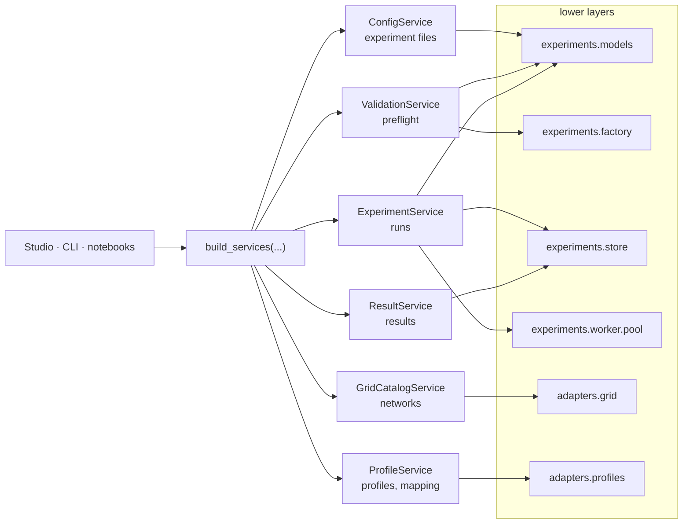
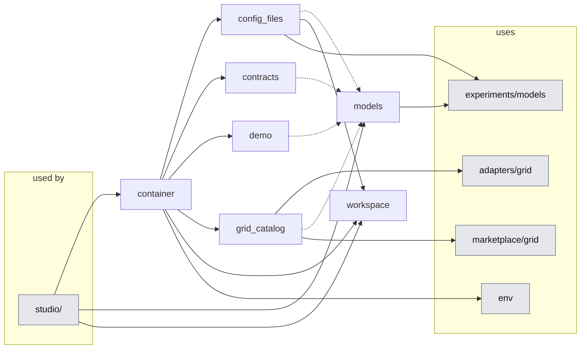

# 04. Application layer

> `src_thesis/application/`: the services that the Studio, the CLI and notebooks call. They hide MARLEM, the experiment layer and the adapters behind typed, plain-data methods.
> Master: [README.md](README.md) · Experiment layer: [03-experiment-layer.md](03-experiment-layer.md) · Presentation: [05-presentation.md](05-presentation.md) · Decisions: D-09, D-13 · Functions: docstrings in [the code](../../../src_thesis/application/), shown in the API Reference · State: [implementation-status.md](implementation-status.md).

<!-- BEGIN toc (python docs_thesis/toc.py) -->
## Contents

- [1. Purpose](#1-purpose)
- [2. At a glance](#2-at-a-glance)
- [3. Structure in code](#3-structure-in-code)
- [4. Rules](#4-rules)
- [5. Services](#5-services)
- [6. Wiring and the workspace](#6-wiring-and-the-workspace)

<!-- END toc -->

## 1. Purpose

Every user interface needs the same operations: open and edit an experiment file, browse networks, check a file, start runs, read results. This layer offers them once, as six services, so the Studio, the CLI and notebooks behave identically and none of them depends on MARLEM, pandapower or Ray. Each service has a **protocol** (what it promises) and one or more **implementations**: demo services with sample data let the user interface be built before the engine exists, and real ones replace them one at a time.

[↑ Contents](#contents)

## 2. At a glance

Callers get plain data back; nothing from the lower layers reaches them. Which services are real today: [implementation status](implementation-status.md).

[↑ Contents](#contents)

## 3. Structure in code

<!-- BEGIN generated:graph application -->

<!-- END generated:graph -->

Arrows are imports. Dashed arrows go to `models`, the data types every service returns. Generated from the code by `docs_thesis/graphs.py`.

| File | What it is for |
|---|---|
| `contracts` | One `Protocol` per service: what callers may rely on, whichever implementation is behind it |
| `models` | The plain data the services return; the only types that cross into the Studio (it also re-exports the experiment records) |
| `container` | `build_services`: the one place that decides which implementation each caller gets |
| `config_files`, `grid_catalog` | Real implementations: experiment files on disk; networks via the pandapower adapter |
| `demo` | Demo implementations of all six services with deterministic sample data |
| `workspace` | Where user data lives: library, run store and exports, outside the repository and OneDrive |

[↑ Contents](#contents)

## 4. Rules

- **Plain data only.** Services return Pydantic models, dicts, lists and chart-ready `Series`, never NiceGUI elements, Ray objects, pandapower nets or MARLEM objects. A page that held an engine object would be tied to it and could freeze or break with it.
- **Translation happens in the service.** A real service converts lower-layer records into `models` (e.g. the grid contract's `TopologyView` into the API model of the same name).
- **Callers depend on protocols, not implementations,** so demo and real services are interchangeable, and only `container.py` changes when a real one arrives. Real services are imported lazily, so the demo setup never loads pandapower (tested).
- **In-process, no REST layer (D-09).** Services run in the caller's process; anything long-running goes to the experiment layer's worker process.
- **Boundaries (tested):** `application/` never imports MARLEM runtime, pandapower, simbench, Ray or torch directly; it reaches them through `adapters/`, the grid contract and `experiments/`.

[↑ Contents](#contents)

## 5. Services

| Service | For | Uses below | Main flows |
|---|---|---|---|
| `ConfigService` | Everything done to an experiment file without running it: presets, library, edit, compare, share | `experiments.models` (files, expand, resolve), workspace | Studio "Apply to draft": `update` (dotted paths, validated) → `save` (atomic) |
| `GridCatalogService` | Choosing and understanding a network before any experiment exists | `adapters.grid` | `topology` and `preview_powerflow` feed the Grid page; no agents or RL involved |
| `ProfileService` | Previewing profiles and placing participants on buses, the most error-prone setup step | `adapters.profiles` (SimBench catalogue, mapping rules; R3) | `suggest_mapping` by rule, `import_mapping`, `preview` per participant |
| `ValidationService` | One set of checks (02 §9), so the Studio and the CLI accept exactly the same files | `experiments.models`, `experiments.factory` | `validate` (schema · references · full); `dry_run` builds one environment and takes one step |
| `ExperimentService` | The only way to create and control runs | `experiments.models`, `.store`, `.worker.pool` | `create_runs`: validate → expand → per run resolve, manifest, folder; `start` / `cancel` / `snapshot` via the pool (03 §5) |
| `ResultService` | Turning run folders into tables and series; outcomes kept apart from RL return | `experiments.store`, paper reference data | `summary`, curves, step replay, the 3 × 3 `matrix`; `reference` returns values reported in the papers, entered by hand with their source |

Every method, its arguments and errors are in the docstrings of `contracts.py`; the returned types in `models.py`.

[↑ Contents](#contents)

## 6. Wiring and the workspace

**Wiring.** `build_services(mode, grid=..., config=..., home=...)` returns all six services. Each real implementation has its own switch, so they can be enabled one at a time; the Studio's header names the real ones and the environment variables `MARLEM_STUDIO_GRID` / `MARLEM_STUDIO_CONFIG` switch them back to demo. `mode="real"` (everything real) is reserved for when all services exist.

**Workspace.** User data lives in one folder outside the repository and OneDrive, because runs write many small files that sync clients lock and duplicate. Its location is, in order: `MARLEM_HOME`; the folder chosen on the Studio's Settings page (kept in `%APPDATA%\MARLEM\settings.json`); otherwise `%LOCALAPPDATA%\MARLEM`. Inside: `library/` (experiment files), `store/` (run folders, 03 §6) and `exports/` (bundles). Presets stay in the repository, read-only.

[↑ Contents](#contents)
