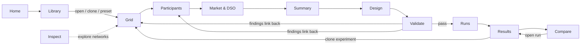
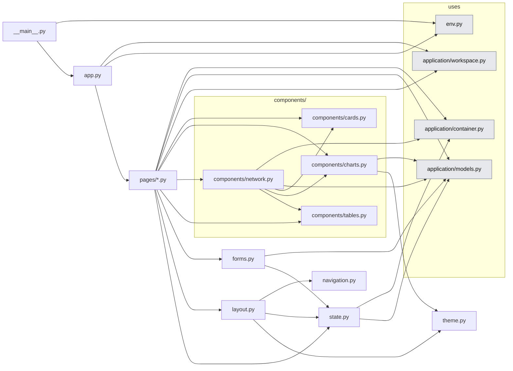
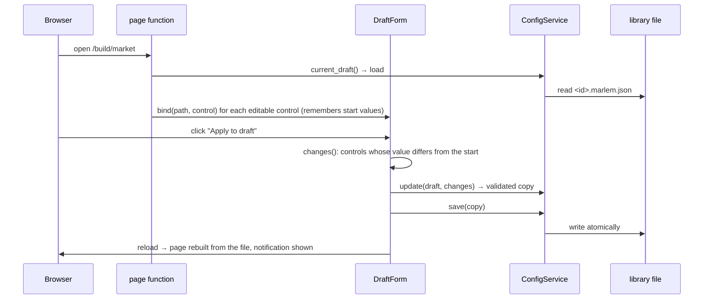

# 05. Presentation: Studio and CLI

> `src_thesis/studio/` and the planned `src_thesis/cli.py`: how people reach the system. Both call only the application layer (04).
> Master: [README.md](README.md) · Services: [04-application-layer.md](04-application-layer.md) · Experiment file: [02-experiment-config.md](02-experiment-config.md) · Functions: docstrings in [the code](../../../src_thesis/studio/), shown in the API Reference · State: [implementation-status.md](implementation-status.md).

<!-- BEGIN toc (python docs_thesis/toc.py) -->
## Contents

- [1. Purpose](#1-purpose)
- [2. At a glance](#2-at-a-glance)
- [3. Structure in code](#3-structure-in-code)
- [4. Rules](#4-rules)
- [5. How a page edits the draft](#5-how-a-page-edits-the-draft)
- [6. Pages](#6-pages)
- [7. CLI](#7-cli)

<!-- END toc -->

## 1. Purpose

The Studio lets a researcher build a study, run it and analyse it without writing code; the CLI does the same from scripts and on machines without a browser. Both produce and consume the same experiment file (02), so anything built in the Studio can be run identically from the CLI. The Studio is presentation only: it holds no research state of its own, and every action is a call to an application service.

[↑ Contents](#contents)

## 2. At a glance



The pages follow how a study is built. The BUILD pages (Grid → Summary) edit the world sections of one draft experiment file, the EXPERIMENT pages (Design, Validate) its learning plan. **Validate is the only way to Runs**, so a broken file can never start a run.

[↑ Contents](#contents)

## 3. Structure in code

<!-- BEGIN generated:graph studio -->

<!-- END generated:graph -->

Arrows are imports; the eleven page modules are drawn as one node (`pages/*.py`). Generated from the code by `docs_thesis/graphs.py`.

| File | What it is for |
|---|---|
| `__main__.py`, `app.py` | Start the server (`python -m src_thesis.studio`); `app.py` imports every page module, which registers its URL, and calls `ui.run` |
| `state.py` | The bridge to the services: `services()` (built once per process), `current_draft()` (the file this browser edits, remembered in `app.storage.user`), notifications across reloads |
| `layout.py` | `shell()`: header, navigation, footer and title around every page; `navigation.py` lists the menu, `theme.py` the colours |
| `forms.py` | `DraftForm`: ties page controls to fields of the draft and saves only what changed |
| `components/` | Reusable building blocks: cards and stat tiles, tables, Plotly figures, and `network.py` (picker, facts, topology, elements, profile inspector), the only component that calls services; shared by Grid and Inspect |
| `pages/*.py` | One module per page (§6), each an `@ui.page` function |

Running it: `python -m src_thesis.studio` with the `marlem` env, then http://localhost:8080. Settings (port, auto-reload, workspace) are environment variables, kept in the repository's `.env` ([.env.example](../../../.env.example) lists them). Auto-reload restarts the server when a `.py` file under `src_thesis/` is saved.

[↑ Contents](#contents)

## 4. Rules

- **Pages call services only** (04). They never build environments, nets or Ray jobs; importing anything but `application/` from `studio/` fails a test.
- **One experiment file.** The Studio edits one draft file, saved in the workspace library after every applied change, so a reload or another browser loses nothing. Its output is always a JSON the CLI could run identically.
- **Long work runs in the worker.** Closing the browser never affects a run; the Runs page only reads and requests.
- **Unvalidated options are disabled with a reason,** never silently available.
- **Research outcomes are shown next to, and separate from, RL reward.**

[↑ Contents](#contents)

## 5. How a page edits the draft

Every page is built when it is opened, from the draft file; edits go through the service and the page is rebuilt from the saved file.



The shell around every page shows the draft (opens Summary), its validation state (opens Validate), the running workers (opens Runs) and which services are real.

[↑ Contents](#contents)

## 6. Pages

| Page | Route | For | Contents | Services |
|---|---|---|---|---|
| Home | `/` | Pick up recent work or start from a paper case | Health, recent drafts and runs, "new from preset" (Cases 1–7) | Config, Experiment |
| Inspect | `/build/inspect` | Get to know networks and their data; compare two networks. Read-only | Two tabs. **Network:** facts, topology (click a bus for its elements), elements with their profiles, SimBench profile inspector (select profiles, window, resolution, P/Q). **Compare:** two network pickers; facts side by side, elements per profile category, both topologies, profiles in A and B | GridCatalog, Profile |
| Grid | `/build/grid` | Choose the network for the experiment and check it | Source and network picker, topology (click a bus for its elements), element table, one-hour power-flow preview with voltage colouring, limits and ratings | GridCatalog; writes `grid.*` |
| Participants | `/build/participants` | Define the agents and tie them to buses and profiles (01 §3) | Participant table, assignment tools (manual, rule, mapping file, [P2] Table 6 roles), map, time window, profile preview, battery editor, inline checks | Profile, GridCatalog, Validation; writes `participants`, `time` |
| Market & DSO | `/build/market` | The economic side: market rules, tariffs and fees, observation and reward | Mechanism and bounds, partner preference, ledger; tariff source and fee factors; observation and reward versions, assessment mode; tariff preview | Profile; writes `market`, `dso`, `environment`, `grid.assessment` |
| Summary | `/build/summary` | Check and save the whole world before the learning plan | Counts, JSON view, save, save as, export bundle, diff against the origin preset | Config |
| Design | `/experiment/design` | The learning plan and what it costs | Sweep, algorithm × paradigm matrix, hyperparameters per algorithm, paradigm options, tuning (PBT), seeds and budget, evaluation, baselines, resources, run estimate | Config, Experiment; writes `learning`, `evaluation`, `baselines`, `sweep`, `resources` |
| Validate | `/experiment/validate` | The only gate to running | Findings by severity and area, each linking to its page and field; dry run; launch (disabled while there are errors) | Validation, Experiment |
| Runs | `/runs` | Watch and control running work | Queue table, run drawer with log tail and cancel, filters; polled every 2 s | Experiment |
| Results | `/results/{run_id}` | One run in depth | Outcomes beside RL return, learning curves with baselines, step-by-step episode replay (market and grid side by side), grid series, per-agent series, export | Result |
| Compare | `/compare` | The thesis comparisons | Algorithm × paradigm matrix (mean ± std over seeds), run overlays (different reward versions flagged), paper reference values | Result |
| Library | `/library` · `/settings` | Find and reuse files; choose the workspace folder | Presets and files (open, clone, delete, import, export), provenance preset → file → runs; Settings | Config |

[↑ Contents](#contents)

## 7. CLI

Not built yet. `python -m src_thesis.cli …` (later `marlem …`), each command a thin wrapper around one service method:

```text
marlem new <preset> -o my.marlem.json          ConfigService.new_from_preset + save
marlem validate <file> [--dry-run]             ValidationService.validate / dry_run
marlem show <file> [--resolved]                ConfigService.load / resolve
marlem runs-plan <file>                        ConfigService.expand + ExperimentService.estimate
marlem run <file> [--only ppo:ctde] [--seeds 1,2]   ExperimentService.create_runs + start
marlem status [<run_id>|--experiment <id>]     ExperimentService.snapshot / list_runs
marlem cancel <run_id>                         ExperimentService.cancel
marlem grid list [--source simbench --level LV]      GridCatalogService.list_networks
marlem grid inspect <source>                   GridCatalogService.summary / elements
marlem grid preview <file> --day D --step t    GridCatalogService.preview_powerflow
marlem profiles <file> --participant <id>      ProfileService.preview
marlem results <run_id>                        ResultService.summary
marlem matrix <experiment_id> --metric <m>     ResultService.matrix
marlem export <run_id>... --fmt csv            ResultService.export
marlem bundle <file>                           ConfigService.export_bundle
```

`marlem run` waits for its runs by polling the worker pool; the Studio polls with a timer instead. Notebooks call the same services.

[↑ Contents](#contents)
