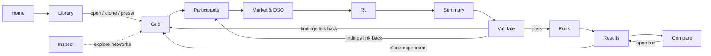
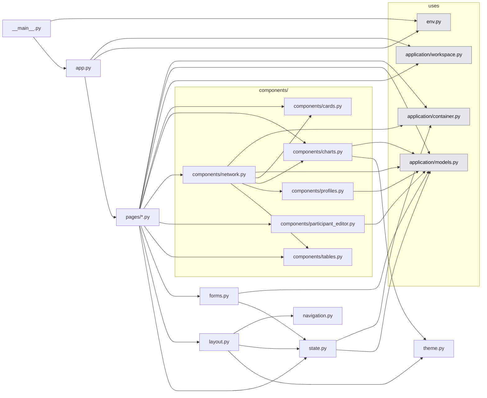
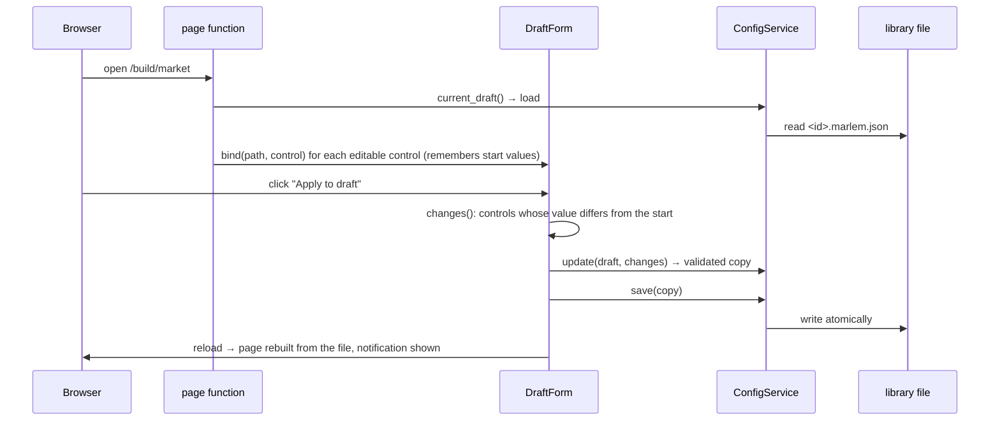

# 05. Presentation: Studio and CLI

> `src_thesis/studio/` and the planned `src_thesis/cli.py`: how people reach the system. Both call only the application layer (04).
> Master: [README.md](README.md) · Services: [04-application-layer.md](04-application-layer.md) · Experiment file: [02-experiment-config.md](02-experiment-config.md) · Functions: docstrings in [the code](../../../src_thesis/studio/), shown in the API Reference · State: [implementation-status.md](implementation-status.md).

<!-- BEGIN toc (python docs_thesis/toc.py) -->
## Contents

- [1. Purpose](#1-purpose)
- [2. At a glance](#2-at-a-glance)
- [3. Structure in code](#3-structure-in-code)
- [4. Rules](#4-rules)
- [5. How a page edits the draft](#5-how-a-page-edits-the-draft)
- [6. Pages](#6-pages)
- [7. CLI](#7-cli)

<!-- END toc -->

## 1. Purpose

The Studio lets a researcher build a study, run it and analyse it without writing code; the CLI does the same from scripts and on machines without a browser. Both produce and consume the same experiment file (02), so anything built in the Studio can be run identically from the CLI. The Studio is presentation only: it holds no research state of its own, and every action is a call to an application service.

[↑ Contents](#contents)

## 2. At a glance



The pages follow how a study is built. The BUILD pages (Grid → RL → Summary) edit every section of one draft experiment file: the world (grid, participants, time, market, DSO, environment) and the learning plan (RL). Summary shows the whole file; the EXPERIMENT page Validate checks it. **Validate is the only way to Runs**, so a broken file can never start a run.

[↑ Contents](#contents)

## 3. Structure in code

<!-- BEGIN generated:graph studio -->

<!-- END generated:graph -->

Arrows are imports; the twelve page modules are drawn as one node (`pages/*.py`). Generated from the code by `docs_thesis/graphs.py`.

| File | What it is for |
|---|---|
| `__main__.py`, `app.py` | Start the server (`python -m src_thesis.studio`); `app.py` imports every page module, which registers its URL, and calls `ui.run` |
| `state.py` | The bridge to the services: `services()` (built once per process), `current_draft()` (the file this browser edits, remembered in `app.storage.user`), notifications across reloads |
| `layout.py` | `shell()`: header, navigation, footer and title around every page; `navigation.py` lists the menu, `theme.py` the colours |
| `forms.py` | `DraftForm`: ties page controls (or any value, `track`) to fields of the draft and saves only what changed; `save_changes` for whole-list edits; `date_input` |
| `components/` | Reusable building blocks: cards and stat tiles, tables, Plotly figures, `network.py` (picker, facts, topology, elements, profile inspector), the only component that calls services, shared by Grid and Inspect, `profiles.py` (the overview of SimBench's profile classes) and `participant_editor.py` (the dialog that adds or edits one participant) |
| `pages/*.py` | One module per page (§6), each an `@ui.page` function |

Running it: `python -m src_thesis.studio` with the `marlem` env, then http://localhost:8080. Settings (port, auto-reload, workspace) are environment variables, kept in the repository's `.env` ([.env.example](../../../.env.example) lists them). Auto-reload restarts the server when a `.py` file under `src_thesis/` is saved.

[↑ Contents](#contents)

## 4. Rules

- **Pages call services only** (04). They never build environments, nets or Ray jobs; importing anything but `application/` from `studio/` fails a test.
- **One experiment file.** The Studio edits one draft file, saved in the workspace library after every applied change, so a reload or another browser loses nothing. Its output is always a JSON the CLI could run identically.
- **Long work runs in the worker.** Closing the browser never affects a run; the Runs page only reads and requests.
- **Unvalidated options are disabled with a reason,** never silently available.
- **Research outcomes are shown next to, and separate from, RL reward.**

[↑ Contents](#contents)

## 5. How a page edits the draft

Every page is built when it is opened, from the draft file; edits go through the service and the page is rebuilt from the saved file.



The shell around every page shows the draft (opens Summary), its validation state (opens Validate), the running workers (opens Runs) and which services are real.

[↑ Contents](#contents)

## 6. Pages

| Page | Route | For | Contents | Services |
|---|---|---|---|---|
| Home | `/` | Pick up recent work or start from a paper case | Health, recent drafts and runs, "new from preset" (Cases 1–7) | Config, Experiment |
| Inspect | `/build/inspect` | Get to know networks and their data; compare two networks; browse all SimBench profiles. Read-only | Three tabs. **Network:** facts, topology (click a bus for its elements), elements with their profiles, SimBench profile inspector (select profiles, window, resolution, P/Q) with a second plot of the profiles scaled by the rated power of the elements that use them, in kW (summed per profile or per element). **Profiles:** SimBench's complete profile catalogue (458 profiles, not tied to a network). Above the table an overview of the profile classes, grouped as in SimBench's own figure (load: accumulated and individual; generation; storage; aggregated grids) with a count per class; clicking classes toggles them (several at once, cleared with All or Clear selection); the table lists the profiles of the selected classes and each class is explained. Searchable, with the same factor plot. **Compare:** two network pickers; facts side by side, elements per profile category, both topologies, profiles in A and B | GridCatalog, Profile |
| Grid | `/build/grid` | Choose the network for the experiment, check it and set its rules | Source and network picker (says whether the draft uses the picked network), topology (click a bus for its elements), element table, one-hour power-flow preview with voltage colouring; grid rules: background elements and factor, voltage band and loading limits, ratings (network, rule, file, none), reactive power, power-flow algorithm and settings, what happens when the power flow fails. Changing the network asks whether to keep or remove the participants | GridCatalog, Config; writes `grid.*` |
| Participants | `/build/participants` | Define the agents and tie them to buses and profiles (01 §3) | Participant table with a check column (bus or elements not in the network); add, edit (dialog: ID, role, bus, owned elements at that bus, profile source native/catalogue/CSV, scaling, battery), duplicate, reorder, remove; placement rule on the page (load types, generation, storage, position, what the agent owns, number and seed; the qualifying buses are counted and marked on the map; replace or add), mapping import (JSON or CSV), [P2] Table 6 roles; map with the participants' buses; profile preview of the selected agent (scaled, a week from the window start); time window with a live count of training and evaluation days | Profile, GridCatalog, Config; writes `participants`, `time` |
| Market & DSO | `/build/market` | The economic side: market rules, tariffs and fees, observation, reward and reputation | Mechanism, price and quantity bounds, match threshold, partner preference, async orders, ledger; tariff source, CSV files and columns, mapping, reset per episode, fees and fee factors; observation version, forecast error and anchors, grid observation, partner reputation; reward version, log scale, grid-violation attribution and weights, assessment mode, reputation decay; all reward and reputation weights; the tariff CSVs as a chart, following unsaved changes | Profile, Config; writes `market`, `dso`, `environment`, `grid.assessment` |
| Summary | `/build/summary` | Check and save the whole file | Counts, values set per section (each links to its page), JSON view, name, description, author, tags, data status, save as, export bundle, diff against the origin preset | Config; writes `meta` |
| RL | `/build/rl` | The learning plan and what it amounts to | Paradigms and algorithms (with the resulting matrix), seeds, budget; hyperparameters per algorithm (empty = RLlib default); paradigm options and network model; tuning (PBT, mutation domains), checkpoints, rollouts; evaluation (interval, episodes, days, seeds, metrics) and baselines; sweep (JSON parameters, mode, labels); resources and outputs; run count following unsaved changes | Config; writes `learning`, `evaluation`, `baselines`, `sweep`, `resources`, `outputs` |
| Validate | `/experiment/validate` | The only gate to running | Findings by severity and area, each linking to its page and field; dry run; launch (disabled while there are errors) | Validation, Experiment |
| Runs | `/runs` | Watch and control running work | Queue table, run drawer with log tail and cancel, filters; polled every 2 s | Experiment |
| Results | `/results/{run_id}` | One run in depth | Outcomes beside RL return, learning curves with baselines, step-by-step episode replay (market and grid side by side), grid series, per-agent series, export | Result |
| Compare | `/compare` | The thesis comparisons | Algorithm × paradigm matrix (mean ± std over seeds), run overlays (different reward versions flagged), paper reference values | Result |
| Library | `/library` · `/settings` | Find and reuse files; choose the workspace folder | Presets and files: open (click), clone, delete, open a file from disk, import a bundle; provenance preset → file → runs; Settings | Config |

[↑ Contents](#contents)

## 7. CLI

Not built yet. `python -m src_thesis.cli …` (later `marlem …`), each command a thin wrapper around one service method:

```text
marlem new <preset> -o my.marlem.json          ConfigService.new_from_preset + save
marlem validate <file> [--dry-run]             ValidationService.validate / dry_run
marlem show <file> [--resolved]                ConfigService.load / resolve
marlem runs-plan <file>                        ConfigService.expand + ExperimentService.estimate
marlem run <file> [--only ppo:ctde] [--seeds 1,2]   ExperimentService.create_runs + start
marlem status [<run_id>|--experiment <id>]     ExperimentService.snapshot / list_runs
marlem cancel <run_id>                         ExperimentService.cancel
marlem grid list [--source simbench --level LV]      GridCatalogService.list_networks
marlem grid inspect <source>                   GridCatalogService.summary / elements
marlem grid preview <file> --day D --step t    GridCatalogService.preview_powerflow
marlem profiles <file> --participant <id>      ProfileService.preview
marlem results <run_id>                        ResultService.summary
marlem matrix <experiment_id> --metric <m>     ResultService.matrix
marlem export <run_id>... --fmt csv            ResultService.export
marlem bundle <file>                           ConfigService.export_bundle
```

`marlem run` waits for its runs by polling the worker pool; the Studio polls with a timer instead. Notebooks call the same services.

[↑ Contents](#contents)
