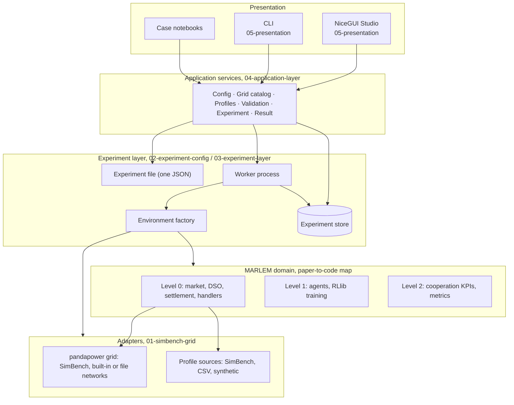
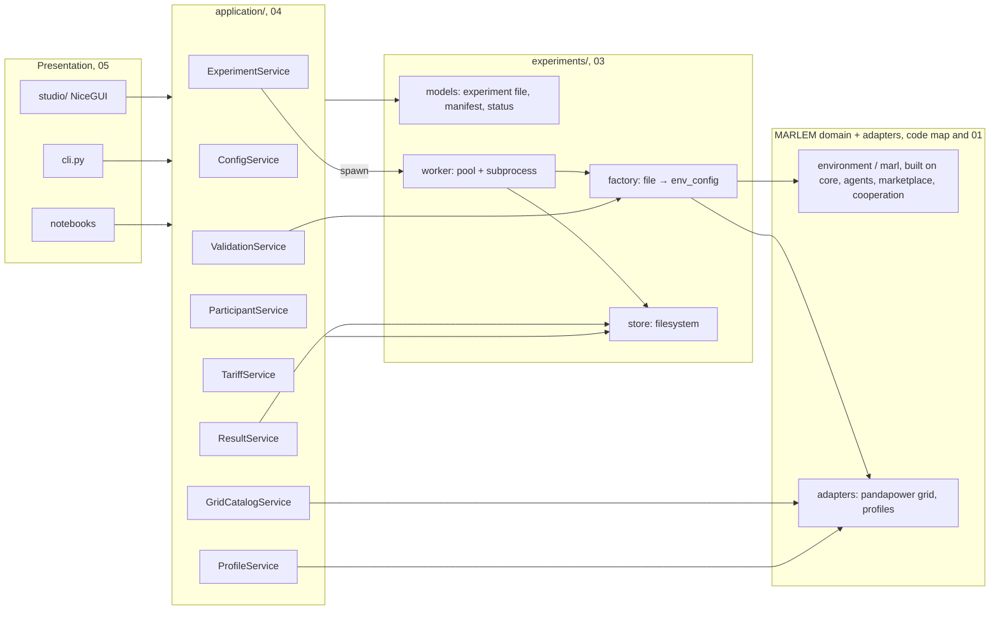
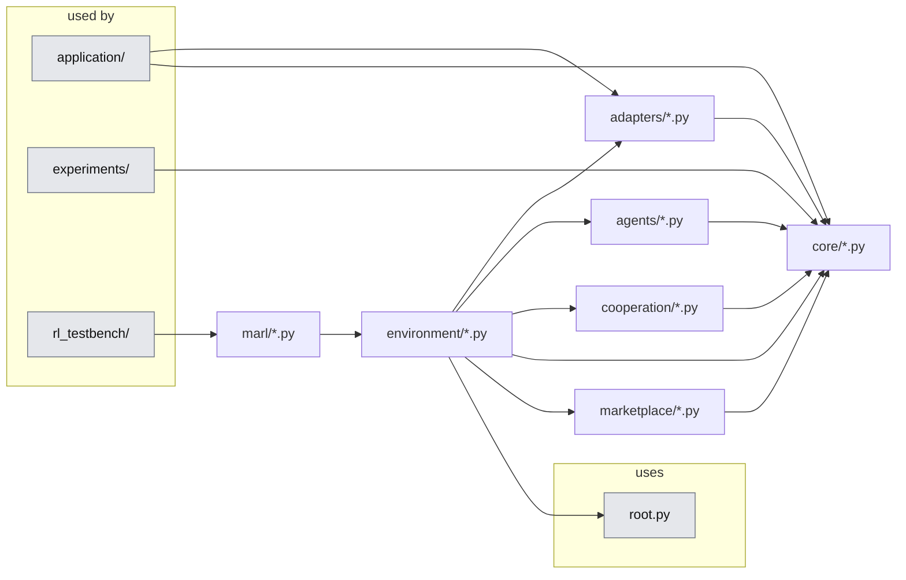

# MARLEM platform architecture (master)

For a step-by-step explanation of the current implementation, start with
[Master: how MARLEM works today](../../master/README.md). This architecture
document retains the target design, roadmap and decision log.

> Status: target architecture, agreed direction, details open where marked **Decision**.
> Written: 2026-09-23 · Branch: `dev`
> Scope: the SimBench edition of MARLEM: the grid, experiment configuration, services, CLI and the NiceGUI Studio.
> The validation against the papers ([../validation/plan.md](../validation/plan.md)) runs alongside: a component is accepted when its issue demos pass.
> Code: `src_thesis/` is the single source of truth (D-14); the original before any rewrite is git tag `marlem-original`.
> Roadmap phases are called R1–R9 (they were P1–P9 until 2026-09-27; P now always means a paper).

<!-- BEGIN toc (python docs_thesis/toc.py) -->
## Contents

- [1. Goal](#1-goal)
- [2. System at a glance](#2-system-at-a-glance)
  - [2.1 Layers and who may call whom](#21-layers-and-who-may-call-whom)
  - [2.2 MARLEM's packages](#22-marlems-packages)
  - [2.3 Dependencies (D-10)](#23-dependencies-d-10)
  - [2.4 Tests per layer](#24-tests-per-layer)
  - [2.5 New components (not in the paper)](#25-new-components-not-in-the-paper)
- [3. Documents](#3-documents)
- [4. Roadmap](#4-roadmap)
- [5. Decision log](#5-decision-log)
- [6. Glossary](#6-glossary)

<!-- END toc -->

## 1. Goal

1. **Rebuild and validate** MARLEM's method faithfully to the papers in `src_thesis/` (a paper-faithful reimplementation). Every issue in the validation register is closed by the new code (its issue demo passes) or by a recorded decision. The original stays available as git tag `marlem-original` for comparison; no separate NetworkX release is published (retired 2026-09-27).
2. **Build the tool on SimBench + pandapower only.** The grid is a realistic AC power flow on real distribution feeders, with far more (and more realistic) load and generation profiles. The NetworkX grid is removed from the tool.
3. **Run all original experiments on the SimBench grid.** That means the 3 × 3 paradigm × algorithm matrix (Case 6) and the other case studies (Cases 1–7). They are compared with the figures published in [P1] and [P2], qualitatively; the original NetworkX grid is not rerun.
4. **Make experiments shareable and reproducible** through one versioned JSON experiment file, executable identically from the CLI, notebooks and the NiceGUI Studio.

[↑ Contents](#contents)

## 2. System at a glance

**Rules of the whole system:**

1. **One way in.** UI, CLI and notebooks all go through the application services and one environment factory. Nothing builds a `LocalEnergyMarket` on its own.
2. **Files, not objects.** Only the versioned experiment JSON is persisted or shared. Live pandapower nets, agents and environments are built inside the process that uses them.
3. **Clearing is economic; the grid assesses afterwards.** Order matching and the DSO fees never query the grid while trades are being cleared; they use only last step's grid signals (point 4). After settlement, one power flow per timestep assesses the resulting injections, and violations are fed back to the agents as observations and reward.
4. **One owner of the grid (D-13).** `LocalEnergyMarket` stays the central orchestrator and is the only holder of the grid model. Market components receive plain grid data as arguments (`GridTopologyInfo`, and `GridSignals` from step t−1) and never read or write the grid themselves (01 §5.1).
5. **One grid technology.** Every network (SimBench, pandapower built-in such as IEEE 33-bus or CIGRE, or a pandapower JSON file) goes through the same pandapower adapter.
6. **Heavy work runs in a worker process.** Ray/RLlib never runs inside the UI process.

### 2.1 Layers and who may call whom

- Presentation calls **only** `application/`.
- Services return typed, plain data: Pydantic models, dicts, lists and chart-ready series. They never return NiceGUI elements, Ray objects or pandapower nets (04 §4).
- Only the **factory** turns an experiment file into live MARLEM objects. Everyone uses it: the worker, validation dry runs, notebooks and tests.
- Training goes through **one trainer**, `marl/train.py`'s `RLTrainer`, which takes the environment as an argument: the factory passes the market, the RL testbench external tasks (D-16).
- Services run **in-process** with the UI or CLI (no REST layer). Anything long-running (training, multi-episode simulation) runs in the **worker subprocess** (D-09).
- `experiments/` never imports `application/` or `studio/`; `application/` never imports MARLEM runtime, pandapower, simbench, Ray or torch directly; `marl/train.py` and `inference.py` load the market only when it is the chosen environment, and `rl_testbench/` reaches MARLEM only through the trainer. [tests/test_studio_boundaries.py](../../../tests/test_studio_boundaries.py) enforces these rules.
- **Imports name their file** (for now, while the platform is being built): `from src_thesis.application.container import build_services`, not `from src_thesis.application import build_services`. Package `__init__.py` files hold only a docstring and re-export nothing; the one deliberate exception is `application/models.py`, the Studio's single source of data types. Short package-level imports can be reintroduced once the structure is settled.

### 2.2 MARLEM's packages

MARLEM itself is split into packages that depend one way (restructured 2026-10-05, behaviour unchanged):

<!-- BEGIN generated:graph marlem -->

<!-- END generated:graph -->

- **`core/`** holds the shared records (`Order`, `Trade`, `MatchingResult`, `Location`, the grid contract) and the protocols components see each other through (`Participant`, `BatteryView`, `GridView`, `MarketBounds`). It imports nothing else from `src_thesis`.
- **`agents/`, `marketplace/`, `cooperation/` and `adapters/`** import only `core/`. The market, the DSO, reputation and the metrics accept anything shaped like a participant or a grid, so each can be tested with small stand-ins.
- **`environment/`** (`LocalEnergyMarket` and its action, observation, reward and configuration handlers) is the only package that builds concrete agents, grids, DSOs and profile handlers and wires them together.
- **`marl/`** reaches the environment only when it is the chosen one (D-16).

[tests/test_package_boundaries.py](../../../tests/test_package_boundaries.py) enforces these rules; [tests/test_golden_episode.py](../../../tests/test_golden_episode.py) replays fixed-seed episodes recorded before the restructure and requires them to be identical. The original layout with the validation markers is git tag `marlem-annotated`.

### 2.3 Dependencies (D-10)

- Canonical environment: conda `marlem` ([environment.yml](../../../environment.yml)).
- Grid: `pandapower` 3.5.4 and `simbench` 1.6.2. Studio: `nicegui` 3.16. Models: `pydantic` 2.13. All pinned in `environment.yml` since 2026-09-27.
- Only `adapters/` imports `simbench` and `pandapower`. Only `studio/` imports `nicegui`.

### 2.4 Tests per layer

What guards each layer; which tests exist today is in the [implementation status](implementation-status.md).

| Layer | What the tests guarantee | Tests |
|---|---|---|
| Domain | The validation acceptance tests: one demonstration per issue, passing once the issue is fixed. Package boundaries; fixed-seed golden episodes that a restructure must reproduce exactly | [../validation/evidence/](../validation/evidence/), [tests/test_package_boundaries.py](../../../tests/test_package_boundaries.py), [tests/test_golden_episode.py](../../../tests/test_golden_episode.py) |
| Adapters | Grid catalog on SimBench and built-in networks; mapping validation, time alignment, injection identity, power flow per step | [tests/test_grid_catalog.py](../../../tests/test_grid_catalog.py) |
| Experiment layer | Round trip, hash stability, expansion, resolution, store, recorder, worker and pool | [tests/test_experiments.py](../../../tests/test_experiments.py) |
| Factory and training configuration | Presets build an environment; each algorithm × paradigm builds an `AlgorithmConfig`; mutation domains contain initial values | planned |
| RL testbench | Every paradigm builds its RLlib configuration on an external environment through MARLEM's `RLTrainer`; run manifests carry the same provenance as market runs; later the paradigm contract checks and learning evidence of [rl-testbench.md](../validation/rl-testbench.md) §4 | [tests/test_rl_testbench.py](../../../tests/test_rl_testbench.py) |
| Services | Experiment files on disk; later create, validate, start, snapshot and cancel against a temporary store | [tests/test_config_service.py](../../../tests/test_config_service.py) |
| Presentation | Import boundaries between the layers; the services satisfy every page call | [tests/test_studio_boundaries.py](../../../tests/test_studio_boundaries.py) |
| Docstrings | Every public module, class and function of the platform code has a docstring; the API Reference is built from them | [tests/test_docstrings.py](../../../tests/test_docstrings.py) |
| Docs | Validation docs consistent with the code markers; generated Contents and file graphs up to date | [tests/test_validation_docs.py](../../../tests/test_validation_docs.py), [test_docs_toc.py](../../../tests/test_docs_toc.py), [test_docs_graphs.py](../../../tests/test_docs_graphs.py) |

### 2.5 New components (not in the paper)

Where the SimBench edition adds to the original; the [P1] Fig. 2 classes themselves are in the [paper-to-code map](../../paper/marlem-paper-to-code-map.md).

| Component | Why it is there | Location | Doc |
|---|---|---|---|
| Grid contracts (`GridModel`, `GridAssessment`, `ParticipantInjection`, `GridViolation`) | The only thing the market and the grid share; the grid backend can change or be mocked | [core/grid_contract.py](../../../src_thesis/core/grid_contract.py) | 01 §5 |
| Settlement ledger (energy identity, battery, cash with fees) | One place decides who delivered and paid what; injections and rewards are derived from it | `marketplace/settlement.py` | 01 §5.1, [audit §5](../validation/marlem-keep-replace-audit.md) |
| Settlement → injection builder | Turns settled energy (kWh per step) into the power injections (kW) a power flow needs | `environment/injection.py` | 01 §7 |
| Scripted baseline policies (no order, random, rule-based) | Reference points that give learned results a scale | `marl/baselines.py` | 02 §3.10 |
| RL testbench | MARLEM's trainer is first shown to learn on CartPole, MultiAgentCartPole and Simple Spread, then used on the market (D-16) | [rl_testbench/](../../../src_thesis/rl_testbench/); trainer: [marl/train.py](https://github.com/KevinRapo/P2P-thesis/blob/marlem-annotated/src_thesis/marl/train.py) | [rl-testbench.md](../validation/rl-testbench.md) |
| pandapower grid adapter (SimBench, built-in, file) | Real power-flow physics in place of the NetworkX graph | [adapters/grid/simbench_new.py](../../../src_thesis/adapters/grid/simbench_new.py) | 01 §1–§5 |
| SimBench profile source | Realistic load and PV profiles for agents on any network | `adapters/profiles/simbench.py` | 01 §3 |
| Experiment layer: file handling, expansion, resolution, manifest, store, recorder, worker, pool | From one experiment file to traceable runs executed outside the UI (03) | [experiments/](../../../src_thesis/experiments/) | 02, 03 |
| Original code (git tag `marlem-original`) | Compare a rewritten file with the original | `git show marlem-original:src_thesis_reference/<path>` | D-14 |
| Application services | One interface for the Studio, the CLI and notebooks | [application/](../../../src_thesis/application/) | 04 |
| CLI | Scripted and headless runs | `src_thesis/cli.py` | 05 §7 |
| NiceGUI Studio | Build, run and analyse studies without writing code | `studio/` (separate presentation package) | 05 |

[↑ Contents](#contents)

## 3. Documents

Read the [paper-to-code map](../../paper/marlem-paper-to-code-map.md) first (it sits with the papers, because it maps the papers' components to the code), then these in order:

| # | Document | Answers |
|---|---|---|
| 01 | [01-simbench-grid.md](01-simbench-grid.md) | The grid: network sources, assigning profiles to agents, the grid contract, the step with a power flow, and which MARLEM files change |
| 02 | [02-experiment-config.md](02-experiment-config.md) | The experiment file: every section and field, with the original defaults; presets; sharing; preflight checks |
| 03 | [03-experiment-layer.md](03-experiment-layer.md) | From a file to runs: run folders, worker processes, run lifecycle, reproducibility |
| 04 | [04-application-layer.md](04-application-layer.md) | The six services every user interface calls, their rules, wiring and the workspace |
| 05 | [05-presentation.md](05-presentation.md) | The NiceGUI Studio (page map, structure, how a page edits the draft, every page) and the CLI |
| — | [implementation-status.md](implementation-status.md) | **What exists in code today**, per phase, layer and Studio page; how to check it yourself |

The numbered documents go bottom-up through the layers. 03–05 share one outline: **Purpose** (what the part is for) → **At a glance** (business diagram) → **Structure in code** (a file graph generated from the imports, one line per file) → **Rules** → the topic itself. 01 and 02 keep their own outline because their subject is a design and a file format; they place the code structure under §0. What each function does is not repeated here: it is in the docstrings, shown in the API Reference of the docs site. Status is only in the implementation-status document.

[↑ Contents](#contents)

## 4. Roadmap

Each phase has an exit criterion.

| Phase | Content | Exit criterion | Doc |
|---|---|---|---|
| **R1 Rebuild and validate** | Steps A0–D3 of the validation plan, built in `src_thesis/` | All 80 issues `fixed` / `decided` / `wontfix`; the demo of every fixed issue passes (its strict-xfail test is moved to `FIXED`) | [validation](../validation/plan.md) |
| ~~R2 Validated release~~ | **Retired 2026-09-27** (D-02): no NetworkX release and no NetworkX reference results. The original code is git tag `marlem-original`. | — | — |
| **R3 Grid seam + pandapower adapter** | Grid contracts, the settlement → injection builder, lossless market, SimBench / built-in / file network loading, profile catalogue, participant mapping, power flow → `GridAssessment`. The NetworkX grid is removed from the tool. | Adapter tests pass: mapping validation, 15-min/hourly alignment, injection signs, convergence, violations | 01 §2–§5 |
| **R4 SimBench, shadow mode** | Assessment runs inside the step and is recorded; rewards and observations unchanged | A full episode runs on SimBench; `env.step` cost measured | 01 §6 |
| **R5 SimBench in the loop** | Versioned observation and reward consume the assessment (violation feedback); KPIs re-sourced from power-flow results | Short training runs reduce violations versus no-order and random baselines | 01 §6–§7 |
| **R6 Experiment file** (can start with R3) | JSON schema, environment factory, presets for Cases 1–7 and the 3 × 3 matrix | Each preset validates and runs 1 episode from its JSON | 02 |
| **R7 Services, CLI, worker** | Application services, filesystem store, worker process, CLI | `marlem run <file>` executes a 3 × 3 smoke matrix end to end | 03, 04 |
| **R8 Studio** | Read-only (Runs, Results, Grid) → editors → launch | An experiment built in the Studio produces a run identical to its CLI equivalent | 05 |
| **R9 Evidence runs** | Original experiments on SimBench; qualitative comparison with the papers' published figures; thesis figures | Results reproducible from the stored manifests | 02 §7 |

[↑ Contents](#contents)

## 5. Decision log

| ID | Decision | Status | Where |
|---|---|---|---|
| D-01 | Grid assessment happens **after settlement**: one power flow per timestep, market not constrained. Agents learn from violation feedback (reward and observation) rather than being blocked. | **Agreed** (2026-09-23) | 01 §5–§6 |
| D-02 | The tool is **SimBench/pandapower only**. The original with its NetworkX grid stays available as git tag `marlem-original` for comparison; it is not a runnable backend, and no validated NetworkX release is published (the old P2 is retired). | **Agreed** (2026-09-23, revised 2026-09-27) | 01 §1 |
| D-03 | Integration goes in two stages: **shadow** (record only, R4) → **feedback** (observation and reward consume the assessment, R5). Each is a versioned mode. | Proposed | 01 §6 |
| D-04 | Keep MARLEM's file names and [P1] Fig. 2 class responsibilities, so the diff against the original (git tag `marlem-original`) stays readable; a file may be **rewritten**. New parts (contracts, injection builder, settlement ledger, adapters, scripted baselines) get new modules. | **Agreed** (revised 2026-09-27) | code map, 01 §7 |
| D-05 | The market is **lossless per trade**. Feeder losses are reported system-wide by the power flow and supplied via the external grid. | Proposed | 01 §5 |
| D-06 | Profile assignment defaults to `mapped_replacement`: agents replace the SimBench elements they own, and all other elements run as background with their own profiles. | Proposed | 01 §3 |
| D-07 | Paper-parity presets use **hourly aggregation** (24 steps), energy-consistent. Native 15-min (96 steps) is an extension. | Proposed | 01 §4, 02 §7 |
| D-08 | **One JSON file per experiment**. It contains the world (time, grid, participants, market, DSO, environment), the learning plan (algorithms, paradigms, hyperparameters, tuning, budget, seeds), evaluation, baselines and the sweep. Runs get a system-written manifest. | **Agreed** (2026-09-23) | 02 |
| D-09 | Services run in-process for UI and CLI. Ray runs only in a worker subprocess. The filesystem experiment store is the source of truth. | Proposed | 04 |
| D-10 | The canonical environment is the conda `marlem` env (`environment.yml`), with pandapower, simbench, pydantic and nicegui pinned. | Proposed | §2.3 |
| D-11 | Violation feedback reward: shared vs bus-attributed vs marginal credit assignment | **Open** | 01 §6 |
| D-12 | Non-convergent power flow during training: truncate with a fixed penalty vs fail the run | **Open** | 01 §6 |
| D-13 | **Grid ownership and data flow.** `LocalEnergyMarket` is the only holder of the `GridModel`. `OrderMatcher`, `DSOAgent` and `DERAgent` get `GridTopologyInfo` (static distances and zones) and `GridSignals` (step t−1) as arguments and never call the grid; KPIs, reward and observation use `GridAssessment[t]`. A read-only view is the accepted fallback. | **Agreed** (2026-09-27) | 01 §5.1 |
| D-14 | **Code home.** `src_thesis/` is the single source of truth (domain, adapters, services, Studio, tests). The upstream `src/` and the frozen copy `src_thesis_reference/` were removed on 2026-10-03; the original with its issue markers is git tag `marlem-original`. | **Agreed** (2026-09-27, revised 2026-10-03) | code map |
| D-15 | **Voltage limits.** `grid.limits` in the experiment file overrides every bus when set; when unset, each bus uses the network's own `min_vm_pu` / `max_vm_pu`, with 0.95–1.05 pu as the fallback. The Studio preview follows the same rule. | **Agreed** (2026-09-27) | 01 §2, 02 §3.3 |
| D-16 | **One RL trainer, the environment as an argument.** MARLEM's `RLTrainer` and `RLInference` ([marl/train.py](https://github.com/KevinRapo/P2P-thesis/blob/marlem-annotated/src_thesis/marl/train.py), `inference.py`) take the environment class as an argument (`env_cls`; the local energy market by default) and load the market only when it is used. Two callers: `experiments/factory/training.py` translates an experiment file and run cell into `RLTrainer`'s arguments for the market, and the [RL testbench](../validation/rl-testbench.md) passes external tasks (CartPole, MultiAgentCartPole, Simple Spread). So the code that trains the market is the code that was shown to learn on established tasks; there is no second trainer. The files are changed in place (D-04). The bench keeps its own run manifest (it has no experiment file) but records provenance with the experiment layer's fingerprints. | Proposed (2026-10-05) | [rl-testbench.md](../validation/rl-testbench.md) §1, 03 §3 |

[↑ Contents](#contents)

## 6. Glossary

| Term | Meaning |
|---|---|
| **Settlement** | Per agent and step: served demand, generation, curtailment, battery charge and discharge, imports, exports and cash. The output of the market step. |
| **Injection** | An agent's net active power at its bus, derived from settlement: production − consumption, in kW. It is **not** trades counted as loads. |
| **Assessment** | One power-flow result for one timestep: voltages, loadings, losses, external-grid exchange and violations |
| **Grid signals** | The few numbers the market may use from the previous step's assessment (max line loading, external-grid exchange); passed as an argument (01 §5.1) |
| **Topology info** | Static per network: electrical distance between buses and bus zones, computed once at reset and passed to the market (01 §5.1) |
| **Background** | Network loads and generators not owned by an agent. They follow their own profiles. |
| **Original** | Git tag `marlem-original`: the last commit with the upstream `src/` and the frozen `src_thesis_reference/` (relocated, with issue markers). View a file with `git show marlem-original:src_thesis_reference/<path>` (D-14). |
| **Experiment file** | The single JSON describing one study (02) |
| **Preset** | A checked-in experiment file reproducing an original MARLEM case on SimBench |

[↑ Contents](#contents)
