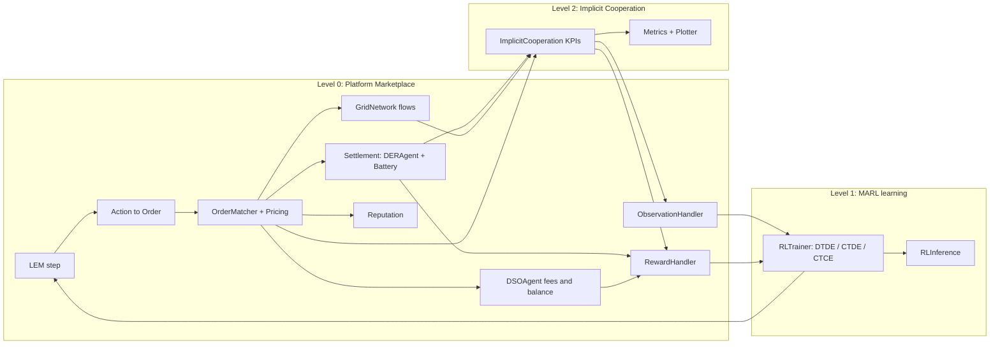
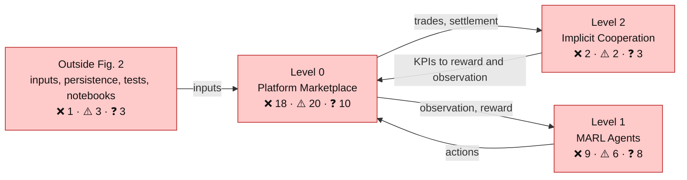
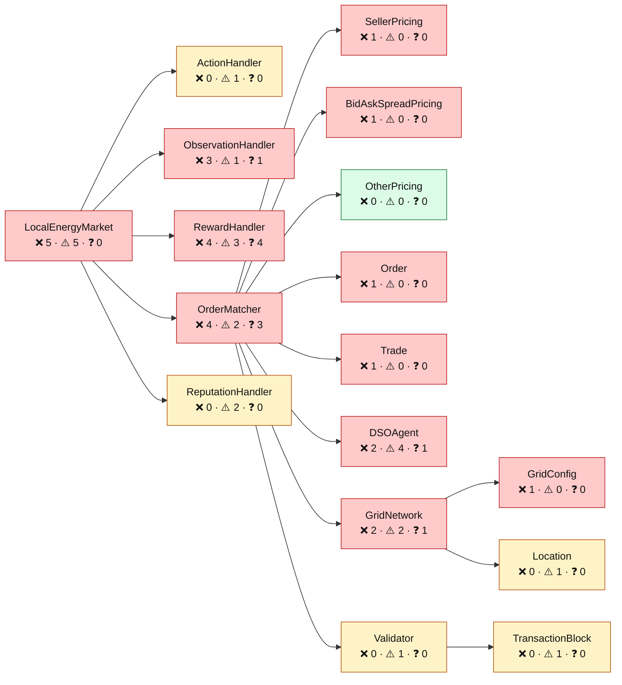
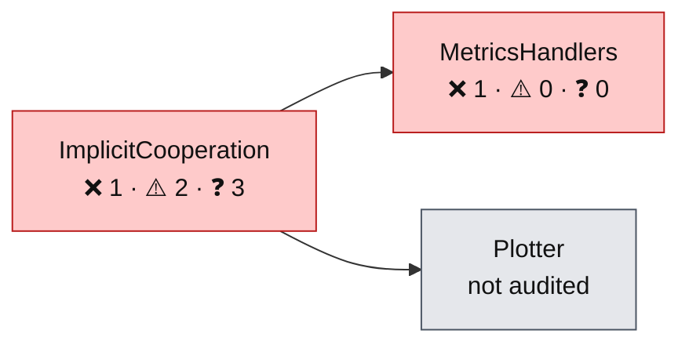
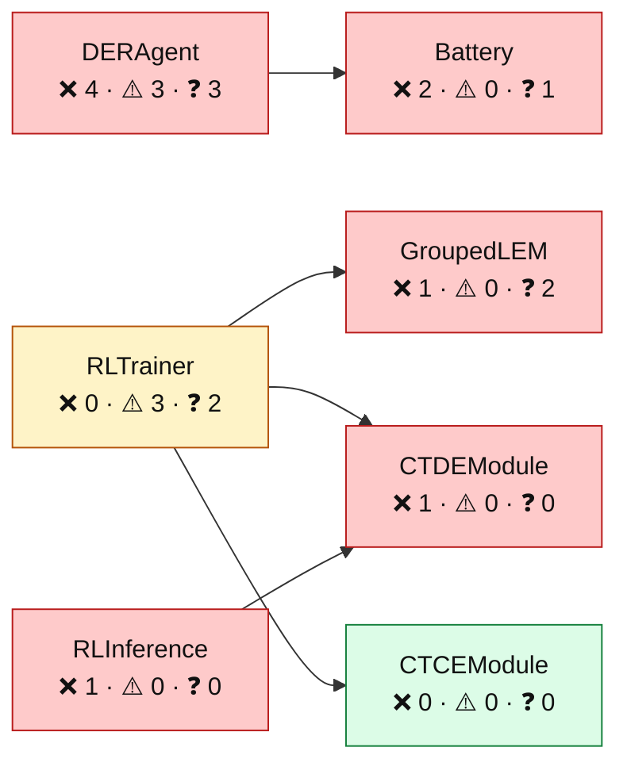
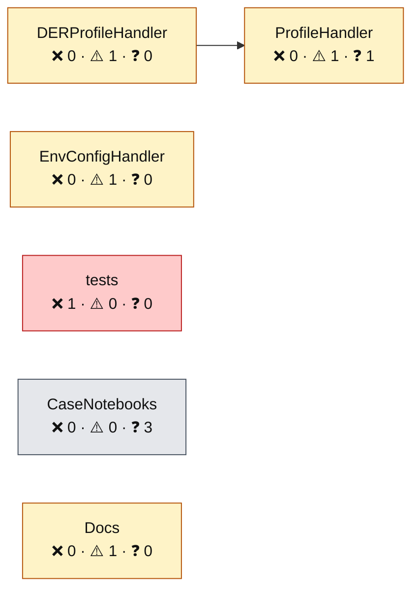
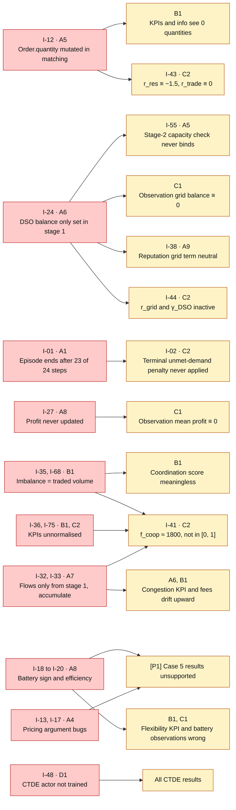

# MARLEM validation plan

> The **work order** for validating MARLEM in `src_thesis/`: steps A0 → D3, each with its components, the decisions to take first and the acceptance test.
> Issue text, code lines and **status** live in [issues.md](issues.md) only. The issue tables and diagrams below marked *generated* are rebuilt from it by [check_docs.py](check_docs.py) (`--write`); do not edit them by hand.
> Legends and conventions: [README.md](README.md).

<!-- BEGIN toc (python docs_thesis/toc.py) -->
## Contents

- [1. How this plan is organised](#1-how-this-plan-is-organised)
- [2. Fault map](#2-fault-map)
  - [How the root faults propagate](#how-the-root-faults-propagate)
- [3. Stage A: Level 0, Platform Marketplace](#3-stage-a-level-0-platform-marketplace)
  - [A0. Test harness](#a0-test-harness)
  - [A1. Episode loop](#a1-episode-loop)
  - [A2. Inputs: profiles and units](#a2-inputs-profiles-and-units)
  - [A3. Action → order](#a3-action--order)
  - [A4. Pricing](#a4-pricing)
  - [A5. Matching](#a5-matching)
  - [A6. DSO: balance and fees](#a6-dso-balance-and-fees)
  - [A7. Grid](#a7-grid)
  - [A8. Settlement: energy and cash](#a8-settlement-energy-and-cash)
  - [A9. Reputation](#a9-reputation)
  - [A10. Ledger](#a10-ledger)
- [4. Stage B: Level 2, Implicit Cooperation](#4-stage-b-level-2-implicit-cooperation)
  - [B1. Cooperation KPIs](#b1-cooperation-kpis)
  - [B2. Metrics and plots](#b2-metrics-and-plots)
- [5. Stage C: Level 0 agent interface (observation and reward)](#5-stage-c-level-0-agent-interface-observation-and-reward)
  - [C1. Observation](#c1-observation)
  - [C2. Reward](#c2-reward)
- [6. Stage D: Level 1, MARL Agents (learning)](#6-stage-d-level-1-marl-agents-learning)
  - [D1. Training paradigms](#d1-training-paradigms)
  - [D2. Inference](#d2-inference)
  - [D3. Experiments and reporting](#d3-experiments-and-reporting)
- [7. Decision log](#7-decision-log)
- [8. Progress](#8-progress)

<!-- END toc -->

## 1. How this plan is organised

The plan follows the three levels of [P1] Fig. 2 (the high-level class diagram), in the order **Level 0 → Level 2 → Level 1**:

| Fig. 2 level | Classes in Fig. 2 | `src_thesis/` location |
|---|---|---|
| **Level 0: Platform Marketplace** | `LEM`, `ObservationHandler`, `ActionHandler`, `RewardHandler`, `ReputationHandler`, `OrderMatcher`, `MarketConfig`, `ClearingMechanism`, `MatchingResult`, `Order`, `Trade`, `DSOAgent`, `GridNetwork`, `GridTopology`, `Location`, `Validator`, `TransactionBlock` | `marketplace/` (`lem.py`, `observation.py`, `action.py`, `reward.py`, `market/`, `dso/`, `grid/`), `adapters/grid/network.py` |
| **Level 1: MARL Agents** | `DERAgent`, `Battery`, `RLTrainer`, `RLInference`, `RLAlgorithm`, `TrainingMode` | `marl/` (`agents/`, `train.py`, `inference.py`, `base.py`, `ctce.py`, `ctde.py`) |
| **Level 2: Implicit Cooperation** | `ImplicitCooperation`, `CoordinationMetricsHandler`, `DSOMetricsHandler`, grid and market metrics handlers, `Plotter` | `cooperation/` (`implicit_cooperation.py`, `metrics/`, `visualization/`) |
| *Not in Fig. 2* | Profile handlers, CTCE/CTDE modules, `GroupedLEM`, config I/O | `adapters/profiles/`, `marl/`, `marketplace/io.py` |

**Two classes cross levels, so the plan moves them.** This keeps your Level 0 → 2 → 1 order while respecting what calls what:

- **`DERAgent` and `Battery` are Level 1 in Fig. 2 but are validated in Stage A.** `LEM.step` calls them to turn actions into orders and to settle energy. A market cannot be validated while its participants' energy and cash accounting is wrong. Only the *learning* part of Level 1 is left for last.
- **`ObservationHandler` and `RewardHandler` are Level 0 in Fig. 2 but are validated in Stage C, after Level 2.** Both consume the Level 2 KPIs.

**Stage order:** A (Level 0 core) → B (Level 2) → C (Level 0 observation and reward) → D (Level 1 learning).

**Rules for every step:**

1. Take the step's **decisions** first. These are Paper-origin issues the paper cannot settle; record each in the [decision log](#7-decision-log) as a one-line rule plus reason, and set its status to `decided`.
2. Write the step's **acceptance test** on a hand-sized case (2–3 agents, 1–3 periods). It must fail on the original code.
3. Port the minimal change (from `marlem-baseline` where it exists). Rerun the test and the evidence trace, and record a before/after.
4. Set the status in [issues.md](issues.md) to `fixed` and delete the issue's code markers in the same commit. Move to the next step only when all of the step's issues are `fixed`, `decided` or `wontfix`.

[↑ Contents](#contents)

## 2. Fault map

Generated from the register's Class, Type and Status columns; it updates as issues close.

<!-- BEGIN generated:fault-map -->
Colour = the worst **open** issue in the box: red ❌, amber ⚠️, grey ❓ (or not audited), green none.
An issue that touches several classes is counted in each.

**Level 0: Platform Marketplace**

**Level 2: Implicit Cooperation**

**Level 1: MARL Agents**

**Outside Fig. 2: inputs, persistence, tests, notebooks**

<!-- END generated:fault-map -->

### How the root faults propagate

Fixing a root (left, with its step) is expected to clear its symptoms (right). Re-check the symptoms after each fix; several close without separate work.

[↑ Contents](#contents)

## 3. Stage A: Level 0, Platform Marketplace

Market, DSO, grid, ledger and the episode loop, plus the two Level 1 classes that Level 0 physically calls (`DERAgent` action/settlement, `Battery`). The goal is that one hand-sized period produces correct orders, trades, prices, energy, cash and grid state.

### A0. Test harness

- **Components:** — (repository)
- **Why here:** A working `pytest` gate with real assertions, so every later step can add a test that fails before its fix.
- **Decisions first:** none
- **Acceptance test:** `pytest -q` collects and runs. A deliberately broken assertion fails.

<!-- BEGIN generated:step-A0 -->
| ID | Type | Origin | Status | Issue |
|---|---|---|---|---|
| [I-52](issues.md#I-52) | ❌ | Code | open | No functioning test gate: tests without assertions, fixtures that fail, signatures that have drifted |
| [I-53](issues.md#I-53) | ⚠️ | Code | open | Defensive checks hide bad state (dead capacity check, bare `except`, float-only validators, mutable defaults) |
<!-- END generated:step-A0 -->

### A1. Episode loop

- **Components:** `LEM` (`reset`, `step`)
- **Why here:** The episode contract everything else sits on: horizon, terminal flag, seeding.
- **Decisions first:** none
- **Acceptance test:** `max_steps = 24` gives 24 `step` calls. Only the last returns `terminated`, and it passes `is_terminal=True` to the reward. The same seed replays the episode exactly; `seed=None` advances.

<!-- BEGIN generated:step-A1 -->
| ID | Type | Origin | Status | Issue |
|---|---|---|---|---|
| [I-01](issues.md#I-01) | ❌ | Fidelity | open | Only 23 of 24 periods run: termination is checked after the step increment against `max_steps − 1` |
| [I-02](issues.md#I-02) | ❌ | Fidelity | open | `is_terminal` is never true, so the terminal unmet-demand penalty never applies |
| [I-03](issues.md#I-03) | ⚠️ | Code | open | `reset(seed=None)` falls back to the config seed, so every episode is identical |
| [I-04](issues.md#I-04) | ⚠️ | Code | open | `LocalEnergyMarket.seed()` is shadowed by the `self.seed` attribute |
| [I-78](issues.md#I-78) | ⚠️ | Fidelity | open | Invalid actions raise `ValueError` instead of being dropped (Alg. 1 `ValidateOrder`) |
<!-- END generated:step-A1 -->

### A2. Inputs: profiles and units

- **Components:** Profile handlers (not in Fig. 2)
- **Why here:** The data every level consumes. Units and Δt are decided here once.
- **Decisions first:** [I-56](issues.md#I-56)
- **Acceptance test:** Profiles supplied to an agent survive `reset()` (or the override is explicit). One CSV column maps to one agent deterministically. Units are stated per quantity.

<!-- BEGIN generated:step-A2 -->
| ID | Type | Origin | Status | Issue |
|---|---|---|---|---|
| [I-05](issues.md#I-05) | ⚠️ | Code | open | Profiles passed to `DERAgent(...)` are overwritten at `reset()` |
| [I-06](issues.md#I-06) | ⚠️ | Fidelity | open | CSV profiles use a random column and random scale per reset |
| [I-56](issues.md#I-56) | ❓ | Paper | open | Units and timestep are inconsistent (W/kW/kWh/Wh, $/Wh vs $/kWh) |
<!-- END generated:step-A2 -->

### A3. Action → order

- **Components:** `ActionHandler`, `DERAgent.adjust_action_for_battery` (Level 1 in Fig. 2), `Order`
- **Why here:** Pulled forward from Level 1 because `LEM.step` calls it before the market.
- **Decisions first:** [I-11](issues.md#I-11)
- **Acceptance test:** For G = 5, D = 30, SoC headroom h and α ∈ {0, 1}: the order quantity equals eq. 15's `q_buy,max` / `q_sell,max` (or the decided rule). α = 0.3 is a sell everywhere.

<!-- BEGIN generated:step-A3 -->
| ID | Type | Origin | Status | Issue |
|---|---|---|---|---|
| [I-08](issues.md#I-08) | ❌ | Fidelity | open | Feasibility clipping does not implement eq. 15: it treats the requested `q` as the need |
| [I-09](issues.md#I-09) | ❌ | Fidelity | open | `is_buy` is truthy in `adjust_action_for_battery` but `> 0.5` in `step`, so the order is sized for the wrong direction |
| [I-10](issues.md#I-10) | ⚠️ | Fidelity | open | β = "no preference" is reachable only at the exact upper bound |
| [I-11](issues.md#I-11) | ❓ | Paper | open | No "submit nothing" action when `q_min > 0` |
| [I-77](issues.md#I-77) | ⚠️ | Fidelity | open | Rule-based partner selection is a lexicographic sort plus a random top-half pick, not a weighted score |
<!-- END generated:step-A3 -->

### A4. Pricing

- **Components:** `MarketConfig`, `ClearingMechanism`
- **Why here:** The smallest pure functions in the model. A good first fix.
- **Decisions first:** none
- **Acceptance test:** For every mechanism with buy = 200, sell = 50, ref = 100: the expected value from eq. 9–11 (check eq. 11 against the rendered PDF).

<!-- BEGIN generated:step-A4 -->
| ID | Type | Origin | Status | Issue |
|---|---|---|---|---|
| [I-13](issues.md#I-13) | ❌ | Fidelity | open | `SELLER` pricing returns the buyer's price (positional-argument bug) |
| [I-17](issues.md#I-17) | ❌ | Fidelity | open | `BID_ASK_SPREAD` pricing receives `market_price` as `factor`, so it returns the buyer's price |
<!-- END generated:step-A4 -->

### A5. Matching

- **Components:** `OrderMatcher`, `MatchingResult`, `Trade`
- **Why here:** Stages 1–3 of Algorithm 1.
- **Decisions first:** [I-15](issues.md#I-15), [I-16](issues.md#I-16)
- **Acceptance test:** A hand case with 2 sellers and 1 buyer at known prices gives the expected trades, quantities and clearing price. Submitted orders are unchanged after matching.

<!-- BEGIN generated:step-A5 -->
| ID | Type | Origin | Status | Issue |
|---|---|---|---|---|
| [I-12](issues.md#I-12) | ❌ | Code | open | Orders are mutated in place, so the reward, KPIs and info see residual quantities (0), not submitted ones |
| [I-14](issues.md#I-14) | ⚠️ | Fidelity | open | P2P loss is topped up from the DSO |
| [I-15](issues.md#I-15) | ❓ | Paper | open | Stage 1 clears DSO-preferred orders with the DSO before any P2P matching |
| [I-16](issues.md#I-16) | ❓ | Paper | open | The clearing price is a VWAP that includes DSO trades |
| [I-54](issues.md#I-54) | ⚠️ | Code | open | DSO fallback skips grid feasibility (zero distance, loss and fee), and `validate_grid_constraints` ignores direction |
| [I-55](issues.md#I-55) | ❌ | Code | open | The Stage-2 capacity check uses `max_quantity·N` and the current balance, not grid capacity or the projected trade |
<!-- END generated:step-A5 -->

### A6. DSO: balance and fees

- **Components:** `DSOAgent`
- **Why here:** The DSO's balance (eq. 7) and fees (eq. 8).
- **Decisions first:** [I-29](issues.md#I-29), [I-74](issues.md#I-74)
- **Acceptance test:** `B_DSO` after one step equals `Σ(E_sold − E_bought)` over DSO trades, with one sign convention. Each fee term matches eq. 8 on a hand case, and the total is charged to the decided payer.

<!-- BEGIN generated:step-A6 -->
| ID | Type | Origin | Status | Issue |
|---|---|---|---|---|
| [I-24](issues.md#I-24) | ❌ | Fidelity | open | `dso.balance` changes only on Stage-1 DSO-preferred trades and carries across steps, so it is ≡ 0 by default |
| [I-25](issues.md#I-25) | ❓ | Code | open | The B_DSO sign convention is inconsistent between `match_orders` and `_match_preferred_partners` |
| [I-28](issues.md#I-28) | ❌ | Fidelity | open | Grid fees are computed but never charged to anyone |
| [I-29](issues.md#I-29) | ❓ | Paper | open | `F_trans` has no formula in the paper; the code uses 0 |
| [I-30](issues.md#I-30) | ⚠️ | Fidelity | open | `F_volt` and `F_thermal` caps (0.2, 0.3) differ from or are undefined in the paper |
| [I-31](issues.md#I-31) | ⚠️ | Fidelity | open | `F_imb` is effectively always 0 |
| [I-74](issues.md#I-74) | ⚠️ | Paper | open | Thermal-fee threshold (20 %) sits below the congestion threshold (80 %) |
<!-- END generated:step-A6 -->

### A7. Grid

- **Components:** `GridNetwork`, `GridTopology`, `Location`
- **Why here:** Graph, losses and congestion (eq. 18–19).
- **Decisions first:** [I-70](issues.md#I-70)
- **Acceptance test:** IEEE-34 is connected. Flows at the start of a period are the decided baseline. After one trade of `q` along a known path, each edge flow and the congestion match a hand calculation.

<!-- BEGIN generated:step-A7 -->
| ID | Type | Origin | Status | Issue |
|---|---|---|---|---|
| [I-32](issues.md#I-32) | ❌ | Fidelity | open | Only Stage-1 trades update edge flows |
| [I-33](issues.md#I-33) | ❌ | Fidelity | open | Edge flows start random and accumulate over the episode instead of being per period |
| [I-34](issues.md#I-34) | ⚠️ | Code | open | Loss factor κ = 0.03 is hard-coded |
| [I-57](issues.md#I-57) | ❌ | Fidelity | open | IEEE-34 graph is disconnected (edge 832–888 missing), and the impedance table is unused |
| [I-70](issues.md#I-70) | ❓ | Paper | open | Grid physics scope: linear unbounded losses, `V_drop = f·d`, transport flows |
<!-- END generated:step-A7 -->

### A8. Settlement: energy and cash

- **Components:** `DERAgent` accounting, `Battery` (Level 1 in Fig. 2)
- **Why here:** Pulled forward from Level 1 because settlement is a Level 0 physical outcome. This is where conservation lives.
- **Decisions first:** [I-22](issues.md#I-22), [I-71](issues.md#I-71)
- **Acceptance test:** Per agent and step, `G + imports + discharge = served D + exports + charge + curtailment`. Profit (eq. 14) changes by `Σ p·q` minus fees. Selling with G = D discharges. The battery respects SoC limits, η and any decided power limit. `B_grid` (eq. 20) is computed.

<!-- BEGIN generated:step-A8 -->
| ID | Type | Origin | Status | Issue |
|---|---|---|---|---|
| [I-18](issues.md#I-18) | ❌ | Fidelity | open | Battery dispatch has the trade term's sign reversed: selling charges the battery |
| [I-19](issues.md#I-19) | ❌ | Fidelity | open | A charge is refused entirely if it would reach SoC_max; there is no partial fill |
| [I-20](issues.md#I-20) | ❌ | Fidelity | open | Discharge efficiency is applied in the wrong direction (`·η` instead of `/η`) |
| [I-21](issues.md#I-21) | ⚠️ | Code | open | Demand satisfaction ignores battery discharge |
| [I-22](issues.md#I-22) | ❓ | Paper | open | No household energy-conservation identity is enforced |
| [I-23](issues.md#I-23) | ❌ | Fidelity | open | `B_grid` (eq. 20) is never computed |
| [I-26](issues.md#I-26) | ⚠️ | Fidelity | open | `agent.balance = sold − bought`, not eq. 13 |
| [I-27](issues.md#I-27) | ❌ | Fidelity | open | Agent profit (eq. 14) is never updated |
| [I-71](issues.md#I-71) | ❓ | Paper | open | Battery model has no charge/discharge power limit (claimed in the text), and eq. 15 ignores efficiency |
<!-- END generated:step-A8 -->

### A9. Reputation

- **Components:** `ReputationHandler`
- **Why here:** Eq. 12. Used as the tie-break in Stage 2.
- **Decisions first:** none
- **Acceptance test:** On a hand case, each of the three components and the decayed score match a hand calculation. Agents' initial reputations are independent draws.

<!-- BEGIN generated:step-A9 -->
| ID | Type | Origin | Status | Issue |
|---|---|---|---|---|
| [I-07](issues.md#I-07) | ⚠️ | Code | open | All agents get the same initial reputation (the RNG is reseeded before each draw) |
| [I-38](issues.md#I-38) | ⚠️ | Code | open | Reputation: reliability ≡ 1, the grid term is neutral, and decay is weighted by time of day |
<!-- END generated:step-A9 -->

### A10. Ledger

- **Components:** `Validator`, `TransactionBlock`
- **Why here:** Audit chain only; no effect on outcomes.
- **Decisions first:** none
- **Acceptance test:** The block hash covers every settlement field. Tampering with a fee breaks `verify_chain()`.

<!-- BEGIN generated:step-A10 -->
| ID | Type | Origin | Status | Issue |
|---|---|---|---|---|
| [I-66](issues.md#I-66) | ⚠️ | Code | open | The block hash omits loss and fees, and blocks are forced every step (in-memory PoW, not consensus) |
<!-- END generated:step-A10 -->

[↑ Contents](#contents)

## 4. Stage B: Level 2, Implicit Cooperation

The KPIs computed from Stage A's outcomes. They can only be validated once A is correct, because they are functions of its output.

### B1. Cooperation KPIs

- **Components:** `ImplicitCooperation`
- **Why here:** The 10 shared KPIs (eq. 21–27) that feed both the observation and the reward.
- **Decisions first:** [I-36](issues.md#I-36), [I-68](issues.md#I-68), [I-69](issues.md#I-69)
- **Acceptance test:** On a fixed hand episode (from A5–A8), each KPI matches its decided definition and range. None is identically 0 or unbounded by construction.

<!-- BEGIN generated:step-B1 -->
| ID | Type | Origin | Status | Issue |
|---|---|---|---|---|
| [I-35](issues.md#I-35) | ❌ | Fidelity | open | "Supply-demand imbalance" is volume/C, not `\|Σbuy − Σsell\|/C` |
| [I-36](issues.md#I-36) | ❓ | Paper | open | Social welfare is turnover `Σ p·q`, not surplus |
| [I-37](issues.md#I-37) | ⚠️ | Fidelity | open | Price volatility is computed over the whole episode, not a window |
| [I-68](issues.md#I-68) | ❓ | Paper | open | Imbalance (eq. 24) over trades is ≡ 0 by construction |
| [I-69](issues.md#I-69) | ⚠️ | Paper | open | "DER self-consumption" is defined as P2P share; the label does not match the quantity |
<!-- END generated:step-B1 -->

### B2. Metrics and plots

- **Components:** `CoordinationMetricsHandler`, `DSOMetricsHandler`, grid and `MarketMetricsHandler`, `Plotter`
- **Why here:** Reporting only. They do not affect learning.
- **Decisions first:** none
- **Acceptance test:** Each reported metric is either the B1 KPI or has its own stated definition. Unsupported metrics are removed or relabelled.

<!-- BEGIN generated:step-B2 -->
| ID | Type | Origin | Status | Issue |
|---|---|---|---|---|
| [I-65](issues.md#I-65) | ❌ | Code | open | `cooperation/metrics` reports welfare, grid and coordination concepts without the required inputs |
<!-- END generated:step-B2 -->

[↑ Contents](#contents)

## 5. Stage C: Level 0 agent interface (observation and reward)

These are drawn in Level 0 in Fig. 2 but consume Level 2 KPIs, so they come after B. The reward is the paper's main contribution.

### C1. Observation

- **Components:** `ObservationHandler`
- **Why here:** Level 0 in Fig. 2, but it consumes Level 2 KPIs, so it is validated after B.
- **Decisions first:** [I-40](issues.md#I-40)
- **Acceptance test:** Each of the 42 entries equals its source value (or forecast). The reset observation is consistent with the reset state. The dimension equals Table 2.

<!-- BEGIN generated:step-C1 -->
| ID | Type | Origin | Status | Issue |
|---|---|---|---|---|
| [I-39](issues.md#I-39) | ❌ | Fidelity | open | Forecast error (`max_error`) is never applied, so the "remaining demand/supply" observations reveal the true future |
| [I-40](issues.md#I-40) | ❓ | Paper | open | Observations are raw and unnormalised |
| [I-58](issues.md#I-58) | ⚠️ | Code | open | The reset observation hard-codes G, D, remaining energy and KPIs to 0 |
<!-- END generated:step-C1 -->

### C2. Reward

- **Components:** `RewardHandler`
- **Why here:** Level 0 in Fig. 2, but it consumes Level 2 KPIs. This is the thesis's central mechanism (eq. 3–6).
- **Decisions first:** [I-42](issues.md#I-42), [I-47](issues.md#I-47), [I-75](issues.md#I-75), [I-76](issues.md#I-76)
- **Acceptance test:** On the fixed hand steps, each component (`r_grid` … `γ_UD`), `f_coop` ∈ [0, 1], `f_contrib` and the final `R_i` match a hand calculation. The ordering P2P > DSO > unmet demand holds.

<!-- BEGIN generated:step-C2 -->
| ID | Type | Origin | Status | Issue |
|---|---|---|---|---|
| [I-41](issues.md#I-41) | ❌ | Fidelity | open | `f_coop` is not in [0, 1] (≈ 1811) |
| [I-42](issues.md#I-42) | ❓ | Paper | open | The cooperation-boost form differs across [P1] eq. 4, the code and [P2] eq. 3 |
| [I-43](issues.md#I-43) | ❌ | Code | open | `r_res ≡ −1.5` and `r_trade ≡ 0` (caused by I-12) |
| [I-44](issues.md#I-44) | ❌ | Fidelity | open | `r_grid`, `γ_DSO` and the grid part of `f_contrib` are inactive (caused by I-24) |
| [I-45](issues.md#I-45) | ⚠️ | Code | open | `_w_local` is overwritten 0.7 → 0.3, so `r_trade = 0.3ρ_local + 0.3ρ_dso` (the paper prints 0.3/0.3) |
| [I-46](issues.md#I-46) | ⚠️ | Fidelity | open | The unmet-demand penalty uses `p_dso`, not the paper's `p_no_trades = 5` |
| [I-47](issues.md#I-47) | ❓ | Paper | open | The no-trade guard returns a fixed −4.46 before any other term |
| [I-75](issues.md#I-75) | ❓ | Paper | open | `f_coop` has no normalisation ranges for its unbounded KPIs, so the [0, 1] claim is unsupported |
| [I-76](issues.md#I-76) | ❓ | Paper | open | `R_base` components have no formulas in the paper; the code is the only specification |
| [I-79](issues.md#I-79) | ⚠️ | Fidelity | open | `f_contrib` grid term is a heuristic, not [P2]'s marginal `−∂\|B_grid\|/∂a_i` |
<!-- END generated:step-C2 -->

[↑ Contents](#contents)

## 6. Stage D: Level 1, MARL Agents (learning)

The learning layer, last. It needs a correct environment, observations and rewards before any training result means anything.

### D1. Training paradigms

- **Independent validation ground:** [Standalone RL testbench](rl-testbench.md) proves training, paradigm semantics, evaluation and checkpoint restoration on established environments before connecting the same RL path to the MARLEM market.
- **Components:** `RLTrainer`, `TrainingMode`, `RLAlgorithm` (plus the CTCE/CTDE modules and `GroupedLEM`, not in Fig. 2)
- **Why here:** The MARL layer.
- **Decisions first:** [I-50](issues.md#I-50), [I-60](issues.md#I-60), [I-73](issues.md#I-73)
- **Acceptance test:** For each of the 9 mode × algorithm combinations: the acting weights change after one update. CTDE acts with the actor it trains. Agent order is preserved through grouping. Short runs beat the fixed no-order and random policies on physical outcomes.

<!-- BEGIN generated:step-D1 -->
| ID | Type | Origin | Status | Issue |
|---|---|---|---|---|
| [I-48](issues.md#I-48) | ❌ | Fidelity | open | CTDE trains a centralized `pi` but acts with per-agent `pi_heads`, which are never trained |
| [I-49](issues.md#I-49) | ⚠️ | Code | open | The PBT lr domain [1e-4, 1e-2] excludes the initial 1e-5, and the entropy domain reaches 10 |
| [I-50](issues.md#I-50) | ❓ | Paper | open | The budget is counted in training iterations, but the paper says "10 000 episodes" |
| [I-59](issues.md#I-59) | ❌ | Code | open | Grouped obs/action tuples may be assigned to the wrong agents: insertion order vs sorted keys |
| [I-60](issues.md#I-60) | ❓ | Paper | open | CTCE is a centralized-information baseline, not a true upper bound |
| [I-62](issues.md#I-62) | ⚠️ | Code | open | Training config defects: positive `evaluation_duration` rejected, CPUs double-allocated, PBT always on, no `finally` around `ray.shutdown` |
| [I-73](issues.md#I-73) | ❓ | Paper | open | Cross-paradigm return comparability: group sum vs per-agent returns |
<!-- END generated:step-D1 -->

### D2. Inference

- **Components:** `RLInference`
- **Why here:** Uses RLlib's own action path.
- **Decisions first:** none
- **Acceptance test:** A restored checkpoint gives the same actions as the trainer's evaluation for the same observation.

<!-- BEGIN generated:step-D2 -->
| ID | Type | Origin | Status | Issue |
|---|---|---|---|---|
| [I-61](issues.md#I-61) | ❌ | Code | open | Standalone inference samples and clips actions itself instead of using RLlib's action path, and reads `info` wrongly |
<!-- END generated:step-D2 -->

### D3. Experiments and reporting

- **Components:** Case notebooks, config I/O, manifests
- **Why here:** What the thesis numbers come from.
- **Decisions first:** [I-51](issues.md#I-51), [I-72](issues.md#I-72), [I-80](issues.md#I-80)
- **Acceptance test:** A saved run reconstructs its scenario exactly. Several seeds are reported. The Case 6 data status is labelled.

<!-- BEGIN generated:step-D3 -->
| ID | Type | Origin | Status | Issue |
|---|---|---|---|---|
| [I-51](issues.md#I-51) | ❓ | Paper | open | The Case 6 profile-to-agent mapping is unpublished |
| [I-63](issues.md#I-63) | ⚠️ | Code | open | The saved env config cannot reconstruct the scenario (seeds, profile sources, rounding) |
| [I-64](issues.md#I-64) | ⚠️ | Code | open | No run manifests, non-learning baselines or multi-seed statistics |
| [I-67](issues.md#I-67) | ⚠️ | Code | open | README, notebooks and docs describe a different repository state |
| [I-72](issues.md#I-72) | ❓ | Paper | open | [P2] protocol: one fixed seed, evaluation on the training scenario, ranking by shaped reward |
| [I-80](issues.md#I-80) | ❓ | Paper | open | [P2] evaluation metric `B_index` is undefined in the paper and absent from the code |
<!-- END generated:step-D3 -->

[↑ Contents](#contents)

## 7. Decision log

Every Paper-origin (❓) issue is settled here before the step that needs it. A changed decision is a new row, not an edit.

| Date | Issue | Rule | Reason |
|---|---|---|---|

[↑ Contents](#contents)

## 8. Progress

Generated from the register's Step and Status columns.

<!-- BEGIN generated:progress -->
| Stage | Issues | open | agreed | fixed | decided | wontfix |
|---|---|---|---|---|---|---|
| A: Level 0, Platform Marketplace | 47 | 47 | 0 | 0 | 0 | 0 |
| B: Level 2, Implicit Cooperation | 6 | 6 | 0 | 0 | 0 | 0 |
| C: Level 0 agent interface | 13 | 13 | 0 | 0 | 0 | 0 |
| D: Level 1, MARL Agents | 14 | 14 | 0 | 0 | 0 | 0 |
| **Total** | **80** | **80** | **0** | **0** | **0** | **0** |
<!-- END generated:progress -->

[↑ Contents](#contents)
