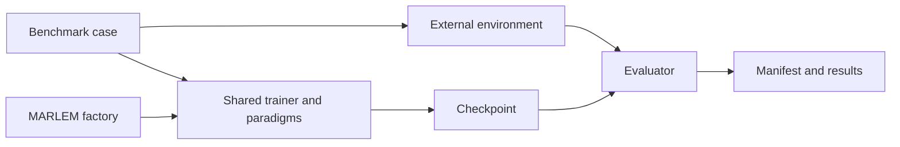

# Standalone RL testbench plan

> Proposed 2026-10-05. This validation ground tests MARLEM's learning layer
> independently of the local energy market. It complements [Stage D](plan.md#6-stage-d-level-1-marl-agents-learning);
> issue status remains in [the register](issues.md). No learning result is claimed here.

<!-- BEGIN toc (python docs_thesis/toc.py) -->
## Contents

- [1. Goal and boundary](#1-goal-and-boundary)
- [2. Environments](#2-environments)
- [3. Paradigm contracts](#3-paradigm-contracts)
- [4. Evidence and acceptance](#4-evidence-and-acceptance)
- [5. Build order](#5-build-order)
- [6. Existing audit links](#6-existing-audit-links)

<!-- END toc -->

## 1. Goal and boundary

Prove that the **same** algorithm, paradigm, evaluation, checkpoint and inference
code intended for MARLEM learns in established environments before attaching it
to the P2P market. A plain RLlib example is an external reference that checks
the library and environment; it does not validate MARLEM's trainer.

Place benchmark cases in a small `src_thesis/rl_testbench/` package with no
imports from `marketplace/`, `adapters/`, `application/` or `studio/`. Extract
the environment-dependent construction from `RLTrainer` into a shared training
interface. Both the benchmark and the future MARLEM factory call that interface.
Keep benchmark configuration separate from the shareable MARLEM experiment JSON.

[↑ Contents](#contents)

## 2. Environments

| Gate | Environment | What it tests | What it cannot prove |
|---|---|---|---|
| A | Gymnasium `CartPole-v1` | PPO sampling, optimizer, evaluation, checkpoint and clear learning signal | Multi-agent behavior |
| B | RLlib `MultiAgentCartPole`, two agents | Agent IDs, policy mapping, separate modules, per-agent returns and multi-agent inference | Cooperation or a central critic; its carts are independent |
| C | Farama MPE2 `simple_spread_v3`, three agents, 25 cycles, discrete actions | Cooperative PPO under DTDE, CTCE and CTDE, with local observations and global state | A universal absolute return threshold |
| D | The same Simple Spread task with continuous actions | Continuous distributions, action bounds and SAC after PPO passes | Direct comparison of returns with the discrete case |

Start C with documented environment defaults. Add a fixed partial-observation
setting only after a reference PPO run learns the default task. Fix all
environment parameters and package versions in each run. Do not alter the
external task's reward or build a MARLEM-like task to make the result easier.
CartPole and MultiAgentCartPole are plumbing gates, not evidence that the
paper's paradigms work.

Sources: [Gymnasium CartPole](https://gymnasium.farama.org/environments/classic_control/cart_pole/),
[RLlib multi-agent environments](https://docs.ray.io/en/latest/rllib/multi-agent-envs.html),
[RLlib MultiAgentCartPole example](https://docs.ray.io/en/latest/rllib/rl-modules.html),
[MPE2 Simple Spread](https://mpe2.farama.org/main/environments/simple_spread/).

[↑ Contents](#contents)

## 3. Paradigm contracts

| Mode | Action-time input | Training information | Required evidence |
|---|---|---|---|
| DTDE | Each agent's own observation | Independent actor and critic use local data | Separate trained policies; another agent's observation never reaches an actor |
| CTDE | Each agent's own observation | Critic may use global state and aligned joint actions | The *acting* local actors receive gradients and change after updates; global information reaches only the critic |
| CTCE | One controller sees ordered joint observations/global state | Joint action and team return | Stable agent order and one action per agent; label as a centralized-information benchmark, not a guaranteed upper bound |

For CTDE, hold agent `i`'s local observation fixed and vary the other agents'
observations: its deterministic action must remain the same. Assert that each
acting head is registered with the optimizer, receives a finite nonzero
gradient on a training batch and changes after an update. For grouped modes,
shuffle dictionary insertion order and verify that agent IDs still match the
correct observations, actions and rewards. These are deterministic contract
tests; return curves cannot establish them.

Record per-agent returns and one consistently defined team score from raw
environment rewards. State whether aggregation is sum or mean. Never compare a
grouped sum against a single agent's return. Parameter sharing, if added later,
is a separately named variant rather than DTDE as defined here.

Specify the centralized critic by algorithm: PPO/APPO normally learn a
centralized value function over global information, while a SAC variant can
learn a joint-action Q function. Record this distinction when comparing either
implementation with the paper's CTDE equation; the shared "CTDE" name alone
does not establish mathematical equivalence.

[↑ Contents](#contents)

## 4. Evidence and acceptance

1. **External reference:** Run RLlib's default PPO module on A, B and C without
   MARLEM training code. Evaluate a random baseline and establish a realistic
   learning budget on the target hardware. Use the installed Ray version's API.
2. **Interface:** Check reset/step contracts, space membership, valid actions,
   transition collection and optimizer updates. A frozen-actor negative control
   must fail the actor-update test.
3. **Paradigm semantics:** Run the gradient, information-flow and agent-order
   checks in section 3 before any long training job.
4. **Learning:** Evaluate untrained, random and trained policies on the same
   held-out environment seeds with exploration disabled and equal sampled
   environment-step budgets. After the reference pilot, pre-register a
   reference-relative improvement threshold before changing MARLEM models.
   Use at least three training seeds; report each seed, median and range. A
   pass requires improvement over random and the pre-registered threshold.
   Do not require CTDE to beat DTDE or CTCE to beat both; that ordering is not
   guaranteed by these tasks.
5. **Persistence:** Restore a checkpoint in a fresh process. Deterministic
   actions on fixed observations must match pre-restore actions. Save a
   machine-readable manifest with dependency versions, environment arguments,
   algorithm, paradigm, training and evaluation seeds, step budget, policy
   mapping, reward aggregation, full config, checkpoint and results.

Keep fast contract checks in pytest. Mark bounded training smokes separately
and run the multi-seed learning benchmark explicitly. Plot held-out evaluation
return against sampled environment steps with variability shown. An improving
training curve alone is insufficient evidence of learning.

[↑ Contents](#contents)

## 5. Build order

1. Reconcile the running interpreter with `environment.yml`, add a pinned MPE2
   dependency for the bench, and verify its RLlib wrapper on the pinned Ray.
   Local inspection found Ray 2.51.1, Gymnasium 1.0.0, Torch 2.9.0 CPU,
   PettingZoo 1.23.1 and no MPE2; the file requests Gymnasium 1.1.1 and
   Torch 2.6.0. Record actual resolved versions for every run.
2. Build the external reference command for A, B and C, including random and
   trained evaluations and a manifest.
3. Extract one shared trainer seam: an environment provider supplies an RLlib
   factory/registration and spaces; the algorithm and paradigm builder use it
   without constructing `LocalEnergyMarket`. Keep Tune/PBT off, one trial, fixed
   hyperparameters until baseline learning is established. The bench registers
   named cases, and a new algorithm supplies a config/module builder; all cases
   reuse the same evaluator, contract checks and report format.
4. Implement PPO paradigms in order: DTDE, CTCE, CTDE. CTDE uses local actors
   and a centralized critic in the pinned RLModule/Learner/connector path.
   Complete contract checks before learning runs.
5. Add APPO, then continuous-action SAC. Record unsupported algorithm/mode
   combinations explicitly rather than claiming the original 3 x 3 matrix
   works because configuration builds.
6. Connect the same trainer/evaluator/checkpoint path to MARLEM through
   `experiments/factory/training.py`. Then test MARLEM's observation, action and
   reward interface before interpreting market learning.

First reviewable milestone: shared-trainer PPO learns CartPole, beats random
on held-out seeds and restores a checkpoint. Second: separate-policy PPO on
MultiAgentCartPole. Third: PPO paradigm contracts and multi-seed Simple Spread
results. Each milestone has a runnable command, manifest, evidence and visible
failures. A proposed entry point is
`python -m src_thesis.rl_testbench run --case cartpole --algorithm ppo --mode single --seed 1`;
its exact flags can be fixed when the first milestone is implemented. The bench
remains available for future algorithms.

[↑ Contents](#contents)

## 6. Existing audit links

The bench directly exposes [I-48](issues.md#I-48) (CTDE acting heads),
[I-59](issues.md#I-59) (agent order), [I-60](issues.md#I-60) and
[I-73](issues.md#I-73) (interpretation and return scale),
[I-61](issues.md#I-61) (inference), [I-62](issues.md#I-62) (training config)
and [I-64](issues.md#I-64) (baselines and multiple seeds). It informs budget
and evaluation decisions [I-50](issues.md#I-50) and [I-72](issues.md#I-72).
An external benchmark pass alone does not close a market or paper-fidelity
issue; the validation plan's acceptance process still applies.

[↑ Contents](#contents)
