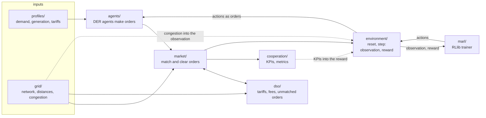
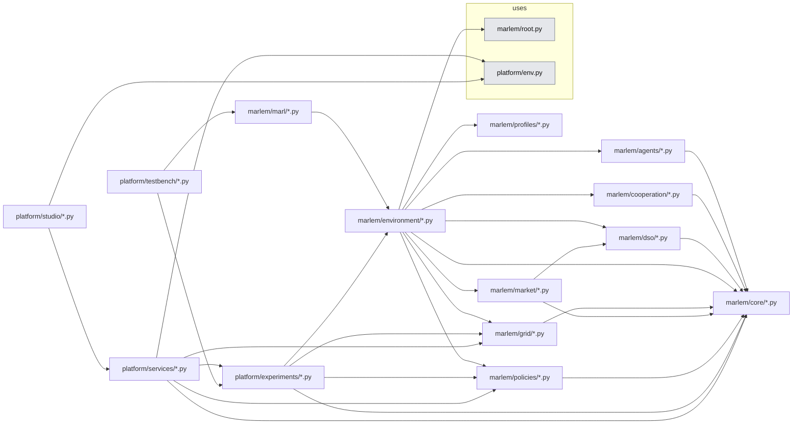

# Code map

`src_thesis/` has two halves:

- **[`marlem/`](marlem/)**: the simulator from the paper: the local energy market,
  its agents, the grid, implicit cooperation and multi-agent RL.
- **[`platform/`](platform/)**: the tool around it: experiment files and runs, the
  services the Studio and the CLI call, the Studio, and the RL testbench.

**Where does new code go?** Part of the simulator the paper describes, or a model
it runs on (grid, profiles): `marlem/`. Anything that sets up, runs, stores or
shows experiments: `platform/`. `marlem/` never imports `platform/`.

## One step of the simulator

How data flows through `marlem/` in one environment step. Read the packages in
this order; the dashed arrows are the feedback loops that make it not a straight
line.

`core/` (not drawn) holds the records and protocols every box shares: `Order`,
`Trade`, `MatchingResult`, `Location`, and `Participant` / `GridView` /
`MarketBounds`, the narrow views components get of each other.

## Packages

Generated from each package's `__init__.py` docstring (`docs_thesis/graphs.py`);
change the docstring to change the line.

<!-- BEGIN generated:packages -->
| Package | What it is for |
|---|---|
| [`marlem/core/`](marlem/core/) | Shared records and the protocols through which components see each other. |
| [`marlem/grid/`](marlem/grid/) | The grid: original NetworkX model, SimBench adapter, participant placement. |
| [`marlem/profiles/`](marlem/profiles/) | Demand, generation and DSO tariff profiles of the original (CSV or synthetic). |
| [`marlem/agents/`](marlem/agents/) | Level 1: DER agents with generation, demand and a battery; they make the orders. |
| [`marlem/policies/`](marlem/policies/) | Scripted controllers (no RL): policies that decide each agent's order. |
| [`marlem/market/`](marlem/market/) | Level 0: order matching, clearing mechanisms, validation and reputation. |
| [`marlem/dso/`](marlem/dso/) | Level 0: the DSO: tariffs, fees, and the counterparty for unmatched orders. |
| [`marlem/cooperation/`](marlem/cooperation/) | Level 2: implicit-cooperation KPIs (fed back into the reward), metrics, plots. |
| [`marlem/environment/`](marlem/environment/) | One episode: wires agents, market, DSO, grid and cooperation into reset/step. |
| [`marlem/marl/`](marlem/marl/) | Level 1: multi-agent RL with RLlib: the trainer, the CTCE/CTDE modules, inference. |
| [`platform/experiments/`](platform/experiments/) | Experiment files and runs: expand, resolve, the run store, worker processes. |
| [`platform/services/`](platform/services/) | The services the Studio, CLI and notebooks call: the only door to the code. |
| [`platform/studio/`](platform/studio/) | MARLEM Studio: the NiceGUI pages; talks only to the services. |
| [`platform/testbench/`](platform/testbench/) | RL reference tasks trained through MARLEM's trainer, independent of the market. |
<!-- END generated:packages -->

## Who may import whom

- `marlem/core/` imports nothing else from `src_thesis`.
- `agents/`, `market/`, `dso/`, `cooperation/`, `profiles/`, `grid/` import only
  `core/` (`market/` also `dso/`). Only `environment/` combines them; `marl/`
  loads the environment only when it is the one being trained.
- `platform/studio/` imports only `platform/services/` (and `platform/env.py`, the
  `.env` settings); the services reach
  `marlem/` through `platform/experiments/` and `marlem/grid/`.
- Only `marlem/grid/simbench.py` imports pandapower and SimBench.

Enforced by `tests/test_package_boundaries.py` and `tests/test_studio_boundaries.py`.
The arrows below are the actual imports, generated from the code:

<!-- BEGIN generated:graph map -->

<!-- END generated:graph -->

## History

The code was restructured into these two halves on 2026-10-05 without changing
behaviour (`tests/test_golden_episode.py` replays fixed-seed episodes recorded
before). The original layout with the validation markers is git tag
`marlem-annotated`; the upstream code is git tag `marlem-original`
(`git show marlem-original:src/<path>`).

| Original location | Now |
|---|---|
| `src/environment/{lem,action,observation,reward,io}.py` | `marlem/environment/` |
| `src/environment/{base,ctce,ctde,train,inference}.py` | `marlem/marl/` (`RLProtection` from `base.py`: `marlem/core/numerics.py`) |
| `src/agent/*.py` | `marlem/agents/` |
| `src/market/order.py` | `marlem/core/orders.py` |
| `src/market/{mechanism,matching,reputation,validation}.py` | `marlem/market/` (`MatchingResult`, `MatchingHistory`: `marlem/core/results.py`) |
| `src/market/dso.py` | `marlem/dso/dso.py` |
| `src/grid/base.py` | `marlem/core/location.py` |
| `src/grid/{config,network}.py` | `marlem/grid/` |
| `src/coordination/implicit_cooperation.py` | `marlem/cooperation/implicit_cooperation.py` |
| `src/analytics/*.py` | `marlem/cooperation/metrics/` |
| `src/visualization/plotter.py` | `marlem/cooperation/visualization/plotter.py` |
| `src/profile/*.py` | `marlem/profiles/` |
| `src/root.py` | `marlem/root.py` |
